# Tarea 2.2 — Genética de poblaciones con software especializado

**Curso** Bioinformática e investigación reproducible para análisis genómicos
**Unidad 2** Control de calidad de datos NGS — Sesión 5
**Estudiante** Camila Astorga
**Profesor** Ricardo Verdugo
**Institución** Facultad de Ciencias Químicas y Farmacéuticas, Universidad de Chile
**Fecha** 09-10-26
**Repositorio** <https://github.com/camipez/Tareas_BioinfRepro2026_CPA>

---

## Objetivos

### Objetivo general

Practicar el manejo de archivos de genotipos en formato VCF y Plink usando VCFtools y Plink 1.9, calculando estadísticos básicos de genética de poblaciones y revisando la calidad de los datos y de sus metadatos, con datos reales de la iniciativa ChileGenomico.

### Objetivos específicos

- Explorar un archivo VCF grande con VCFtools sin copiarlo, contando individuos, variantes, datos perdidos y cobertura.
- Calcular frecuencias alélicas, el espectro de la frecuencia del alelo menor (MAF), la heterocigosidad por individuo y la diversidad nucleotídica por sitio.
- Filtrar variantes según su número de alelos y según su MAF.
- Convertir un VCF a formato Plink y un archivo Plink binario a formato texto.
- Aplicar filtros de calidad en Plink y revisar el equilibrio de Hardy-Weinberg.
- Entender qué información tiene y qué información le falta al archivo .fam, y cambiar los IDs de familia según la ancestría de cada muestra.
- Comparar el sexo reportado en el .fam con el de popinfo y con el estimado por Plink, y armar una tabla de individuos por sexo y ancestría.

---

## Contenido de este directorio

| Ruta | Contenido |
|---|---|
| [`Prac_Uni5/`](Prac_Uni5/) | Scripts (`plot_maf.R`, `update.sh`, `actualizar_id.sh`, `discordancia_sexo.sh` y `contingencia.sh`). |
| [`Figuras/`](Figuras/) | Capturas citadas en este informe. |

Los archivos grandes, como el VCF filtrado, los archivos `.ped` y los `.bed`, no se subieron al repositorio por su tamaño y quedaron en el servidor.

---

## Desarrollo

### Preparación del entorno

Los datos están en el servidor genoma.med.uchile.cl, así que el trabajo se hizo por ssh. Todos los archivos de resultados y los scripts quedaron en la carpeta `Unidad2/Prac_Uni5`, dentro de la cuenta de usuario del servidor, y por eso ningún comando usa rutas con `../`.

```bash
ssh -Y bioinfo1@genoma.med.uchile.cl
cd castorga
mkdir -p Unidad2/Prac_Uni5/data
module load vcftools
module load R
cd /datos/compartido/ChileGenomico/
ls -lh *vcf*
cd ~/castorga/Unidad2/Prac_Uni5
VCF=/datos/compartido/ChileGenomico/GATK_ChGdb_recalibrated.autosomes.12262013.snps.known.vcf
ls -lh $VCF
```

La variable `VCF` guarda la ruta del archivo para no tener que escribirla en cada comando, y el archivo se usa directo desde la carpeta compartida, sin copiarlo, como pide el enunciado.

#### Resultados

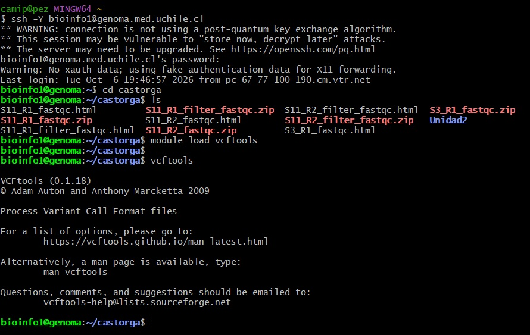

**Figura 1.** *La terminal mostrando la conexión por ssh al servidor, la carga del módulo vcftools y la pantalla de ayuda del programa.*

---

### Ejercicio 1 (VCF)
>*¿Cuántos individuos y variantes (SNPs) tiene el archivo GATK_ChGdb_recalibrated.autosomes.12262013.snps.known.vcf?*

#### Metodología

```bash
vcftools --vcf $VCF --out conteo
```

Como no se le pide ninguna operación, vcftools lee el archivo y entrega un resumen del número de individuos y de sitios. La opción `--out` define el prefijo del archivo `.log`, donde queda guardado el mismo resumen. 

#### Resultados

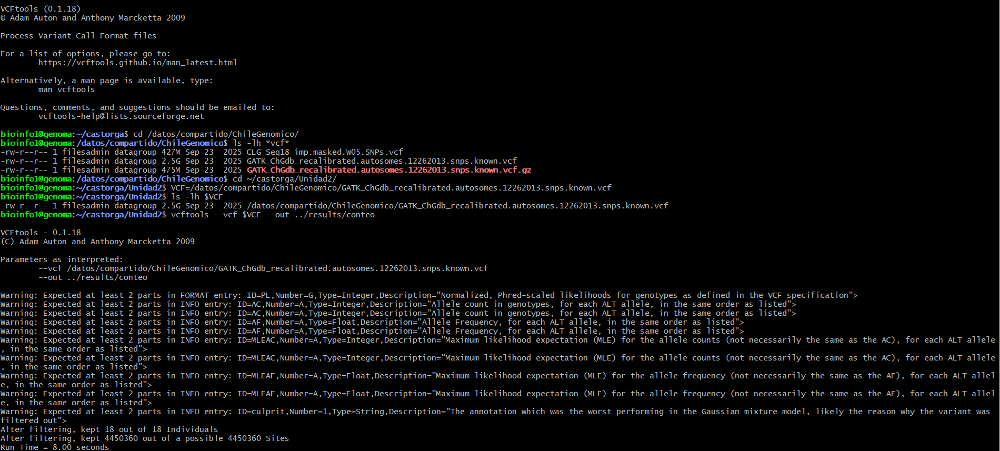

**Figura 2.** *La terminal mostrando los archivos VCF de la carpeta compartida y el resultado de vcftools, con 18 individuos y 4.450.360 sitios.*

#### Conclusión

Para saber el tamaño de un VCF no hace falta abrirlo, vcftools lo lee y dice directamente cuántos individuos y cuántos sitios tiene, que en este caso son 18 individuos y 4.450.360 sitios. Dejar además la salida en un archivo con `--out` sirve para tener el registro guardado y no depender de lo que quedó en la pantalla.

---

### Ejercicio 2 (VCF)
>*¿Cuántos sitios del archivo no tienen datos perdidos?*

#### Metodología

```bash
vcftools --vcf $VCF --max-missing 1 --out sin_perdidos
```

La opción `--max-missing` fija la proporción mínima de individuos con genotipo en cada sitio. El valor 1 exige que todos tengan dato, y el valor 0 acepta todos los sitios.

#### Resultados

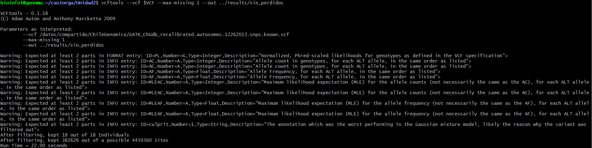

**Figura 3.** *La terminal mostrando que quedan 382.626 sitios sin datos perdidos de un total de 4.450.360.*

#### Conclusión

Con `--max-missing 1` se queda uno solo con los sitios que están genotipados en todos los individuos, y ver cuántos quedan permite saber qué tan completo está el archivo. Aquí quedaron solo 382.626 de los 4.450.360 sitios, un 8,6 %, así que exigir dato completo en todos los individuos dejaría fuera a más del 90 % del archivo.

---

### Ejercicio 3 (VCF)
>*Genera un archivo en tu carpeta de trabajo que contenga solo SNPs en una ventana de 2Mb en cualquier cromosoma. Nombra el archivo CLG_Chr\<X\>_\<Start\>-\<End\>Mb.vcf donde  es número del cromosoma, es el inicio de la ventana genómica y es el final en megabases.*

#### Metodología

```bash
vcftools --vcf $VCF --chr 1 --from-bp 10000000 --to-bp 12000000 \
  --recode --recode-INFO-all --stdout > CLG_Chr1_10-12Mb.vcf
ls -lh CLG_Chr1_10-12Mb.vcf
```

Las opciones `--chr`, `--from-bp` y `--to-bp` delimitan la ventana de 10 a 12 Mb del cromosoma 1. `--recode` escribe un VCF nuevo y `--recode-INFO-all` conserva la información de la columna INFO. `--stdout` manda el resultado a la pantalla y el símbolo `>` lo guarda en un archivo, lo que permitió ponerle directamente el nombre exacto que pide el ejercicio.

#### Resultados

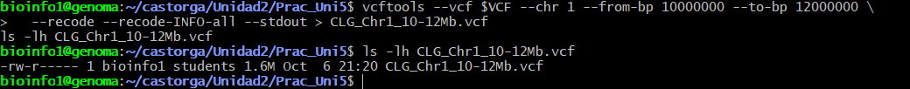

**Figura 4.** *La terminal mostrando el comando que genera la ventana de 10 a 12 Mb del cromosoma 1 y el archivo CLG_Chr1_10-12Mb.vcf ya creado, con un tamaño de 1.6 M.*

#### Conclusión

Con `--chr`, `--from-bp` y `--to-bp` se puede sacar un pedazo del genoma sin tener que copiar el archivo completo de 2.5 G. Trabajar con una ventana de 2 Mb deja un archivo de solo 1.6 M.

---

### Ejercicio 4 (VCF)
>*Reporta cuántas variantes tiene el archivo generado.*

#### Metodología

```bash
awk '!/^#/ {n++} END {print n}' CLG_Chr1_10-12Mb.vcf
```

En un VCF cada línea que no es encabezado es una variante. El patrón `!/^#/` descarta los encabezados, que empiezan con `#`, y `n++` va contando el resto.

#### Resultados

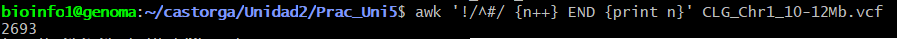

**Figura 5.** *La terminal mostrando que la ventana de 2 Mb tiene 2.693 variantes.*

#### Conclusión

Contar las líneas que no son encabezado es una forma simple de saber cuántas variantes tiene un VCF. En la ventana de 2 Mb hay 2.693 variantes, es decir cerca de 1.350 SNPs por Mb, lo que da una idea de qué tan densa es la región en SNPs.

---

### Ejercicio 5 (VCF)
>*Reporta la cobertura promedio para todos los individuos del set de datos.*

#### Metodología

```bash
vcftools --vcf $VCF --depth --out profundidad
head profundidad.idepth
awk 'NR>1 {s+=$3; n++; if (min==""||$3<min) min=$3; if ($3>max) max=$3} END {print "promedio", s/n, "min", min, "max", max}' profundidad.idepth
```

La opción `--depth` calcula la profundidad media de cada individuo y la guarda en el archivo `.idepth`, con las columnas `INDV`, `N_SITES` y `MEAN_DEPTH`. Con awk se promedia la tercera columna y se sacan también el mínimo y el máximo.

#### Resultados

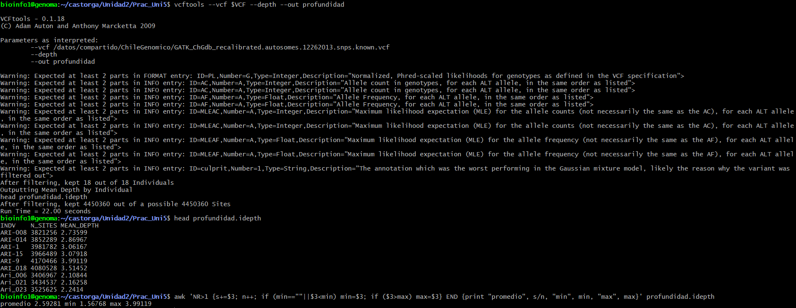

**Figura 6.** *La terminal mostrando la cobertura de los individuos, con un promedio de 2,59, un mínimo de 1,57 y un máximo de 3,99.*

#### Conclusión

`--depth` entrega la cobertura de cada individuo y awk la resume en un solo número. Mirar además el mínimo y el máximo es importante, porque un individuo con muy poca cobertura tiene genotipos menos confiables aunque el promedio se vea bien. La cobertura promedio fue de 2,59, con valores entre 1,57 y 3,99, una cobertura baja, así que los genotipos de este conjunto deben interpretarse con cuidado.

---

### Ejercicio 6 (VCF)
>*Calcula la frecuencia de cada alelo para todos los individuos dentro del archivo y guarda el resultado en un archivo.*

#### Metodología

```bash
vcftools --vcf $VCF --freq --out frecuencias_alelicas
head frecuencias_alelicas.frq
```

`--freq` calcula la frecuencia de cada alelo en cada sitio usando a todos los individuos. El archivo `.frq` tiene una fila por sitio, con las columnas `CHROM`, `POS`, `N_ALLELES` y `N_CHR`, y luego una columna por alelo en formato `alelo:frecuencia`.

#### Resultados

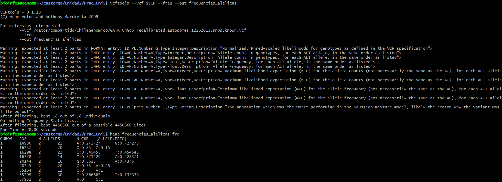

**Figura 7.** *La terminal mostrando el cálculo de frecuencias alélicas y las primeras filas del archivo frecuencias_alelicas.frq, con una fila por sitio y el alelo con su frecuencia en las últimas columnas.*

#### Conclusión

Cada fila del archivo de frecuencias es un sitio, y el formato `alelo:frecuencia` deja ver de inmediato cuál es el alelo más común. Los sitios que tienen más de dos alelos traen columnas extra, y por eso hay que apartarlos antes de calcular una frecuencia del alelo menor. Algunas filas tienen frecuencias de 0 y 1, que son sitios sin variación en estos 18 individuos.

---

### Ejercicio 7 (VCF)
>*Filtra el archivo de frecuencias para solo incluir variantes bialélicas.*

#### Metodología

```bash
awk 'NR==1 || $3==2' frecuencias_alelicas.frq > frecuencias_bialelicas.frq
awk 'END {print NR-1}' frecuencias_alelicas.frq
awk 'END {print NR-1}' frecuencias_bialelicas.frq
```

El primer awk conserva el encabezado y las filas cuya tercera columna, `N_ALLELES`, vale 2. Los otros dos cuentan los sitios antes y después del filtro, restando la fila del encabezado. Se usó awk, que es la pista que da el ejercicio.

#### Resultados

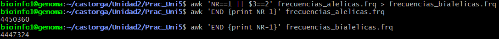

**Figura 8.** *La terminal mostrando 4.450.360 sitios en el archivo original y 4.447.324 sitios bialélicos después del filtro.*

#### Conclusión

Del total de 4.450.360 sitios, 4.447.324 son bialélicos, es decir un 99,93 %, y solo se descartaron 3.036 sitios con tres o más alelos. Filtrar por la columna del número de alelos con awk es una forma rápida de dejar solo los sitios donde se puede calcular una frecuencia del alelo menor.

---

### Ejercicio 8 (VCF)
>*Llama a un script escrito en lenguaje R que lee el archivo de frecuencias de variantes bialélicas y guarda un histograma con el espectro de MAF para las variantes bialélicas.*

#### Metodología

```bash
nano plot_maf.R
```

```r
#!/usr/bin/env Rscript
args <- commandArgs(trailingOnly = TRUE)
entrada <- args[1]
salida  <- args[2]

frq <- read.table(entrada, header = FALSE, skip = 1, stringsAsFactors = FALSE)
colnames(frq) <- c("CHROM", "POS", "N_ALLELES", "N_CHR", "A1", "A2")

f1  <- as.numeric(sub(".*:", "", frq$A1))
f2  <- as.numeric(sub(".*:", "", frq$A2))
maf <- pmin(f1, f2)

pdf(salida, width = 8, height = 5)
hist(maf, breaks = 50, col = "steelblue", border = "white",
     main = "Espectro de frecuencia del alelo menor (MAF)",
     xlab = "MAF", ylab = "Número de variantes")
dev.off()
```

```bash
Rscript plot_maf.R frecuencias_bialelicas.frq histograma_MAF.pdf
ls -lh histograma_MAF.pdf
```

El script recibe como argumentos el archivo de frecuencias y el nombre del PDF de salida. Separa cada columna `alelo:frecuencia`, se queda con la frecuencia y toma como MAF la menor de las dos con `pmin`. Para poder correr `Rscript` en el servidor primero hubo que cargar R con `module load R`.

#### Resultados

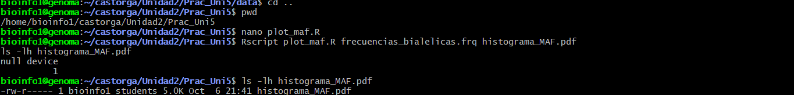

**Figura 9.** *La terminal mostrando la ejecución del script de R y el archivo histograma_MAF.pdf generado, de 5.0 K.*

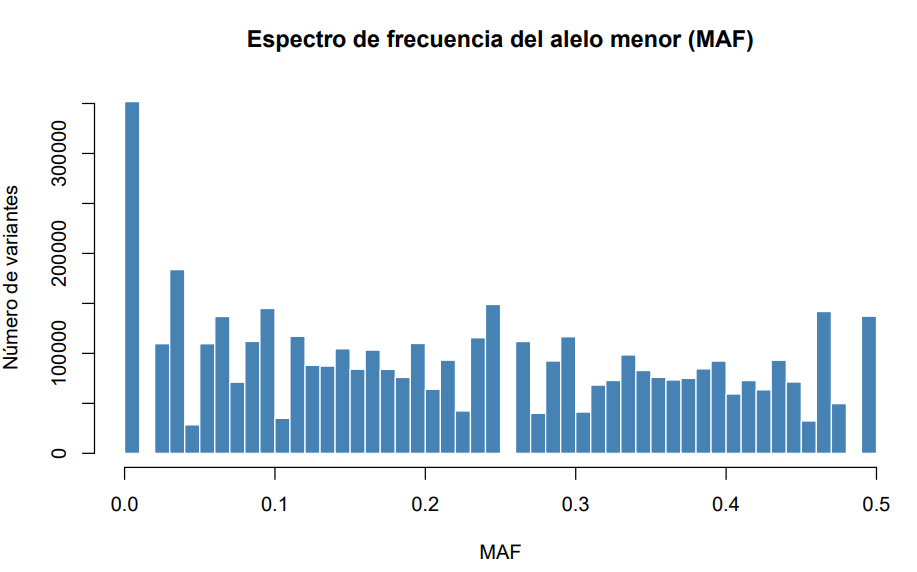

**Figura 10.** *Histograma del espectro de MAF de las 4.447.324 variantes bialélicas.*

#### Conclusión

El MAF solo se puede calcular en sitios con dos alelos o más, por eso el histograma se hizo con el archivo bialélico. Un histograma deja ver de un vistazo cuántas variantes son raras y cuántas son comunes, algo que no se alcanza a ver en una tabla de millones de filas. En la Figura 10 hay una barra muy alta en MAF cercano a 0, de unas 350.000 variantes, y después el número de variantes por intervalo se mantiene bastante parejo, entre unas 30.000 y 150.000, hasta MAF 0.5. Los picos y los vacíos entre barras se deben probablemente a que con solo 18 individuos las frecuencias posibles son pocas y discretas.

---

### Ejercicio 9 (VCF)
>*¿Cuántos sitios tienen una frecuencia del alelo menor < 0.05?*

#### Metodología

```bash
awk 'NR>1 {split($5,a,":"); split($6,b,":"); m=(a[2]<b[2])?a[2]:b[2]; if (m<0.05) c++} END {print c+0}' frecuencias_bialelicas.frq
```

El comando separa el alelo de su frecuencia en las columnas 5 y 6, se queda con la menor de las dos, y suma un sitio al contador cada vez que esa frecuencia es menor a 0.05.

#### Resultados

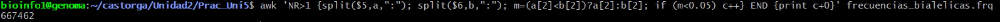

**Figura 11.** *La terminal mostrando que 667.462 sitios tienen una frecuencia del alelo menor menor a 0.05, es decir un 15,01 % de las 4.447.324 variantes bialélicas.*

#### Conclusión

Contar las variantes con MAF menor a 0.05 pone una cifra concreta a lo que ya se veía en el histograma, que es qué parte del archivo corresponde a variantes raras. Hay 667.462 sitios con MAF menor a 0.05, un 15,01 % de las 4.447.324 variantes bialélicas. Ese número concuerda con el histograma del ejercicio anterior, donde las barras por debajo de 0.05 suman cerca de 670.000 variantes, lo que sirve para confirmar que ambos cálculos están bien hechos.

---

### Ejercicio 10 (VCF)
>*Calcula la heterocigosidad de cada individuo.*

#### Metodología

```bash
vcftools --vcf $VCF --het --out heterocigosidad
head heterocigosidad.het
awk 'NR>1 {print $1, ($4-$2)/$4}' heterocigosidad.het > het_observada.txt
head het_observada.txt
awk '{s+=$2; n++; if (min==""||$2<min) min=$2; if ($2>max) max=$2} END {print "promedio", s/n, "min", min, "max", max}' het_observada.txt
```

`--het` genera un archivo con las columnas `INDV`, `O(HOM)`, `E(HOM)`, `N_SITES` y `F`. La columna `F` es el coeficiente de endogamia y no la heterocigosidad, así que la heterocigosidad observada se calculó como el número de sitios menos los homocigotos observados, dividido por el número de sitios. Con awk se guardó ese valor para cada individuo y se resumió el promedio, el mínimo y el máximo.

#### Resultados

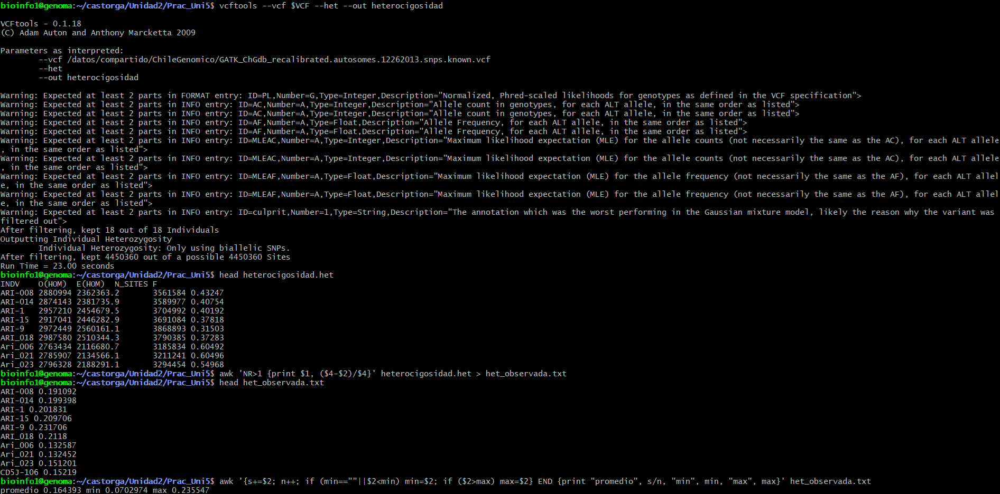

**Figura 12.** *La terminal mostrando las primeras filas de la heterocigosidad por individuo y un promedio de 0,164, con valores entre 0,070 y 0,236.*

#### Conclusión

La salida de `--het` no entrega directamente la heterocigosidad, pero se obtiene calculándola a partir de los homocigotos observados. Mirar el rango entre individuos sirve para detectar casos atípicos, que podrían deberse a contaminación, parentesco o problemas de calidad. La heterocigosidad observada promedio fue de 0,164, con valores entre 0,070 y 0,236. Entre los individuos que se ven en la salida, Ari_006, Ari_021 y Ari_023 tienen coeficientes F de 0,55 a 0,60, más altos que los 0,32 a 0,43 de los demás, y Ari_006 y Ari_021 son además los de menor heterocigosidad, 0,13. El mínimo de 0,070 pertenece a un individuo que no aparece entre esas filas.

---

### Ejercicio 11 (VCF)
>*Calcula la diversidad nucleotídica por sitio.*

#### Metodología

```bash
vcftools --vcf $VCF --site-pi --out diversidad_nucleotidica
head diversidad_nucleotidica.sites.pi
awk 'NR>1 {s+=$3; n++} END {print s/n}' diversidad_nucleotidica.sites.pi
```

`--site-pi` genera un archivo con el cromosoma, la posición y el valor de diversidad nucleotídica de cada sitio. El awk promedia la tercera columna. Como el archivo tiene millones de filas, solo se revisaron las primeras con `head`.

#### Resultados

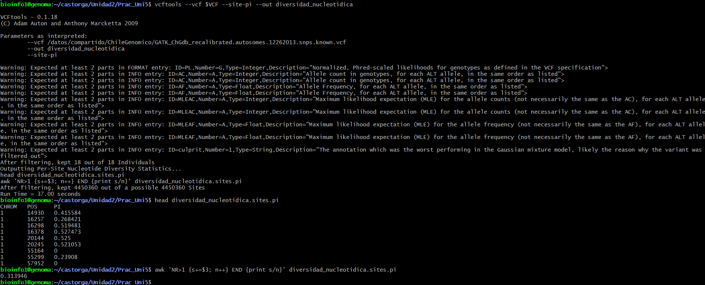

**Figura 13.** *La terminal mostrando las primeras filas del archivo de diversidad por sitio y un promedio de 0,314.*

#### Conclusión

La diversidad nucleotídica por sitio es más alta cuando los alelos tienen frecuencias intermedias y se acerca a cero en los sitios casi sin variación. Resumirla con un promedio permite comparar este conjunto con otros, aunque se pierde el detalle de qué zonas del genoma son más diversas. El promedio por sitio fue de 0,314, y en las primeras filas se ven sitios con valor 0, que son sitios sin variación.

---

### Ejercicio 12 (VCF)
>*Filtra los sitios que tengan una frecuencia del alelo menor < 0.05.*

#### Metodología

```bash
vcftools --vcf $VCF --maf 0.05 --recode --recode-INFO-all --out CLG_maf05
ls -lh CLG_maf05.recode.vcf
```

`--maf 0.05` conserva los sitios con frecuencia del alelo menor igual o mayor a 0.05, y `--recode` escribe el resultado en un VCF nuevo con el sufijo `.recode.vcf`. Se interpretó "filtrar" como eliminar las variantes raras. Para quedarse solo con las raras se habría usado `--max-maf 0.05`.

#### Resultados

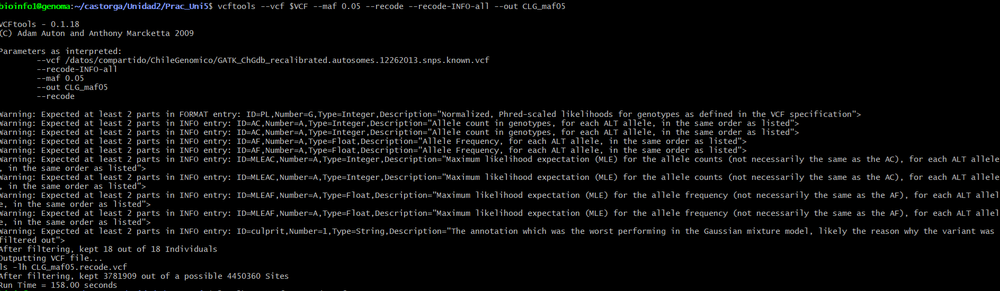

**Figura 14.** *La terminal mostrando que quedan 3.781.909 sitios de 4.450.360 después del filtro por frecuencia del alelo menor.*

#### Conclusión

`--maf` deja solo las variantes comunes, que son las que suelen usarse en los análisis de genética de poblaciones porque las raras pueden ser errores o aportar poca información. Quedaron 3.781.909 sitios y se eliminaron 668.451, un 15,02 %, una cifra muy cercana a los 667.462 sitios del ejercicio 9, y la diferencia de 989 sitios probablemente viene de los sitios que no son bialélicos.

---

### Ejercicio 13 (VCF)
>*Convierte el archivo GATK_ChGdb_recalibrated.autosomes.12262013.snps.known.vcf a formato plink.*

#### Metodología

```bash
vcftools --vcf $VCF --plink --out GATK_ChGdb_plink
plink --file GATK_ChGdb_plink --make-bed --out GATK_ChGdb_plink
ls -lh GATK_ChGdb_plink*
```

`--plink` genera los archivos de texto `.ped` y `.map`. Después `plink --file` los lee y `--make-bed` los pasa al formato binario, con los archivos `.bed`, `.bim` y `.fam`.

#### Resultados

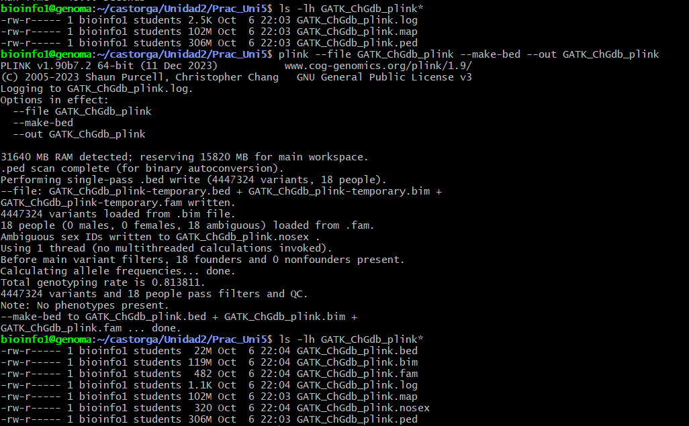

**Figura 15.** *La terminal mostrando la conversión del VCF a formato texto de Plink y los archivos .map, de 102 M, y .ped, de 306 M.*


#### Conclusión

Pasar de VCF a Plink toma solo dos comandos, uno de vcftools para el formato texto y otro de plink para el binario. El formato binario es mucho más liviano que el de texto, ya que el `.bed` pesa 22 M frente a los 306 M del `.ped`. vcftools avisó que solo escribe los sitios bialélicos, y por eso en la conversión quedaron 4.447.324 variantes de los 4.450.360 sitios del VCF, el mismo número del ejercicio 7, y 18 personas. Al convertir se pierde información propia del VCF, como la calidad de cada genotipo y la profundidad de lectura, y además quedó claro que el VCF no trae el sexo ni el fenotipo, porque Plink marcó a las 18 personas con sexo ambiguo y sin fenotipo.

---

### Ejercicio 1 (Plink)
>*Enlista los archivos plink que hay en data. ¿Qué tipos de archivos son cada uno?*

#### Metodología

```bash
cd ~/castorga/Unidad2/Prac_Uni5
cp /datos/compartido/ChileGenomico/chilean_all48_hg19* .
ls -lh chilean_all48_hg19*
```

Los archivos se copiaron desde la carpeta compartida a la carpeta de trabajo. El asterisco copia los cuatro archivos que comparten el prefijo y el punto final indica que el destino es la carpeta actual.

#### Resultados

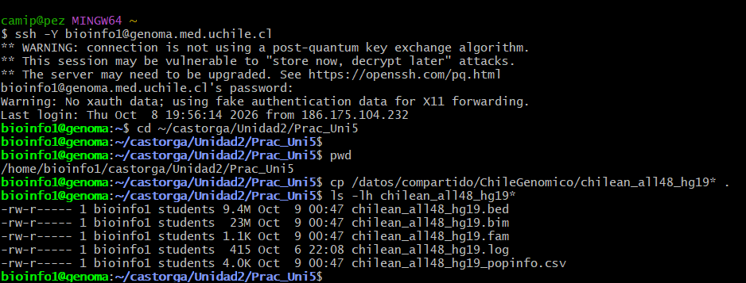

**Figura 17.** *La terminal mostrando la copia de los archivos y su listado, chilean_all48_hg19.bed, .bim, .fam y chilean_all48_hg19_popinfo.csv, con sus tamaños.*

| Archivo | Tipo | Contenido |
|---|---|---|
| `chilean_all48_hg19.bed` | Binario | Tabla de genotipos bialélicos, que no se puede leer directamente. |
| `chilean_all48_hg19.bim` | Texto | Información de cada SNP, con cromosoma, ID, posición genética, posición física y alelos. |
| `chilean_all48_hg19.fam` | Texto | Información de cada muestra, con familia, individuo, padre, madre, sexo y fenotipo. |
| `chilean_all48_hg19_popinfo.csv` | Texto | Metadatos de las muestras, que no forman parte del formato Plink. |

En la captura aparece además un archivo `chilean_all48_hg19.log`, que quedó de una ejecución anterior de Plink.

#### Conclusión

Los archivos `.bed`, `.bim` y `.fam` forman juntos el formato binario de Plink 1 y tienen que mantener el mismo prefijo para que el programa los reconozca. El `.bed` no se debe confundir con el formato BED de intervalos genómicos, y el archivo `popinfo` es aparte, con información extra de las muestras.

---

### Ejercicio 2a (Plink)
>*Transforma de formato bed a formato ped. El nombre del output debe ser igual, solo cambiando la extensión.*

#### Metodología

```bash
plink --bfile chilean_all48_hg19 --recode --out chilean_all48_hg19
ls -lh chilean_all48_hg19*
```

`--bfile` indica el prefijo del conjunto binario, sin extensión, y `--recode` escribe los archivos en formato texto. Con `--out` se dejó el mismo prefijo para que cambie solo la extensión.

#### Resultados

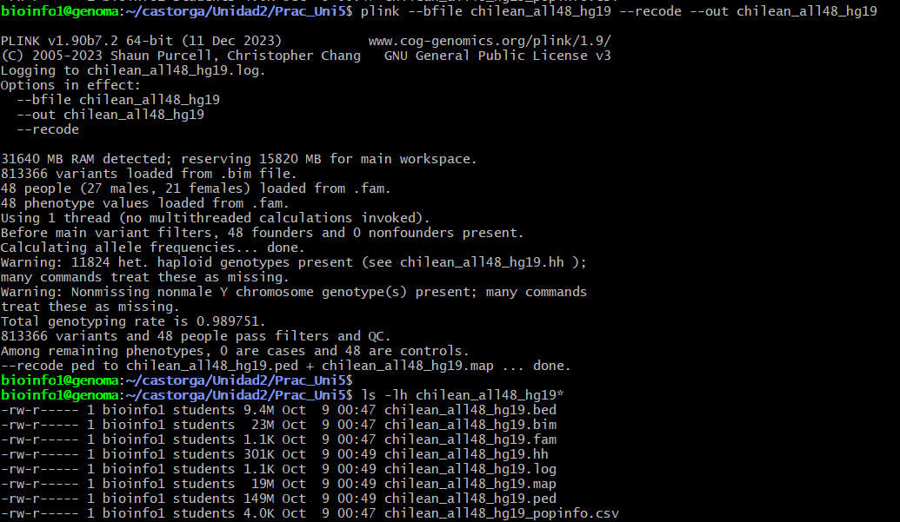

**Figura 18.** *La terminal mostrando la conversión de bed a ped, con 813.366 variantes y 48 personas (27 hombres y 21 mujeres), y los archivos chilean_all48_hg19.ped, de 149 M, y chilean_all48_hg19.map, de 19 M.*

#### Conclusión

`--recode` pasa el formato binario a texto con un solo comando, y los archivos `.ped` y `.map` quedan con el mismo nombre que los originales. El formato texto es más pesado pero se puede leer y lo aceptan más programas. Plink avisó además de genotipos heterocigotos en cromosomas haploides y de genotipos del cromosoma Y en personas que no son hombres, y los dejó registrados en el archivo `.hh`, algo que se vuelve a revisar con la estimación de sexo del ejercicio 6.

---

### Ejercicio 2b (Plink)
>*Crea otro archivo ped, pero esta vez filtrando los SNPs cuya frecuencia del alelo menor sea menor a 0.05 y filtrando los individuos con más de 10% de datos perdidos. Tu output debe llamarse chilean_all48_hg19_maf05_missing10. ¿Cuántos SNPs y cuántos individuos fueron removidos por los filtros?*

#### Metodología

```bash
plink --bfile chilean_all48_hg19 --recode --maf 0.05 --mind 0.1 --out chilean_all48_hg19_maf05_missing10
```

`--maf 0.05` elimina los SNPs cuya frecuencia del alelo menor es menor a 0.05, y `--mind 0.1` elimina los individuos con más de 10 % de genotipos perdidos. Los números de variantes y personas removidas aparecen en la pantalla al terminar el comando, y los individuos eliminados quedan listados en el archivo `.irem`.

#### Resultados

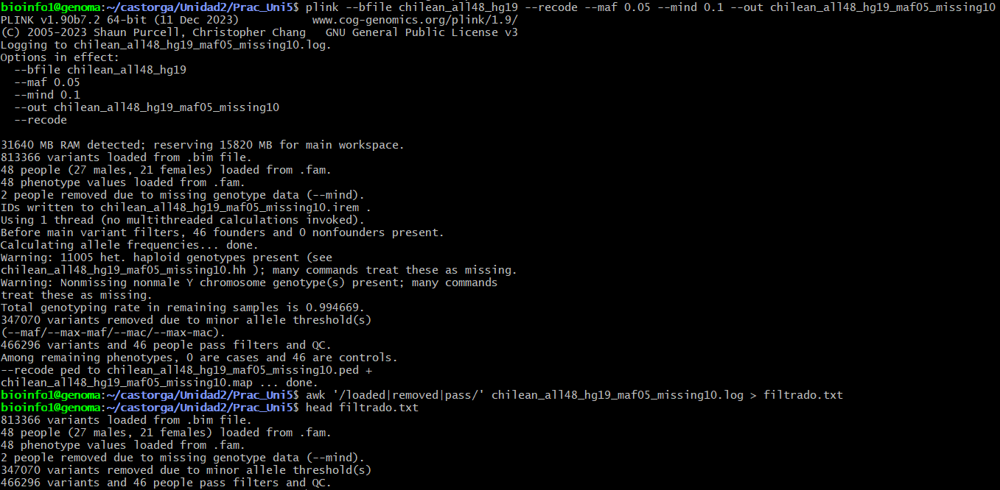

**Figura 19.** *La terminal mostrando que se removieron 347.070 SNPs por frecuencia del alelo menor y 2 individuos por datos perdidos, quedando 466.296 SNPs y 46 individuos.*

#### Conclusión

Plink aplica los dos filtros en el mismo comando y avisa en la pantalla cuántos elementos saca cada uno, lo que permite saber de inmediato cuánto del conjunto original se pierde. Los individuos con muchos datos perdidos y las variantes raras son los dos primeros filtros de calidad que se suelen aplicar antes de cualquier análisis. Aquí se eliminaron 2 de los 48 individuos y 347.070 de las 813.366 variantes, un 42,7 %, y la tasa de genotipado de las personas que quedaron subió a 0,995.

---

### Ejercicio 2c (Plink)
>*Realiza un reporte de equilibrio de Hardy-Weinberg sobre el archivo chilean_all48_hg19_maf05_missing10 creado en el ejercicio anterior. El nombre del archivo de tu output debe contener chilean_all48_hg19_maf05_missing10. Observa el output y discute qué es cada columna.*

#### Metodología

```bash
plink --file chilean_all48_hg19_maf05_missing10 --hardy --out chilean_all48_hg19_maf05_missing10
head chilean_all48_hg19_maf05_missing10.hwe
```

Aquí se usó `--file` y no `--bfile` porque la entrada es el archivo en formato texto del ejercicio anterior. `--hardy` calcula la prueba exacta de Hardy-Weinberg para cada SNP.

#### Resultados

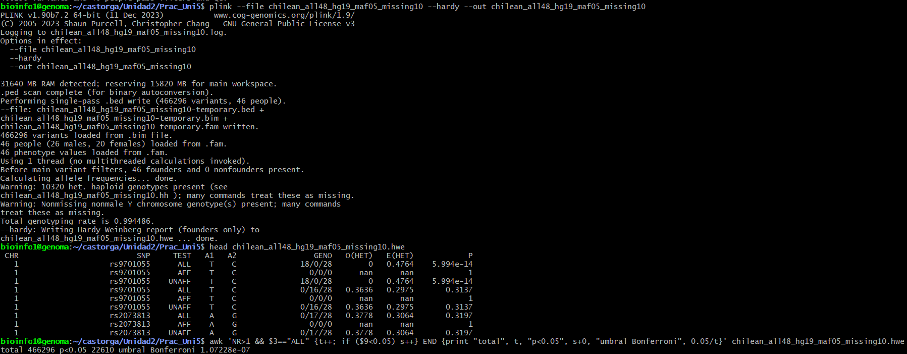

**Figura 20.** *La terminal mostrando las primeras filas del archivo .hwe, calculado con 466.296 variantes y 46 personas.*

| Columna | Significado |
|---|---|
| `CHR` | Cromosoma del SNP. |
| `SNP` | Identificador del SNP. |
| `TEST` | Grupo analizado, `ALL` para todos, `AFF` para casos y `UNAFF` para controles. |
| `A1`, `A2` | Alelo menor y alelo mayor. |
| `GENO` | Conteo de genotipos, en el orden homocigoto A1, heterocigoto y homocigoto A2. |
| `O(HET)` | Heterocigosidad observada. |
| `E(HET)` | Heterocigosidad esperada bajo Hardy-Weinberg. |
| `P` | Valor p de la prueba exacta de equilibrio de Hardy-Weinberg. |

#### Conclusión

Cada fila del reporte compara la heterocigosidad observada con la esperada si la población estuviera en equilibrio, y el valor p dice qué tan raro sería ver esa diferencia solo por azar. Las filas `AFF` quedan vacías porque en el archivo `.fam` todos los individuos tienen fenotipo de control, así que no hay casos que analizar. Como se hacen miles de pruebas a la vez, los valores p se tienen que interpretar con una corrección por pruebas múltiples, como la de Bonferroni. Además, en poblaciones mezcladas como las chilenas un déficit de heterocigotos puede deberse a estructura poblacional y no solo a errores de genotipado. En este reporte, el primer SNP, rs9701055, tiene 18 homocigotos T, ningún heterocigoto y 28 homocigotos C, es decir una heterocigosidad observada de 0 frente a 0.4764 esperada, con un valor p de 5.994e-14. Ese mismo identificador aparece en otras filas con conteos distintos de genotipos (0/16/28), lo que indica que dos variantes del archivo comparten el mismo ID.

---

### Ejercicio 2d (Plink)
>*Observa el archivo chilean_all48_hg19.fam. Consulta la documentación de plink para determinar qué es cada columna. ¿Qué información hay y no hay en este archivo?*

#### Metodología

```bash
head chilean_all48_hg19.fam
awk '{c[$5]++} END {for (k in c) print "sexo", k, c[k]}' chilean_all48_hg19.fam
awk '{c[$6]++} END {for (k in c) print "fenotipo", k, c[k]}' chilean_all48_hg19.fam
awk '{c[$3" "$4]++} END {for (k in c) print "padre madre", k, c[k]}' chilean_all48_hg19.fam
```

El primer comando muestra las primeras filas del archivo. Los tres awk cuentan cuántos individuos hay en cada categoría de sexo, de fenotipo y de padre y madre, que son las columnas 5, 6, y 3 y 4.

#### Resultados

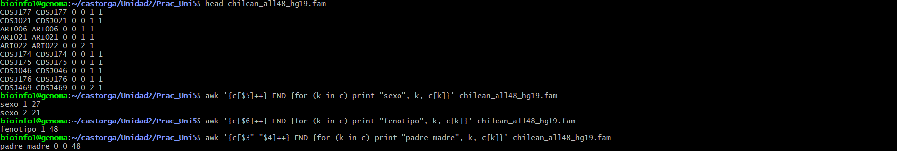

**Figura 21.** *La terminal mostrando las primeras filas del archivo .fam y el conteo de individuos por sexo, 27 hombres y 21 mujeres, por fenotipo, los 48 controles, y por padre y madre, los 48 con 0 0.*

| Columna | Contenido |
|---|---|
| 1 | ID de familia. |
| 2 | ID del individuo dentro de la familia. |
| 3 | ID del padre, 0 si no está en el archivo. |
| 4 | ID de la madre, 0 si no está en el archivo. |
| 5 | Sexo, 1 hombre, 2 mujer y 0 desconocido. |
| 6 | Fenotipo, 1 control, 2 caso, y 0 o -9 para dato perdido. |

#### Conclusión

El archivo trae los identificadores de las muestras y su sexo reportado, 27 hombres y 21 mujeres. En cambio, el padre y la madre figuran como 0 en las 48 filas, así que no hay relaciones de parentesco, y los 48 individuos son controles, así que el fenotipo no sirve para comparar casos y controles. Tampoco aparece la ancestría ni la población de cada muestra, que está solo en el archivo `popinfo`.

---

### Ejercicio 4 (Plink)
>*Utiliza la info del archivo chilean_all48_hg19_popinfo.csv y el comando update-ids de plink para cambiar los nombres de las muestras de chilean_all48_hg19.fam de tal forma que el family ID corresponda a la info de la columna Ancestry. Tu respuesta debe incluir todos los scripts.*

#### Metodología

Primero se revisó cómo estaba armado el archivo `popinfo`, para saber en qué columna está el ID de la muestra y en cuál la ancestría.

```bash
head chilean_all48_hg19_popinfo.csv
```

El archivo tiene las columnas `IndID`, `Sex`, `Source`, `Region`, `Population`, `Ancestry` e `IndLab`, así que el ID de la muestra está en la columna 1, el sexo en la 2, la fuente en la 3 y la ancestría en la 6. Además, en `popinfo` los IDs llevan guion, como `ARI-001`, y en el `.fam` no, como `ARI006`, por lo que hay que quitar los guiones para que las muestras coincidan.

`--update-ids` necesita un archivo de cuatro columnas, con el ID de familia antiguo, el ID del individuo antiguo, el ID de familia nuevo y el ID del individuo nuevo. Ese archivo se armó con un primer script, `update.sh`.

```bash

#!/bin/bash

# Columnas del archivo popinfo
ID_COL=1
ANC_COL=6

# Crear el archivo con los IDs y sus ancestrías
awk -v idc=$ID_COL -v anc=$ANC_COL '
BEGIN { printf "" > "sin_match_ids.txt" }

# Leer popinfo y guardar la ancestría de cada individuo
NR==FNR {
    if (FNR>1) {
        split($0, f, ",")
        a=f[anc]
        gsub(/[\r"]/,"",a)
        gsub(/ /,"_",a)
        id=f[idc]
        gsub(/[\r"_-]/,"",id)
        ancestria[toupper(id)]=a
    }
    next
}

# Buscar los individuos del archivo fam en popinfo
{
    clave=toupper($2)
    gsub(/[-_]/,"",clave)

    # Guardar los IDs que no se encontraron
    if (!(clave in ancestria)) {
        falta++
        print $2 > "sin_match_ids.txt"
        next
    }

    # Crear las cuatro columnas para PLINK
    # FID antiguo, IID antiguo, FID nuevo, IID nuevo
    print $1, $2, ancestria[clave], $2
}

# Mostrar cuántos individuos no se encontraron
END {
    print "Individuos sin ancestría:", falta+0 > "/dev/stderr"
}
' chilean_all48_hg19_popinfo.csv chilean_all48_hg19.fam > update_ids.txt

# Revisar las primeras filas del archivo creado
head update_ids.txt

# Contar las filas del archivo creado
awk 'END {print "Filas en update_ids.txt:", NR}' update_ids.txt

```

El script lee `popinfo` cortando cada línea por las comas, arma una tabla que va del ID de la muestra a su ancestría, y después recorre el `.fam` imprimiendo las cuatro columnas, con la ancestría como ID de familia nuevo. Los espacios de los nombres de ancestría se cambian por guiones bajos, porque Plink no acepta espacios en los identificadores, y los guiones de los IDs se quitan para que coincidan con los del `.fam`. Las muestras que no se encuentran en `popinfo` se anotan en `sin_match_ids.txt` y se cuentan, y el resultado correcto es 0 muestras sin ancestría y 48 filas en `update_ids.txt`. Un segundo script, `actualizar_id.sh`, corre plink con ese archivo.

```bash
#!/bin/bash
plink --bfile chilean_all48_hg19 \
  --update-ids update_ids.txt \
  --make-bed --out chilean_all48_hg19_ancestry

head chilean_all48_hg19_ancestry.fam
```

```bash
bash update.sh
bash actualizar_id.sh
```

#### Resultados

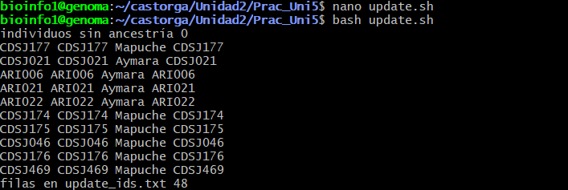

**Figura 22.** *La terminal mostrando las primeras filas de update_ids.txt, con 48 filas en total y 0 individuos sin ancestría.*

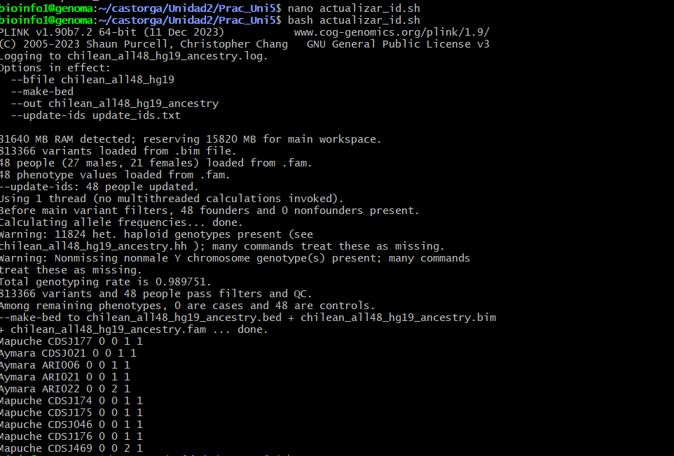

**Figura 23.** *La terminal mostrando que Plink actualizó a 48 personas y las primeras filas del archivo chilean_all48_hg19_ancestry.fam, con la ancestría en la primera columna.*

#### Conclusión

`--update-ids` cambia los identificadores de las muestras a partir de una tabla de cuatro columnas, sin tocar los genotipos. Con la ancestría como ID de familia, los análisis que vengan después pueden agrupar por población sin tener que cargar el archivo de metadatos otra vez. Revisar que ninguna muestra quedara sin ancestría evita actualizaciones incompletas. Aquí las 48 personas quedaron con una ancestría y Plink las actualizó a todas.

---

### Ejercicio 5 (Plink)
>*Realiza una comparación entre el sexo del archivo fam y el de popinfo, y calcula la proporción de discordancias.*

#### Metodología

```bash

#!/bin/bash

# Columnas de ID y sexo en popinfo
ID_COL=1
SEX_COL=2

# Comparar el sexo entre popinfo y fam
awk -v idc=$ID_COL -v sxc=$SEX_COL '

# Crear el archivo para guardar las diferencias
BEGIN {
    printf "" > "sexo_discordante_fam_popinfo.txt"
}

# Leer los IDs y el sexo de popinfo
NR==FNR {
    if (FNR>1) {
        split($0, f, ",")

        id=f[idc]
        v=f[sxc]

        # Limpiar los IDs y el sexo
        gsub(/[\r"_-]/,"",id)
        gsub(/[\r"]/,"",v)
        v=toupper(v)

        # Codificar el sexo como en PLINK
        if (v=="M" || v=="MALE" || v=="1")
            s[toupper(id)]=1
        else if (v=="F" || v=="FEMALE" || v=="2")
            s[toupper(id)]=2
        else
            s[toupper(id)]=0
    }
    next
}

# Comparar el sexo del fam con el de popinfo
{
    n++
    clave=toupper($2)
    gsub(/[-_]/,"",clave)

    # Contar individuos que no están en popinfo
    if (!(clave in s)) {
        sinpop++
        next
    }

    # Contar los individuos comparados
    comp++

    # Guardar los individuos con sexo diferente
    if ($5 != s[clave]) {
        d++
        print $2, "fam="$5, "popinfo="s[clave] > "sexo_discordante_fam_popinfo.txt"
    }
}

# Mostrar los resultados
END {
    print "Individuos en fam:", n
    print "Sin coincidencia en popinfo:", sinpop+0
    print "Comparados:", comp+0
    print "Discordantes:", d+0

    # Calcular la proporción de discordancias
    if (comp>0)
        print "Proporción:", d/comp
}
' chilean_all48_hg19_popinfo.csv chilean_all48_hg19.fam

```

El script, `discordancia_sexo.sh`, quita los guiones de los IDs de `popinfo`, que ahí aparecen como `ARI-006` y en el `.fam` como `ARI006`, y traduce el sexo a la misma codificación del `.fam`, que es 1 para hombre, 2 para mujer y 0 para desconocido. Después compara cada individuo del `.fam` con su fila de `popinfo`, cuenta los que no coinciden y guarda sus IDs en un archivo aparte. La proporción se calcula sobre los individuos que se encontraron en ambos archivos.

#### Resultados

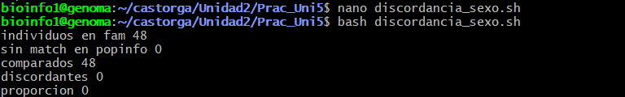

**Figura 24.** *La terminal mostrando que se compararon 48 individuos, sin ninguno sin match en popinfo, y que hay 0 discordantes, con una proporción de discordancia de 0.*

#### Conclusión

Comparar el sexo de dos archivos distintos es una forma simple de detectar errores de registro, y la proporción de discordancias dice qué tan confiables son los metadatos. Antes de comparar hay que asegurarse de que los dos archivos usen la misma codificación, porque si no cualquier diferencia de formato se cuenta como una discordancia falsa. Aquí los 48 individuos del `.fam` se encontraron en `popinfo` y ninguno tiene un sexo distinto en los dos archivos, así que ambos registran el mismo sexo.

---

### Ejercicio 6 (Plink)
>*Realiza un test de estimación de sexo usando plink y reporta los resultados en formato de tabla para todos los individuos con discordancia entre el sexo reportado en fam y el calculado con plink.*

#### Metodología

```bash
plink --bfile chilean_all48_hg19 --check-sex --out chilean_all48_hg19_sexcheck
head chilean_all48_hg19_sexcheck.sexcheck

# solo los individuos con discordancia
awk 'NR==1 || $5=="PROBLEM"' chilean_all48_hg19_sexcheck.sexcheck > sexo_discordante_plink.txt
head sexo_discordante_plink.txt
```

`--check-sex` calcula el coeficiente de endogamia `F` en el cromosoma X y con eso asigna el sexo, mujer si `F` es menor a 0.2 y hombre si es mayor a 0.8. El archivo de salida trae las columnas `FID`, `IID`, `PEDSEX` (sexo del `.fam`), `SNPSEX` (sexo estimado), `STATUS` (OK o PROBLEM) y `F`. El awk deja en un archivo aparte solo los individuos marcados como PROBLEM.

#### Resultados

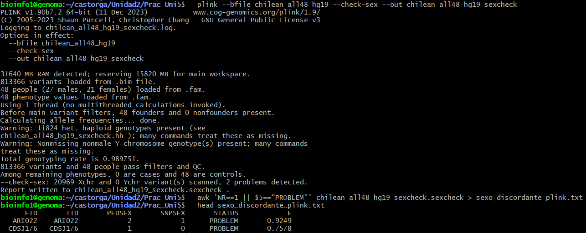

**Figura 25.** *La terminal mostrando las primeras filas del archivo .sexcheck y los individuos con discordancia entre el sexo reportado y el estimado, ARI022 y CDSJ176.*

| FID | IID | PEDSEX | SNPSEX | F |
|---|---|---|---|---|
| ARI022 | ARI022 | 2 | 1 | 0.9249 |
| CDSJ176 | CDSJ176 | 1 | 0 | 0.7578 |

#### Conclusión

Estimar el sexo con los genotipos del cromosoma X permite revisar si el sexo registrado coincide con el que muestran los datos. De las 48 personas, 2 quedaron marcadas como PROBLEM. ARI022 figura como mujer, pero su coeficiente F de 0.9249 corresponde a un hombre, lo que apunta a un error de registro o de muestra y coincide con el aviso de Plink sobre genotipos del cromosoma Y en personas que no son hombres. CDSJ176 figura como hombre, pero su F de 0.7578 queda entre 0.2 y 0.8, donde Plink no puede asignar un sexo, y por eso aparece con 0. En ese caso la discordancia viene de que la estimación no es concluyente y no necesariamente de un error en el registro. Como el `.fam` y `popinfo` coinciden en el sexo de las 48 personas, estas dos discordancias no son un error de transcripción entre archivos, sino una diferencia entre el sexo registrado y el que muestran los genotipos.

---

### Ejercicio 7 (Plink)
>*Genera una tabla de contingencia de individuos por sexo y ancestría.*

#### Metodología

```bash

#!/bin/bash

# Columnas del archivo popinfo
ID_COL=1
SEX_COL=2
SRC_COL=3
ANC_COL=6

# Fuente que queremos analizar
FUENTE="CLG_Axiom48"

# Crear una tabla de sexo y ancestría
awk -v idc=$ID_COL -v sxc=$SEX_COL -v src=$SRC_COL -v anc=$ANC_COL -v fuente="$FUENTE" '

# Leer los individuos del archivo fam
NR==FNR {
    id=toupper($2)
    gsub(/[-_]/,"",id)
    en_fam[id]=1
    next
}

# Leer la información del archivo popinfo
FNR>1 {
    split($0, f, ",")

    # Seleccionar los individuos de la fuente indicada
    o=f[src]
    gsub(/[\r"]/,"",o)
    if (o != fuente) next

    # Comprobar que el individuo está en fam
    id=f[idc]
    gsub(/[\r"_-]/,"",id)
    if (!(toupper(id) in en_fam)) next

    # Obtener el sexo y la ancestría
    s=f[sxc]
    a=f[anc]
    gsub(/[\r"]/,"",s)
    gsub(/[\r"]/,"",a)
    gsub(/ /,"_",a)

    # Contar individuos por sexo y ancestría
    c[s,a]++
    S[s]=1
    A[a]=1
    n++
}

# Mostrar la tabla con los totales
END {
    printf "Sexo"
    for (a in A) printf "\t%s", a
    printf "\tTotal\n"

    # Mostrar los resultados de cada sexo
    for (s in S) {
        printf "%s", s
        t=0
        for (a in A) {
            printf "\t%d", c[s,a]
            t+=c[s,a]
        }
        printf "\t%d\n", t
    }

    # Calcular el total de cada ancestría
    printf "Total"
    g=0
    for (a in A) {
        x=0
        for (s in S) x+=c[s,a]
        printf "\t%d", x
        g+=x
    }
    printf "\t%d\n", g

    # Mostrar el número de individuos incluidos
    print "Individuos contados:", n+0 > "/dev/stderr"
}
' chilean_all48_hg19.fam chilean_all48_hg19_popinfo.csv > contingencia_sexo_ancestria.txt

# Revisar la tabla generada
head contingencia_sexo_ancestria.txt

```

```bash
bash contingencia.sh
```

El archivo `popinfo` tiene 61 personas, 13 con `Source` igual a `ChileGenomico` y 48 con `CLG_Axiom48`, que son las del `.fam`. Por eso el script, `contingencia.sh`, cuenta solo las filas de `CLG_Axiom48` que además están en el `.fam`, y cuenta cuántos individuos y en qué combinación de sexo y ancestría hay, agregando los totales por fila y por columna.

#### Resultados

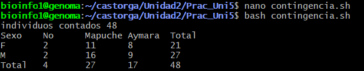

**Figura 26.** *La terminal mostrando la tabla de contingencia de individuos por sexo y ancestría, con 48 individuos contados.*

| Sexo | No | Mapuche | Aymara | Total |
|---|---|---|---|---|
| F | 2 | 11 | 8 | 21 |
| M | 2 | 16 | 9 | 27 |
| Total | 4 | 27 | 17 | 48 |

#### Conclusión

La muestra de 48 personas tiene 21 mujeres y 27 hombres repartidos en tres categorías de ancestría, 27 Mapuche, 17 Aymara y 4 en la categoría No. En los tres grupos hay hombres y mujeres, y la proporción de hombres va de 50 % a 59 %, así que no hay un desbalance fuerte de sexo entre las ancestrías. El grupo No tiene solo 4 personas, por lo que sus proporciones valen poco.

---

## Discusión

Los primeros ejercicios con el VCF mostraron que, aunque el archivo es muy grande, con vcftools se puede manejar sin tener que abrirlo ni copiarlo. Con 4.450.360 sitios, casi todo se resuelve con una opción de vcftools o con un awk sobre un archivo de resultados más chico. Lo que más me sirvió fue ver que conviene ir guardando cada resultado en su propio archivo, como el de frecuencias, porque los ejercicios siguientes parten de ahí y así no hay que volver a leer el VCF completo cada vez. Al convertir el VCF a Plink, además, la tasa de genotipado del conjunto fue de 0,81, es decir que cerca de un 19 % de los genotipos están perdidos, un dato que conviene tener presente antes de filtrar por datos perdidos.

Pasar por el archivo de frecuencias y filtrar los sitios bialélicos dejó claro por qué el MAF necesita exactamente dos alelos. Casi todos los sitios cumplían esa condición, 4.447.324 de 4.450.360, así que el filtro no cambió mucho el conjunto, pero igual era necesario para que el histograma y el conteo de variantes raras tuvieran sentido. El histograma mostró una barra muy alta en MAF cercano a 0 y después una distribución bastante pareja, algo distinto a la curva con muchas variantes raras que se espera en poblaciones grandes, que probablemente se relaciona con tener solo 18 individuos. El histograma ayudó a ver todo eso junto, porque en una tabla de millones de filas no se alcanza a ver cuántas variantes son raras y cuántas comunes.

En la parte de Plink pasó algo parecido, pero con las muestras en vez de los sitios. Los filtros sacaron a 2 de los 48 individuos y a 347.070 de las 813.366 variantes por tener una frecuencia del alelo menor baja. Los filtros de MAF y de datos perdidos, el reporte de Hardy-Weinberg y la revisión del archivo `.fam` mostraron que un conjunto de datos puede estar completo en genotipos y aun así tener poca información sobre las personas, como el fenotipo o el parentesco. Por eso fue útil traer la ancestría desde `popinfo` y comparar el sexo de tres formas, la del `.fam`, la de `popinfo` y la estimada con el cromosoma X, porque cada una puede tener errores distintos y solo al cruzarlas se pueden detectar. En este caso el `.fam` y `popinfo` registran el mismo sexo para las 48 personas, pero Plink marcó a 2, ARI022, que figura como mujer pero tiene un cromosoma X de hombre, y CDSJ176, cuyo sexo no se pudo asignar. Al final, la tabla de sexo por ancestría mostró 27 hombres y 21 mujeres repartidos en tres ancestrías.

También hubo cosas más prácticas que aprender. Trabajar en un servidor por ssh significa que las variables y los módulos se pierden al desconectarse, que un comando puede fallar solo porque la carpeta en la que se está parado no es la correcta, y que R no estaba disponible hasta cargarlo con `module load R`. Además, los valores p del reporte de Hardy-Weinberg no se pueden leer uno por uno, porque con miles de SNPs algunos van a salir significativos por azar y hace falta una corrección por pruebas múltiples.

## Conclusión general

Esta sesión me permitió aprender a trabajar con dos formatos de datos genéticos, VCF utilizando VCFtools y PLINK. Pude ver que cada uno tiene distintas funciones y que ambos son útiles dependiendo del análisis que se quiera realizar. Con VCFtools aprendí a obtener información sobre los individuos y las variantes, calcular frecuencias alélicas, heterocigosidad y diversidad, además de aplicar algunos filtros. Por otro lado, con PLINK pude revisar la calidad de los datos, realizar la prueba de Hardy-Weinberg y trabajar con información de las muestras, como el sexo y la ancestría.

De todos los talleres que hemos realizado, este ha sido el que más me ha costado, ya que había muchas cosas que no sabía hacer y varios comandos que no conocía. En algunos ejercicios me costó entender qué tenía que hacer, cómo utilizar los comandos y cómo interpretar los resultados. También tuve dificultades al trabajar en el servidor y manejar los archivos. Sin embargo, a medida que fui avanzando, pude comprender mejor para qué servía cada herramienta y la importancia de revisar los datos antes de analizarlos. Aunque todavía me falta bastante práctica para poder realizar estos procedimientos de forma mas expedita, considero que este taller me ayudó a aprender cosas nuevas y a entender mejor cómo se trabaja con datos genéticos en bioinformática.

---

