# Tarea 2.3 — Estructura poblacional

**Curso:** Bioinformática e investigación reproducible para análisis genómicos  
**Unidad 2:** Genética de poblaciones con software especializado — Sesión 2  
**Estudiante:** Camila Astorga  
**Profesor:** Ricardo Verdugo  
**Institución:** Facultad de Ciencias Químicas y Farmacéuticas, Universidad de Chile  
**Fecha de actualización:** 20-10-2026  
**Repositorio:** <https://github.com/camipez/Tareas_BioinfRepro2026_CPA>

---

## Objetivos

### Objetivo general

Aplicar un flujo de control de calidad con Plink y R a datos de genotipificación con microarreglos de 48 individuos del proyecto ChileGenomico, para dejar un conjunto de SNPs e individuos confiable, y luego unirlo con los datos de 1000G y analizar la estructura poblacional con MDS y ADMIXTURE.

### Objetivos específicos

- Evaluar la cantidad de datos perdidos por SNP y por individuo, y filtrar los que superan un umbral.
- Revisar si el sexo declarado de cada individuo coincide con el inferido desde el cromosoma X, y eliminar las discrepancias.
- Restringir el análisis a SNPs autosómicos, calcular las frecuencias alélicas y eliminar los SNPs sin variación.
- Eliminar los SNPs cuyas frecuencias genotípicas se desvían del equilibrio de Hardy-Weinberg.
- Identificar parentescos desconocidos usando SNPs con bajo desequilibrio de ligamiento, y eliminar a los individuos que los generan.
- Unir los datos de ChileGenomico con los de 1000G, homologando variantes, coordenadas, alelos de referencia y hebras.
- Calcular un MDS con los datos unidos y graficar distintos componentes, para ver cómo se agrupan las muestras chilenas respecto de las poblaciones de 1000G.
- Estimar la ancestría de las muestras chilenas con ADMIXTURE para distintos valores de K, y evaluarlos con el error de validación cruzada.

---

## Contenido de este directorio

| Ruta | Contenido |
|---|---|
| [`Sesion2/code/`](Sesion2/code/) | Copias de los scripts de R utilizados durante el trabajo. |
| [`Sesion2/resultados/`](Sesion2/resultados/) | Registros de PLINK y ADMIXTURE, lista de SNPs y resultados de control de calidad. |
| [`Sesion2/figuras/`](Sesion2/figuras/) | Gráficos conservados en PDF y PNG. |
| [`graficos_servidor/`](graficos_servidor/) | Gráficos descargados del servidor. |
| [`figuras/`](figuras/) | Capturas y gráficos citados en este informe. |


---

## Desarrollo

### Preparación del entorno

Los datos de ChileGenomico, los scripts del tutorial y los datos de 1000G están en el servidor genoma.med.uchile.cl, así que el trabajo se hizo por ssh. Las variables de ambiente acortan las rutas a los datos y a los scripts, y los módulos cargan Plink 1.9 y R.

```bash
ssh -Y bioinfo1@genoma.med.uchile.cl
cd ~/castorga
mkdir -p Unidad2/Sesion2
cd Unidad2/Sesion2
export T=/datos/compartido/GWA_tutorial/1_QC_GWAS
export P=/datos/compartido/GWA_tutorial/2_Population_stratification/
export C=/datos/compartido/ChileGenomico
export G=~/1000G
export W=~/WK2019-PopGeno
ls $T
ls $G
ls $W
module load plink/1.90
module load R/4.0.5
```

Las variables y los módulos se pierden al cerrar la sesión, por lo que tuve que cargarlos cada vez que entré al servidor. 

#### Resultados

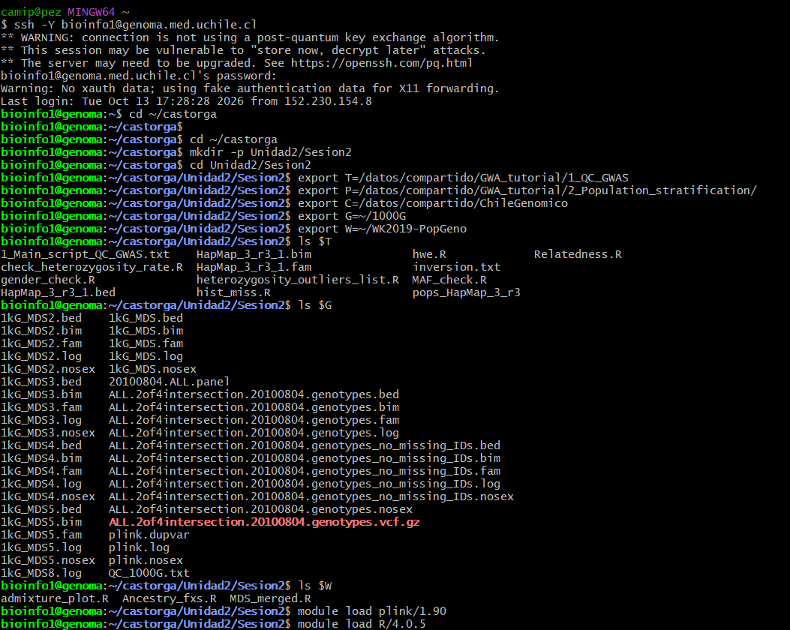

**Figura 1.** *Registro de la conexión al servidor, la creación de la carpeta Unidad2/Sesion2, las variables de ambiente, el contenido de las carpetas de scripts y datos, y la carga de los módulos plink/1.90 y R/4.0.5.*

---

### Ejercicio 1 — Datos perdidos 
>*¿Cómo se llaman los archivos que contienen las tasas de datos perdidos por SNP y por muestra? ¿Cuántas variantes se eliminaron por tener una tasa de datos perdidos mayor a 0.2? ¿Cuántos individuos tenían una tasa de datos perdidos mayor a 0.02? Basados en los histogramas y en sus cálculos, ¿qué valores umbrales de datos perdidos para muestras y SNPs sugeriría?*

#### Metodología

```bash
plink --bfile $C/chilean_all48_hg19 --missing
Rscript --no-save $T/hist_miss.R
plink --bfile $C/chilean_all48_hg19 --geno 0.2 --make-bed --out chilean_all48_hg19_2
plink --bfile chilean_all48_hg19_2 --mind 0.2 --make-bed --out chilean_all48_hg19_3
plink --bfile chilean_all48_hg19_3 --geno 0.02 --make-bed --out chilean_all48_hg19_4
plink --bfile chilean_all48_hg19_4 --mind 0.02 --make-bed --out chilean_all48_hg19_5
ls -lh plink.imiss plink.lmiss
head plink.imiss
head plink.lmiss
awk 'NR>1 && $6>0.02' plink.imiss | wc -l
```

`--missing` calcula la tasa de datos perdidos y genera los archivos `plink.imiss`, por individuo, y `plink.lmiss`, por SNP. El script de R dibuja los histogramas de ambas tasas. `--geno` elimina los SNPs con más datos perdidos que el umbral y `--mind` elimina a los individuos, y se aplicó primero el umbral laxo de 0.2 y después el estricto de 0.02, como sale en el repo. Para contar los individuos con tasa mayor a 0.02 se usó la columna 6 de `plink.imiss`, que es `F_MISS`, sin contar el encabezado, y `wc -l` cuenta las líneas que cumplen.

#### Resultados

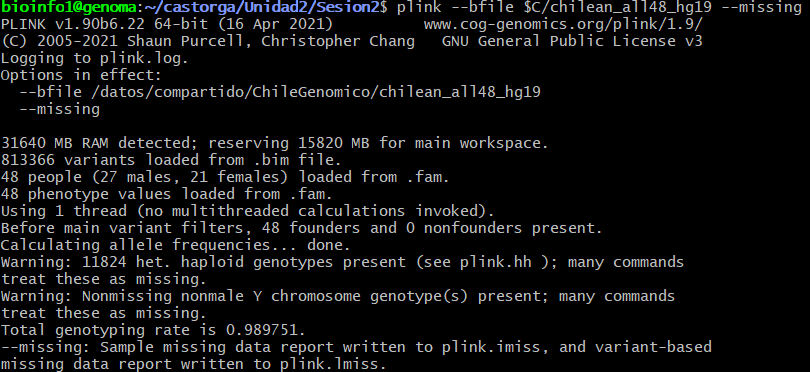

**Figura 2.** *Registro del cálculo de datos perdidos sobre 813.366 variantes y 48 personas, con una tasa de genotipado total de 0.989751, y los archivos plink.imiss y plink.lmiss generados.*

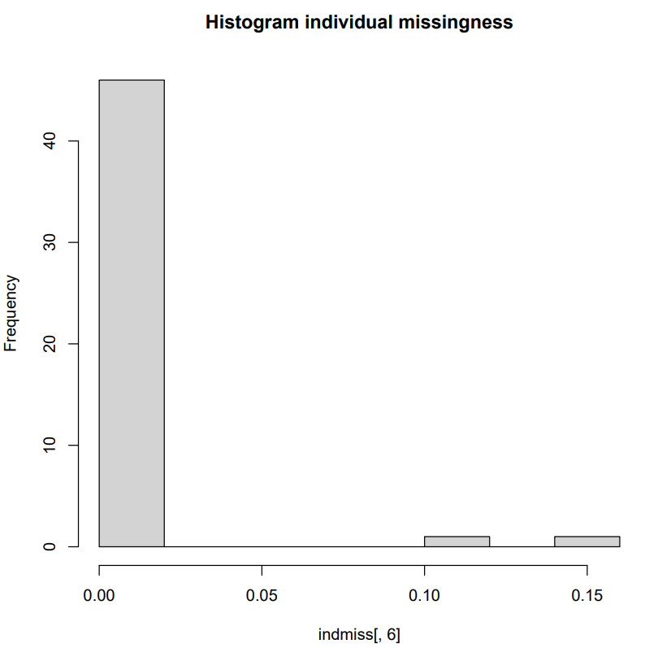

**Figura 3.** *Histograma de la tasa de datos perdidos por individuo, calculada en plink.imiss.*

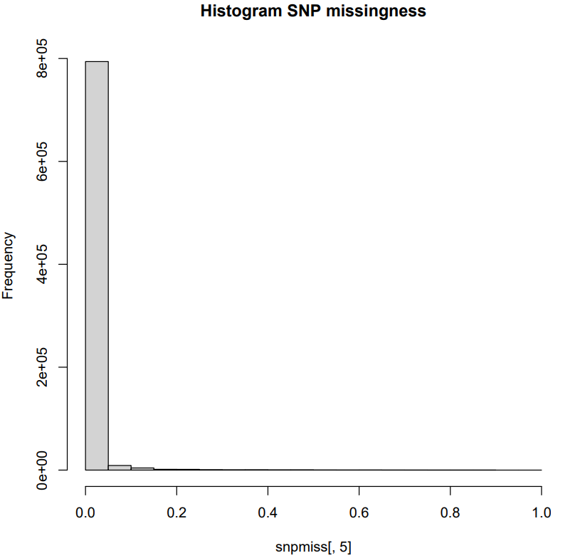

**Figura 4.** *Histograma de la tasa de datos perdidos por SNP, calculada en plink.lmiss.*

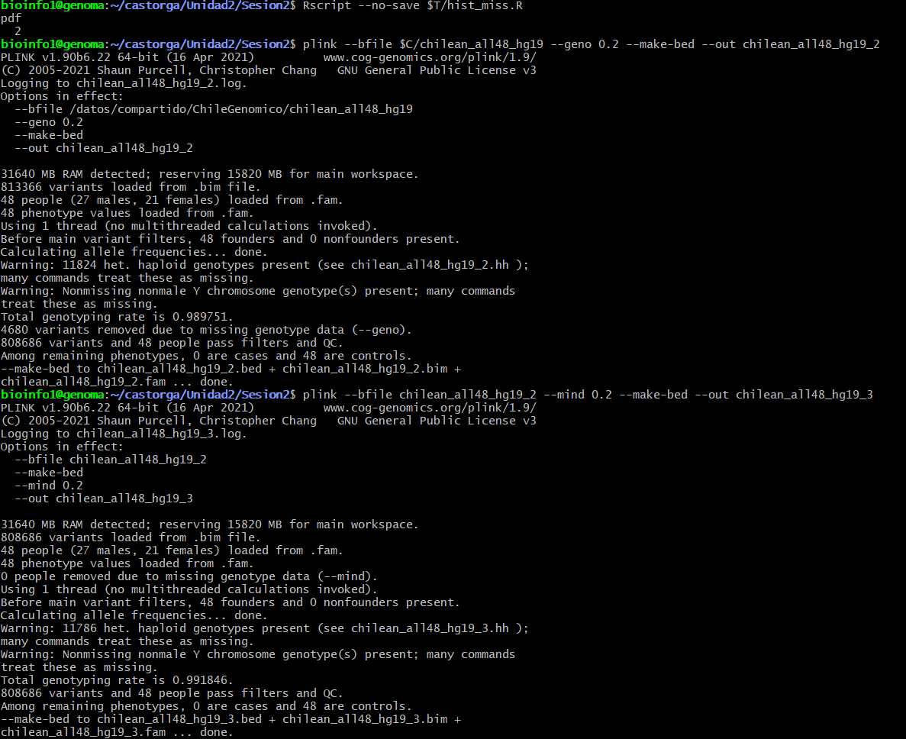

**Figura 5.** *La salida muestra que el filtro de 0.2 eliminó 4.680 variantes y ningún individuo, quedando 808.686 variantes y 48 personas.*

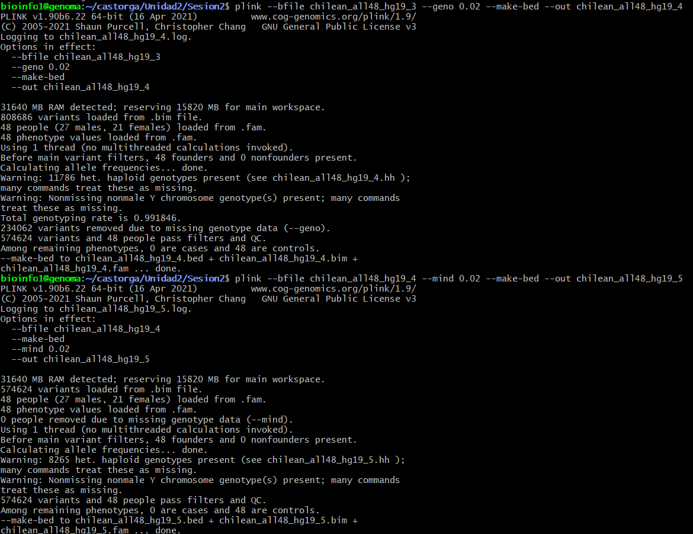

**Figura 6.** *La salida muestra que el filtro de 0.02 eliminó 234.062 variantes y ningún individuo, quedando 574.624 variantes y 48 personas.*

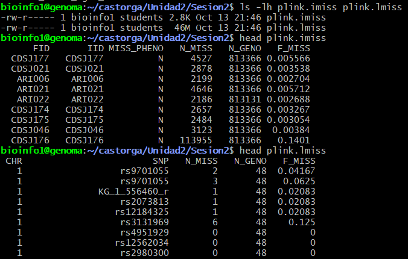

**Figura 7.** *Registro de los archivos plink.imiss, de 2.8 K, y plink.lmiss, de 46 M, y sus primeras filas con la tasa de datos perdidos de cada individuo y de cada SNP.*

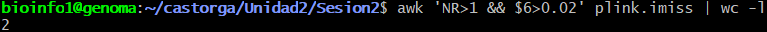

**Figura 8.** *La salida muestra que 2 individuos tienen una tasa de datos perdidos mayor a 0.02.*

#### Conclusión

Los archivos con las tasas de datos perdidos se llaman `plink.imiss`, que tiene la tasa por individuo, y `plink.lmiss`, que tiene la tasa por SNP. Con el umbral de 0.2 se eliminaron 4.680 variantes de las 813.366 iniciales y ningún individuo, y solo 2 individuos tenían una tasa mayor a 0.02. Uno de ellos es CDSJ176, con 0.1401, muy por encima del resto, donde no pasan de 0.006. Por eso el filtro de individuos de 0.02 no eliminó a nadie, ya que al sacar antes los SNPs con más de 2 % de datos perdidos la tasa de esos dos individuos bajó del umbral.

En un SNP autosómico evaluado en los 48 individuos, un solo genotipo perdido da una tasa de 0.0208, así que el umbral de 0.02 para SNPs equivale a exigir que no falte ningún genotipo. Eso eliminó 234.062 variantes más, un 29 % de las que quedaban, pero dejó 574.624 SNPs, que son suficientes para un análisis de estructura. Para los individuos, 0.02 separa con claridad a los pocos con muchos datos perdidos del resto. Se sugiere entonces 0.02 para individuos y para SNPs, aunque con 0.05 para SNPs se conservarían los que tienen uno o dos genotipos perdidos, que equivalen a tasas de 0.0208 y 0.0417. Los histogramas de las Figuras 3 y 4 representan estas mismas distribuciones, así que el análisis está correcto.

---

### Ejercicio 2 — Discrepancias de sexo
>*¿Cuántos individuos fueron eliminados por discrepancia de sexo? ¿Qué riesgo(s) se corre(n) si no se eliminaran?*

#### Metodología

```bash
plink --bfile chilean_all48_hg19_5 --check-sex
Rscript --no-save $T/gender_check.R
head plink.sexcheck
grep "PROBLEM" plink.sexcheck | awk '{print$1,$2}'> sex_discrepancy.txt
plink --bfile chilean_all48_hg19_5 --remove sex_discrepancy.txt --make-bed --out chilean_all48_hg19_6
wc -l sex_discrepancy.txt
```

`--check-sex` compara el sexo registrado con la clasificación basada en el coeficiente F del cromosoma X. En este procedimiento se usan los umbrales F<0.2 para la que se clasifique como  femenina y F>0.8 para la masculina; las discrepancias y los valores intermedios se señalan como PROBLEM. El script de R dibuja los valores de `F`. El `grep` y el `awk` dejan en `sex_discrepancy.txt` solo el ID de familia y el ID de individuo de los marcados, y `--remove` los elimina del conjunto.

#### Resultados

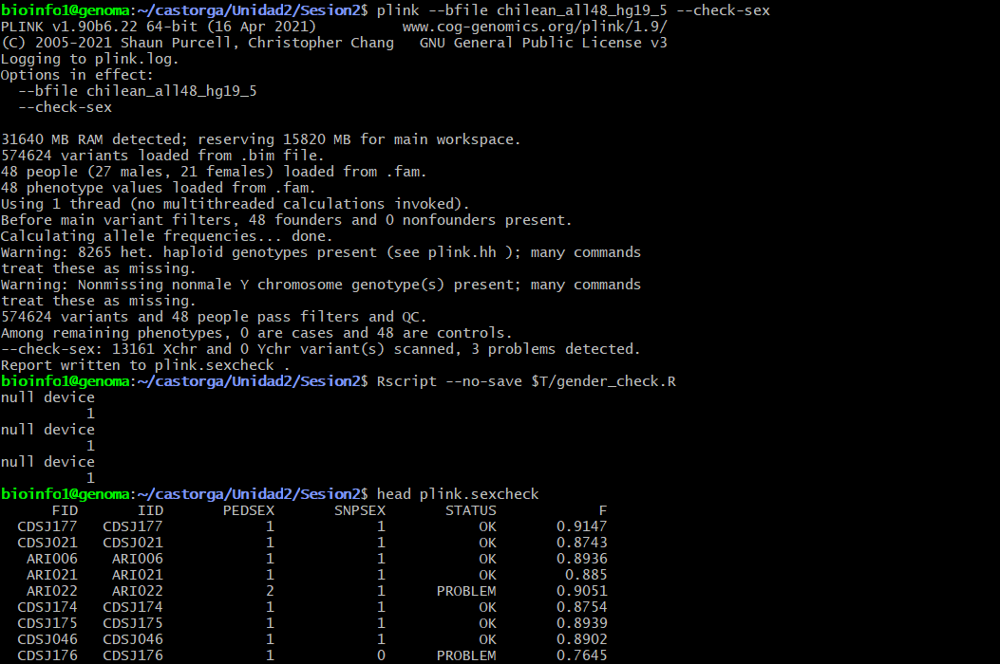

**Figura 9.** *Registro del análisis de sexo con 13.161 variantes del cromosoma X, 3 problemas detectados y las primeras filas de plink.sexcheck, con ARI022 y CDSJ176 marcados como PROBLEM.*

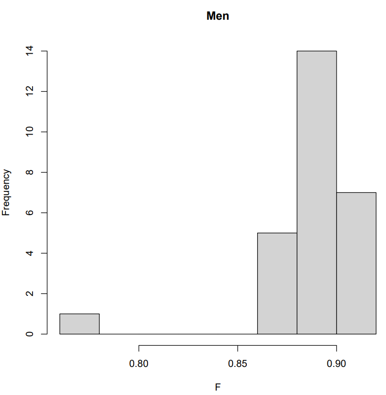

**Figura 10.** *Valores de F del cromosoma X de los individuos declarados como hombres.*

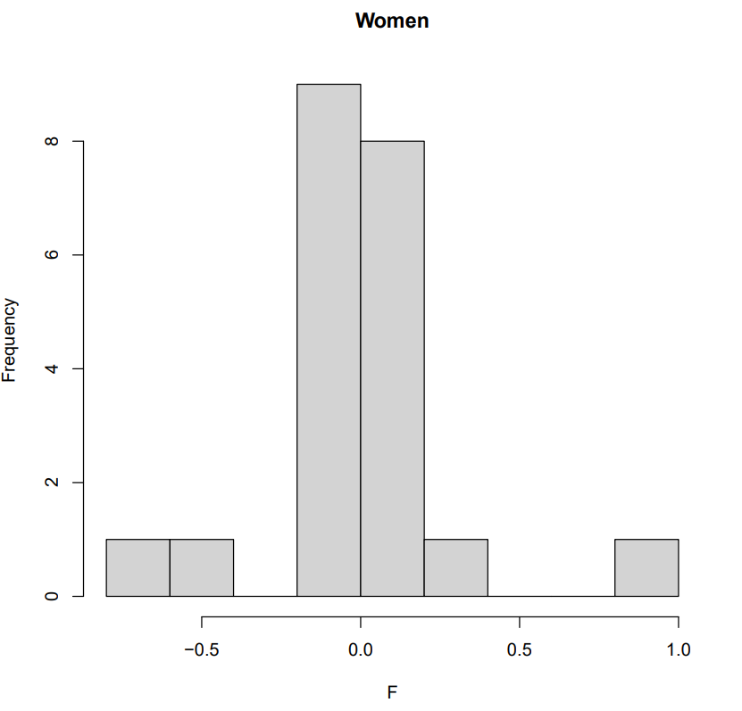

**Figura 11.** *Valores de F del cromosoma X de los individuos declarados como mujeres.*

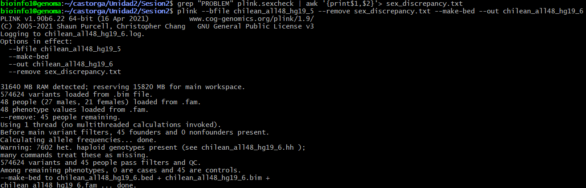

**Figura 12.** *Registro de la eliminación de los individuos con discrepancia de sexo, con 45 personas restantes.*

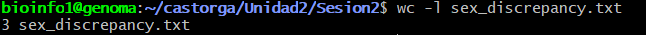

**Figura 13.** *La salida muestra que el archivo sex_discrepancy.txt tiene 3 individuos.*

| FID | IID | PEDSEX | SNPSEX | F |
|---|---|---|---|---|
| ARI022 | ARI022 | 2 | 1 | 0.9051 |
| CDSJ176 | CDSJ176 | 1 | 0 | 0.7645 |
| CDSJ118 | CDSJ118 | 2 | 0 | 0.2160 |

#### Conclusión

Se eliminaron 3 individuos ARI022, CDSJ176 y CDSJ118, según `sex_discrepancy.txt` y `plink.sexcheck`. ARI022 tiene sexo registrado como femenino, pero PLINK lo clasifica como masculino por su F de 0.9051. En CDSJ176 y CDSJ118, los valores 0.7645 y 0.2160 quedan en el intervalo intermedio y PLINK no asigna sexo, por eso aparecen con `SNPSEX=0`.

Estas discrepancias justifican revisar la identidad y calidad de las muestras como un control de calidad. Si no se eliminan puede generar confusión entre las muestras y poca trazabilidad.

---

### Ejercicio 3 — Filtrado de SNPs 
>*¿Cuál es el nombre del primer conjunto de datos que solo contiene SNPs en autosomas? ¿Cuántos SNPs se encontraban en cromosomas sexuales? ¿Cómo calcularía el número de cromosomas que porta cada uno de los alelos para cada SNP?*

#### Metodología

```bash
awk '{ if ($1 >= 1 && $1 <= 22) print $2 }' chilean_all48_hg19_6.bim > snp_1_22.txt
plink --bfile chilean_all48_hg19_6 --extract snp_1_22.txt --make-bed --out chilean_all48_hg19_7
plink --bfile chilean_all48_hg19_7 --freq --out MAF_check
head MAF_check.frq
Rscript --no-save $T/MAF_check.R
plink --bfile chilean_all48_hg19_7 --maf 0.011 --make-bed --out chilean_all48_hg19_8
wc -l chilean_all48_hg19_6.bim chilean_all48_hg19_7.bim
```

El `awk` guarda en `snp_1_22.txt` los IDs de los SNPs de los cromosomas 1 a 22 y `--extract` los conserva. `--freq` calcula la frecuencia de cada alelo y el script de R dibuja la distribución de la frecuencia del alelo menor (MAF). Con 45 individuos, la menor frecuencia posible para un polimorfismo es 1 dividido por 2 por 45, es decir, aproximadamente 0.01111; por eso `--maf 0.011` elimina los SNPs sin variación. Para contar los SNPs fuera de los autosomas se comparó el número de líneas de los archivos `.bim` antes y después de extraerlos.

#### Resultados

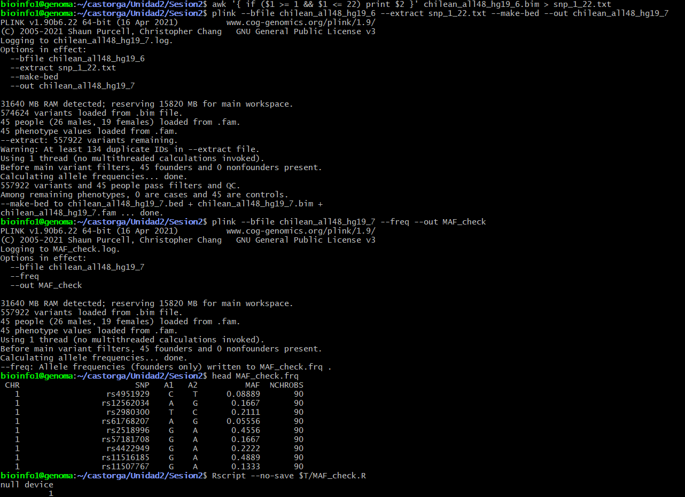

**Figura 14.** *Registro de los 557.922 SNPs autosómicos extraídos, el cálculo de frecuencias alélicas y las primeras filas de MAF_check.frq.*

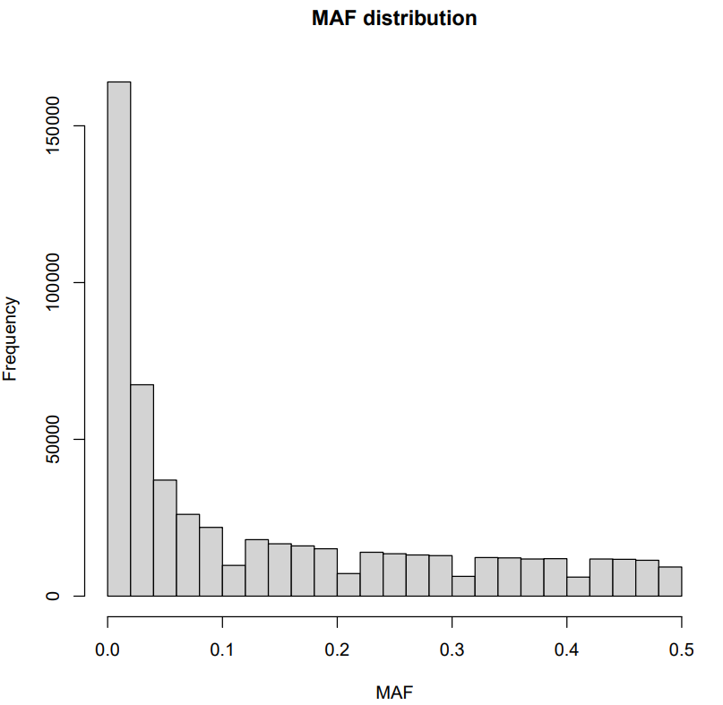

**Figura 15.** *Distribución de la frecuencia del alelo menor (MAF) de los SNPs autosómicos.*

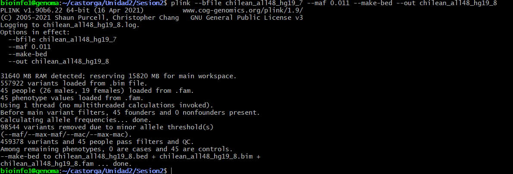

**Figura 16.** *La salida muestra que el filtro de MAF de 0.011 eliminó 98.544 variantes, quedando 459.378 variantes y 45 personas.*

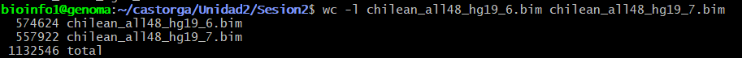

**Figura 17.** *Registro del número de líneas de los archivos .bim antes, 574.624, y después, 557.922, de extraer los autosomas.*

#### Conclusión

El primer conjunto de datos que solo contiene SNPs en autosomas es `chilean_all48_hg19_7`. Entre ese conjunto y el anterior hay una diferencia de 16.702 SNPs que no se conservaron al seleccionar los cromosomas 1–22. De ellos, 13.161 corresponden a variantes del cromosoma X examinadas en la Figura 9. La diferencia total de 16.702 cuenta variantes no autosómicas; no permite atribuirlas todas a cromosomas sexuales ni separar Y, XY y ADN mitocondrial sin revisar el archivo `.bim` por lo que tengo entendido.


---

### Ejercicio 4 — Equilibrio de Hardy-Weinberg
>*¿Cuál es el nombre del archivo con los resultados de la prueba de HWE? ¿Basándose en la distribución de los valores de p, le parece el umbral usado razonable o propondría otro valor?*

#### Metodología

```bash
plink --bfile chilean_all48_hg19_8 --hardy
awk '{ if ($9 <0.000001) print $0 }' plink.hwe > plinkzoomhwe.hwe
Rscript --no-save $T/hwe.R
plink --bfile chilean_all48_hg19_8 --hwe 1e-6 --hwe-all --make-bed --out chilean_all48_hg19_9
grep "removed" chilean_all48_hg19_9.log
```

`--hardy` calcula la prueba exacta de Hardy-Weinberg para cada SNP y la guarda en `plink.hwe`. El `awk` deja en `plinkzoomhwe.hwe` los SNPs con valor p menor a 0.000001, porque uno de los scripts de R los necesita para dibujar los SNPs con mayor desviación. El último comando elimina los SNPs con valor p menor a 1e-6. Plink avisa que `--hwe-all` está en desuso y recomienda `--hwe include-nonctrl`, pero el comando del tutorial funciona igual.

#### Resultados

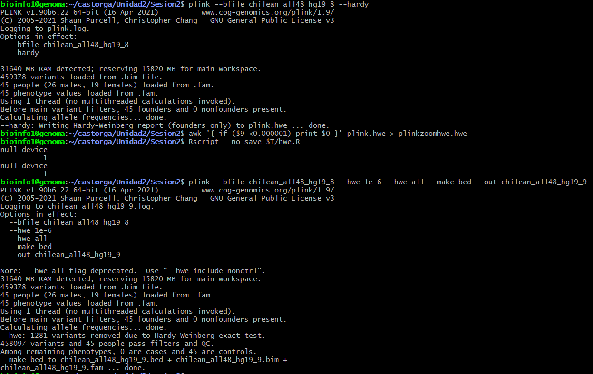

**Figura 18.** *Registro de la prueba de Hardy-Weinberg sobre 459.378 variantes, la selección de SNPs con valor p menor a 0.000001, la ejecución de hwe.R y el filtro de 1e-6, que dejó 458.097 variantes y 45 personas.*

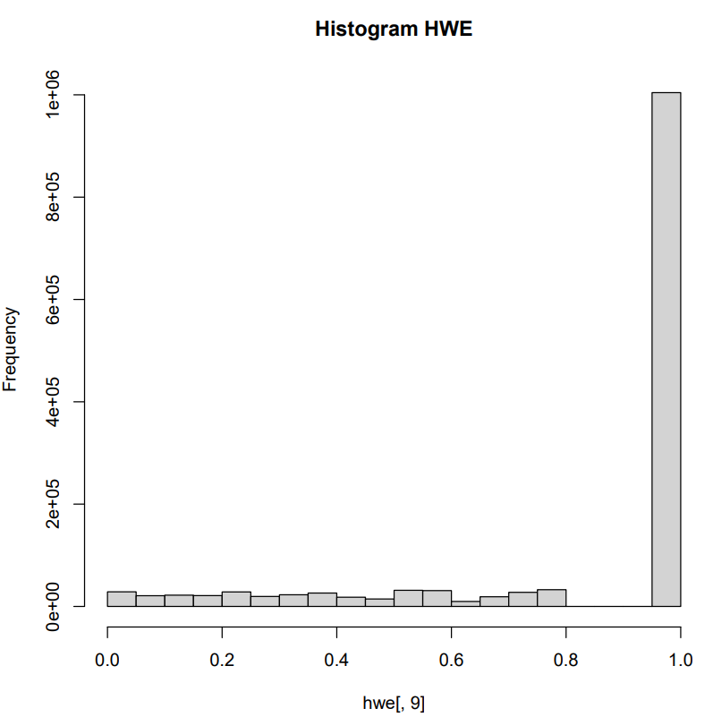

**Figura 19.** *Distribución de los valores p leídos desde plink.hwe.*

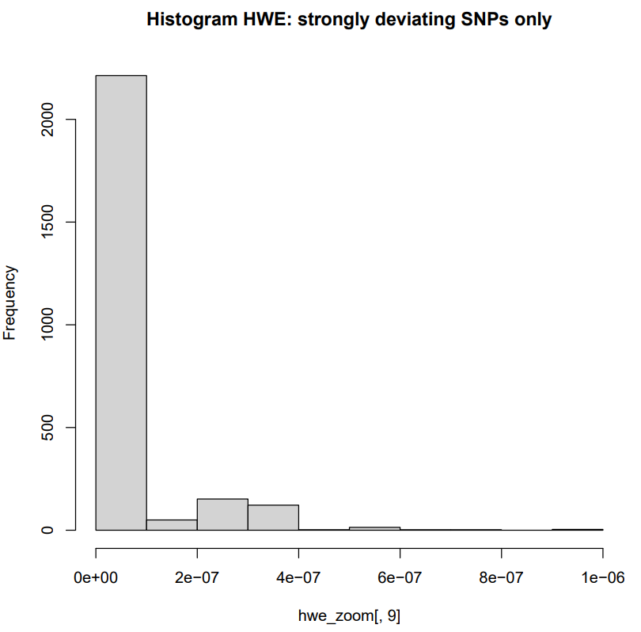

**Figura 20.** *Distribución de los registros de plink.hwe con p menor a 0.000001; la frecuencia no equivale necesariamente a SNPs únicos.*

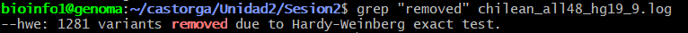

**Figura 21.** *La salida muestra que el filtro eliminó 1.281 variantes por la prueba exacta de Hardy-Weinberg.*

#### Conclusión

El archivo con los resultados se llama `plink.hwe`. El umbral de 1e-6 eliminó 1.281 de los 459.378 SNPs, cerca del 0,28 %. Para este ejercicio me parece una elección razonable porque retiene la mayor parte de las variantes y descarta las que muestran desviaciones más marcadas.

Eso no significa que cada SNP excluido tenga un error de genotipificación. La estructura poblacional también puede producir desviaciones y, con 45 individuos, no rechazar HWE tampoco demuestra que un SNP esté en equilibrio. Los histogramas permiten describir la distribución, pero no bastan para determinar la causa de cada desviación. Además, `plink.hwe` puede contener varias filas por SNP para distintos grupos de análisis; las frecuencias del histograma no deben confundirse directamente con el número de variantes únicas. El conteo de SNPs eliminados se obtuvo del registro del filtro.

---

### Ejercicio 5 — Parentescos desconocidos 
>*¿Cuántos SNPs en aparente equilibrio de ligamiento se encontraron? ¿Cuántos SNPs se eliminaron por estar en regiones de inversiones conocidas? ¿Cuántos individuos quedaron luego del filtro de parentesco? ¿Cuál fue el mayor coeficiente de parentesco efectivamente aceptado?*

#### Metodología

```bash
plink --bfile chilean_all48_hg19_9 --exclude $T/inversion.txt --range --indep-pairwise 50 5 0.2 --out indepSNP
plink --bfile chilean_all48_hg19_9 --extract indepSNP.prune.in --genome --min 0.2 --out pihat_min0.2
head pihat_min0.2.genome | cut -c 1-77
head pihat_min0.2.genome | cut -c 78-
Rscript --no-save $T/Relatedness.R
```

El primer comando excluye las regiones de inversión de la selección para el análisis de LD y deja en `indepSNP.prune.in` los SNPs retenidos, usando ventanas de 50 SNPs. Este paso genera una lista; no elimina esas regiones del conjunto completo que luego se conserva para la unión. El segundo calcula el parentesco entre pares de individuos con esos SNPs y guarda los pares con `PI_HAT` de 0.2 o más. El script original `Relatedness.R` falló, porque desde R 4.0 `read.table` ya no convierte las columnas de texto en factores y la leyenda del gráfico quedaba vacía. Lo corregí en una copia, agregando `stringsAsFactors=TRUE` a la lectura de `pihat_min0.2.genome`, y el archivo faltante se creó con los pares con `Z1` mayor a 0.9.

```bash
cp $T/Relatedness.R Relatedness_corregidofinal.R
nano Relatedness_corregidofinal.R
awk '{ if ($8 >0.9) print $0 }' pihat_min0.2.genome > zoom_pihat.genome
Rscript --no-save Relatedness_corregidofinal.R
ls -lh relatedness.pdf zoom_relatedness.pdf hist_relatedness.pdf
```

Para ver qué individuos generan los parentescos se usó R.

```r

rel <- read.table("pihat_min0.2.genome", header=T)
table(rel$IID1)
table(rel$IID2)
subset(rel, !IID1 %in% "ARI001" & !IID2 %in% "ARI001")

```

Con esa información se eliminaron los individuos que generan más parentescos, y después se contaron los resultados que piden las preguntas.

```bash
awk '$2=="ARI001" || $2=="ARI021" || $2=="ARI018"' chilean_all48_hg19_9.fam > to_romeve_by_relatedness.txt
plink -bfile chilean_all48_hg19_9 -remove to_romeve_by_relatedness.txt -make-bed --out chilean_all48_hg19_10
wc -l indepSNP.prune.in
grep "Pruning" indepSNP.log
grep "exclude" indepSNP.log
wc -l chilean_all48_hg19_10.fam
```

#### Resultados

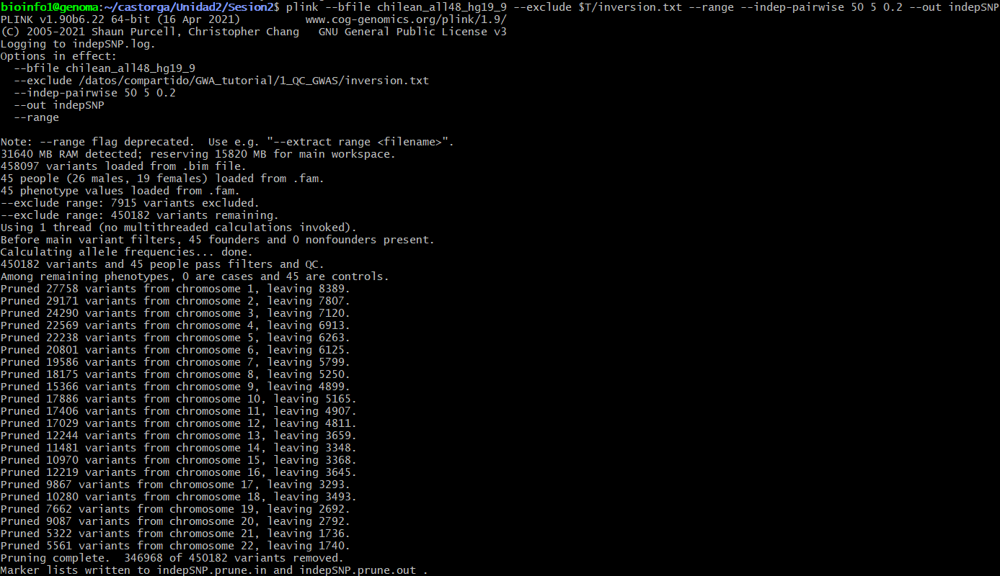

**Figura 22.** *La salida muestra que se excluyeron 7.915 variantes por estar en regiones de inversión y que el filtro de ligamiento eliminó 346.968 de las 450.182 variantes restantes.*

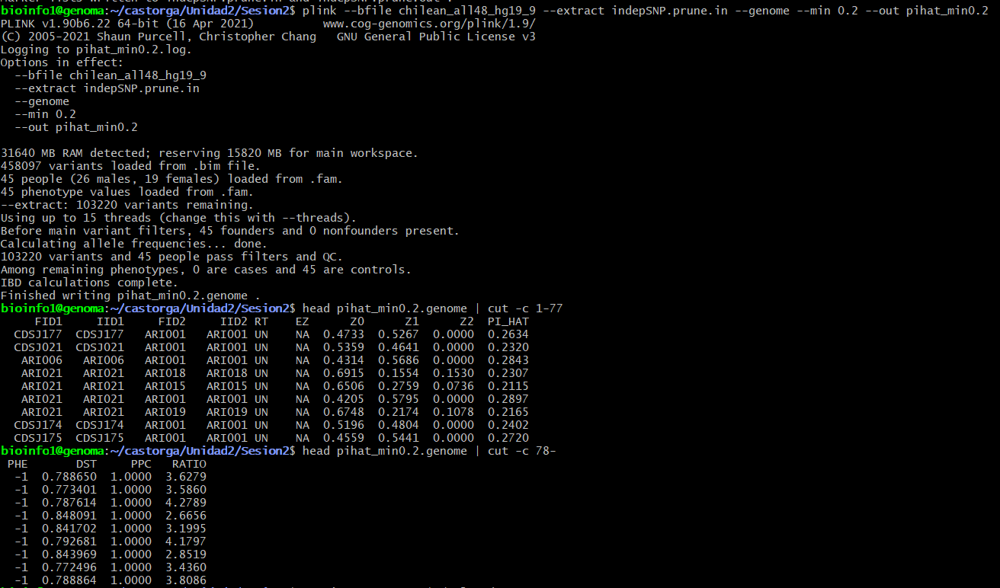

**Figura 23.** *Registro del cálculo de parentesco con 103.220 variantes y las primeras filas de pihat_min0.2.genome, con ARI001 como segundo individuo en la mayoría de los pares.*

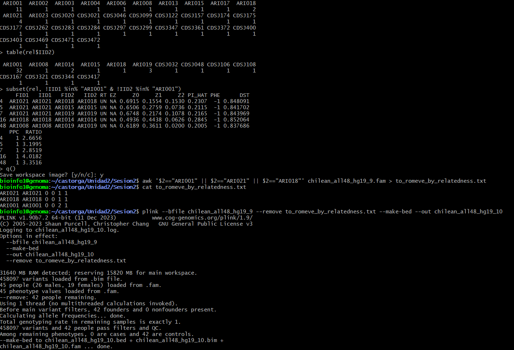

**Figura 24.** *Revisión de parentescos en R y exclusión de ARI001, ARI021 y ARI018 en PLINK. El conjunto resultante conservó 42 individuos y 458.097 SNPs.*

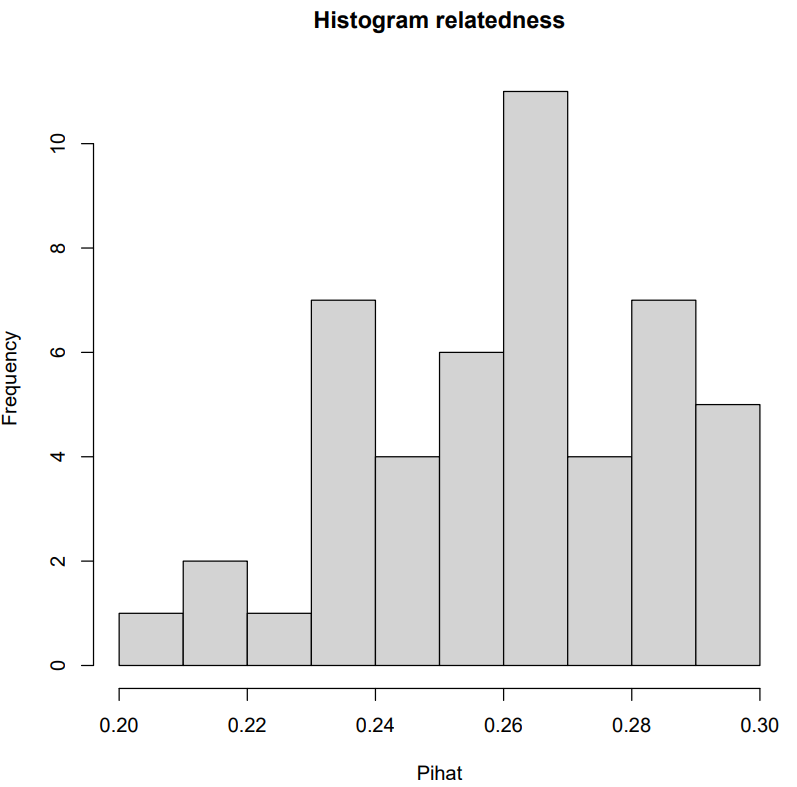

**Figura 25.** *Histograma del coeficiente de parentesco PI_HAT de los pares con valor de 0.2 o más.*

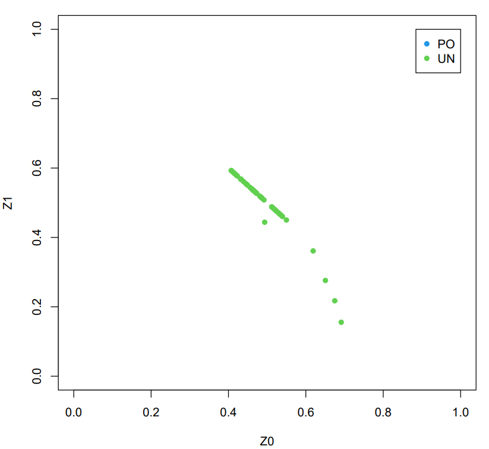

**Figura 26.** *Gráfico de Z0 contra Z1. Los puntos visibles corresponden a UN; las etiquetas de la leyenda no constituyen una confirmación de parentesco biológico.*

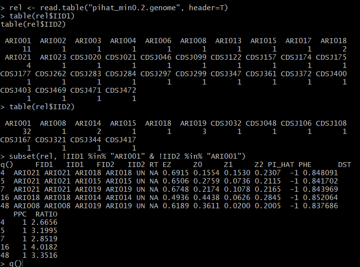

**Figura 27.** *Consulta en R que muestra cuántas veces aparece cada individuo en los pares con parentesco, con ARI001 en 43 de los 48 pares, y los 5 pares que quedan al excluirlo.*


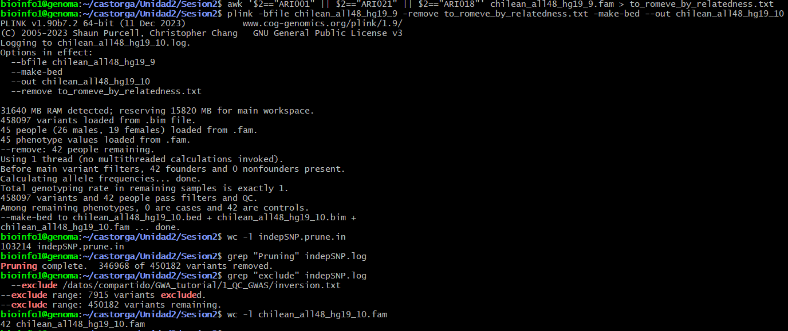

**Figura 29.** *Registro de la eliminación de ARI001, ARI021 y ARI018, con 42 personas restantes, y los conteos de SNPs en equilibrio de ligamiento, 103.214, y de SNPs excluidos por inversiones, 7.915.*

#### Conclusión

Se encontraron 103.214 SNPs en aparente equilibrio de ligamiento, es decir los 450.182 SNPs que quedaron fuera de las inversiones menos los 346.968 eliminados por ligamiento. Plink usó 103.220 variantes al extraerlos, seis más que los IDs de la lista, una diferencia compatible con IDs repetidos, aunque no se puede confirmar su causa sin revisar el `.bim` utilizado. Se eliminaron 7.915 SNPs por estar en regiones de inversiones conocidas.

Hay 48 pares con `PI_HAT` de 0.2 o más, y ARI001 aparece en 43 de ellos, 11 veces como primer individuo y 32 como segundo, con valores de 0.23 a 0.29 en las filas visibles, con muchas personas distintas. Ese patrón motivó su exclusión siguiendo el tutorial, aunque el coeficiente por sí solo no permite establecer la causa. Al excluirlo quedan 5 pares, 4 de los cuales incluyen a ARI021 o a ARI018, por lo que se eliminaron también ellos. Con eso quedaron 42 individuos, tres menos que los 45 anteriores. El mayor coeficiente de parentesco aceptado fue 0.2005, del par ARI008 y ARI019, que se dejó porque está muy cerca del límite, y porque los coeficientes pueden estar sobreestimados en individuos mestizos.

---

### Ejercicio 6 — Unión con 1000G 
>*Una los datos de ChileGenomico con los de 1000G, de modo que ambos conjuntos tengan las mismas variantes, las mismas coordenadas y los mismos alelos de referencia, y no tengan problemas de hebra.*

#### Metodología

Antes de unir los conjuntos hay que dejarlos comparables. Primero se eliminaron las variantes duplicadas del conjunto chileno y se buscaron los SNPs en común con 1000G. Los IDs se ordenaron con `sort -u`, porque `comm` lo necesita, y `comm -12` deja solo los SNPs presentes en ambas listas.

```bash
plink --bfile chilean_all48_hg19_10 --list-duplicate-vars suppress-first
plink --bfile chilean_all48_hg19_10 --exclude plink.dupvar --make-bed --out chilean_all48_hg19_11
cut -f 2 chilean_all48_hg19_11.bim | sort -u > chilean_all48_hg19_11.snps
cut -f 2 $G/1kG_MDS5.bim | sort -u  > 1kG_MDS5.snps
comm -12 chilean_all48_hg19_11.snps 1kG_MDS5.snps > common_snps.txt
plink --bfile $G/1kG_MDS5 --extract common_snps.txt --recode --make-bed --out 1kG_MDS6
plink --bfile chilean_all48_hg19_11 --extract common_snps.txt --make-bed --out chilean_all48_hg19_12
```

Después se actualizaron las posiciones de las variantes de 1000G con las del conjunto chileno. 

```bash
awk '{print $2, $4}' chilean_all48_hg19_12.bim> buildhapmap.txt
plink --bfile 1kG_MDS6 --update-map buildhapmap.txt --make-bed --out 1kG_MDS7
```

Luego se armonizó el alelo A1 del conjunto chileno con el de 1000G y se compararon los pares de alelos. Aquí el alelo de referencia corresponde al uso de `--reference-allele` en PLINK.
```bash
awk '{print $2, $5}' 1kG_MDS7.bim> 1kG_ref-list.txt
plink --bfile chilean_all48_hg19_12 --reference-allele 1kG_ref-list.txt --make-bed --out chilean_all48_hg19_13
grep "Impossible" chilean_all48_hg19_13.log | wc -l
awk '{print $2, $5, $6}' 1kG_MDS7.bim> 1kG_MDS7_tmp
awk '{print $2, $5, $6}' chilean_all48_hg19_13.bim > chilean_all48_hg19_13_tmp
sort 1kG_MDS7_tmp chilean_all48_hg19_13_tmp | uniq -u > all_differences.txt
wc -l all_differences.txt
```

Por último se ejecutaron los pasos previstos para corregir hebras y excluir variantes discordantes. Como las listas estaban vacías, no se cambió la hebra ni se excluyeron SNPs en esta etapa. Después se fusionaron los conjuntos.

```bash
awk '{print $ 1}' all_differences.txt | sort -u > flip_list.txt
plink --bfile chilean_all48_hg19_13 --flip flip_list.txt --reference-allele 1kG_ref-list.txt --make-bed --out chilean_all48_hg19_14
awk '{print $2, $5, $6}' chilean_all48_hg19_14.bim > chilean_all48_hg19_14_tmp
sort 1kG_MDS7_tmp chilean_all48_hg19_14_tmp | uniq -u> uncorresponding_SNPs.txt
wc -l uncorresponding_SNPs.txt
awk '{print $ 1}' uncorresponding_SNPs.txt | sort -u > SNPs_for_exlusion.txt
plink --bfile 1kG_MDS7 --exclude SNPs_for_exlusion.txt --make-bed --out 1kG_MDS8
plink --bfile chilean_all48_hg19_14 --exclude SNPs_for_exlusion.txt --make-bed --out chilean_all48_hg19_15
plink --bfile 1kG_MDS8 --bmerge chilean_all48_hg19_15.bed chilean_all48_hg19_15.bim chilean_all48_hg19_15.fam --allow-no-sex --make-bed --out MDS_merge
```

#### Resultados

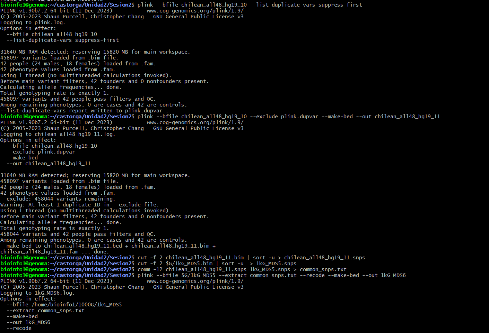

**Figura 30.** *Registro de la búsqueda de variantes duplicadas en el conjunto chileno, que dejó 458.044 de 458.097 variantes al excluirlas, la lista de SNPs en común y el inicio de la extracción en el conjunto de 1000G.*

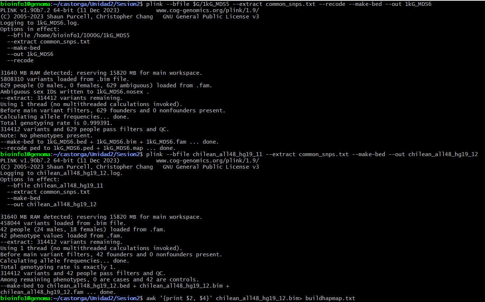

**Figura 31.** *Registro de que, de las 5.808.310 variantes de 1000G, quedaron 314.412 en común, igual que en el conjunto chileno, con 629 y 42 personas respectivamente, y la creación de buildhapmap.txt.*

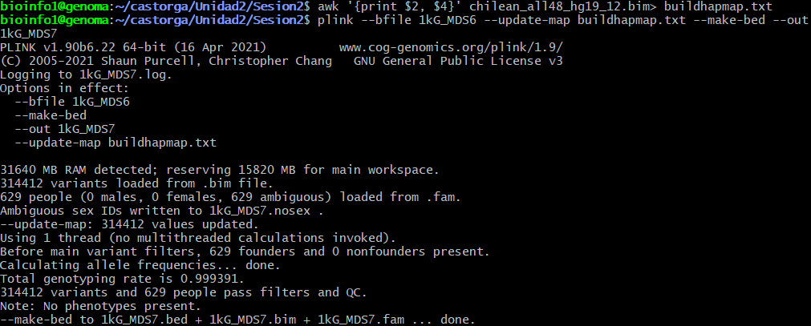

**Figura 32.** *Registro de la actualización de las coordenadas del conjunto de 1000G con buildhapmap.txt.*

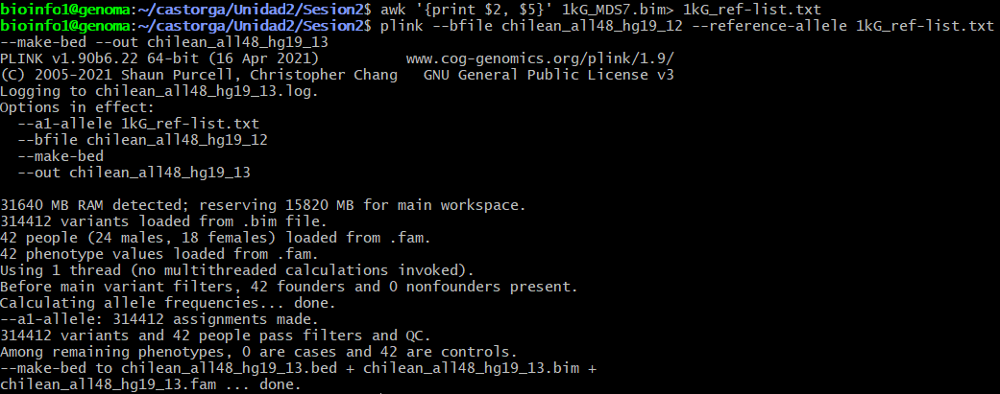

**Figura 33.** *Registro de la asignación del alelo de referencia de 1000G al conjunto chileno.*

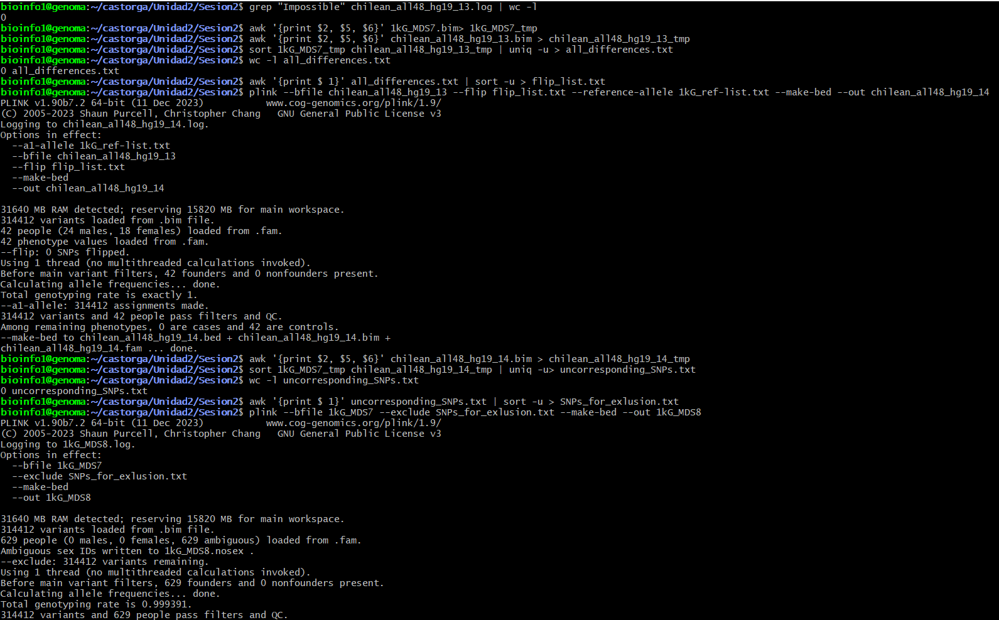

**Figura 34.** *Registro de 0 asignaciones imposibles de alelos, 0 diferencias entre los conjuntos, 0 SNPs con hebra cambiada y 0 SNPs sin correspondencia, y el conjunto de 1000G con 314.412 variantes y 629 personas tras la exclusión.*

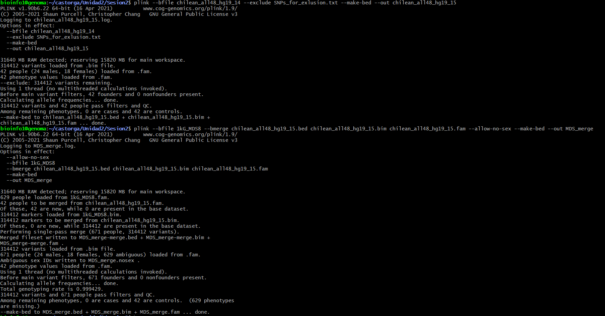

**Figura 35.** *Fusión de 629 individuos de 1000G y 42 de ChileGenomico: MDS_merge contiene 671 individuos y 314.412 variantes.*

#### Conclusión

El paso de exclusión de duplicados retiró 53 registros de variantes y dejó 458.044. De las 5.808.310 variantes de 1000G, solo 314.412 estaban también en el conjunto chileno, un 5,4 %, y esas son las que se conservaron en ambos conjuntos. Después de igualar las coordenadas y los alelos de referencia no se encontraron diferencias entre los conjuntos, con 0 asignaciones imposibles de alelos, 0 diferencias de alelos entre los archivos y 0 SNPs con la hebra cambiada, así que no hubo que excluir ninguna variante. Con eso los conjuntos quedaron con las mismas variantes seleccionadas, posiciones actualizadas y pares de alelos coincidentes en las comprobaciones realizadas, y se pudieron fusionar.

---

### Ejercicio 7 — MDS 
>*En R, genere gráficos similares para las combinaciones Component 2 vs 3 y 3 vs 4. ¿Qué puede concluir de estos gráficos?*

#### Metodología

Para calcular las similitudes usadas en el MDS se extrajeron los SNPs de bajo desequilibrio de ligamiento. 

```bash
plink --bfile MDS_merge --extract indepSNP.prune.in --genome --out MDS_merge2
plink --bfile MDS_merge --read-genome MDS_merge2.genome --cluster --mds-plot 10 --out MDS_merge2
```

Para colorear los gráficos se armó un archivo con la población de cada individuo.

```bash
awk '{print$1,$1,$2}' $G/20100804.ALL.panel > ethnicity_1kG.txt
sed 's/JPT/ASN/g' ethnicity_1kG.txt>ethnicity_1kG2.txt
sed 's/ASW/AFR/g' ethnicity_1kG2.txt>ethnicity_1kG3.txt
sed 's/CEU/EUR/g' ethnicity_1kG3.txt>ethnicity_1kG4.txt
sed 's/CHB/ASN/g' ethnicity_1kG4.txt>ethnicity_1kG5.txt
sed 's/CHD/ASN/g' ethnicity_1kG5.txt>ethnicity_1kG6.txt
sed 's/YRI/AFR/g' ethnicity_1kG6.txt>ethnicity_1kG7.txt
sed 's/LWK/AFR/g' ethnicity_1kG7.txt>ethnicity_1kG8.txt
sed 's/TSI/EUR/g' ethnicity_1kG8.txt>ethnicity_1kG9.txt
sed 's/MXL/AMR/g' ethnicity_1kG9.txt>ethnicity_1kG10.txt
sed 's/GBR/EUR/g' ethnicity_1kG10.txt>ethnicity_1kG11.txt
sed 's/FIN/EUR/g' ethnicity_1kG11.txt>ethnicity_1kG12.txt
sed 's/CHS/ASN/g' ethnicity_1kG12.txt>ethnicity_1kG13.txt
sed 's/PUR/AMR/g' ethnicity_1kG13.txt>ethnicity_1kG14.txt
awk '{if($1~/CDSJ/) pop="MAP"}{if($1~/ARI/) pop="AYM"} {print $1, $2, pop}' chilean_all48_hg19_14.fam > ethnicityfile_CLG.txt
cat ethnicity_1kG14.txt ethnicityfile_CLG.txt | sed -e '1i \ FID IID ethnicity'> ethnicityfile.txt
head ethnicityfile.txt
```

Para graficar C1–C2 se utilizó `MDS_merged.R`. Las capturas también documentan la copia, edición y ejecución de los scripts para C2–C3 y C3–C4. En una de las sesiones fue necesario cargar el módulo de R antes de ejecutar `Rscript`.

```bash
module load R
Rscript $W/MDS_merged.R
cp $W/MDS_merged.R MDS_C2_C3.R
nano MDS_C2_C3.R
Rscript MDS_C2_C3.R
cp $W/MDS_merged.R MDS_C3_C4.R
nano MDS_C3_C4.R
Rscript MDS_C3_C4.R
```

#### Resultados

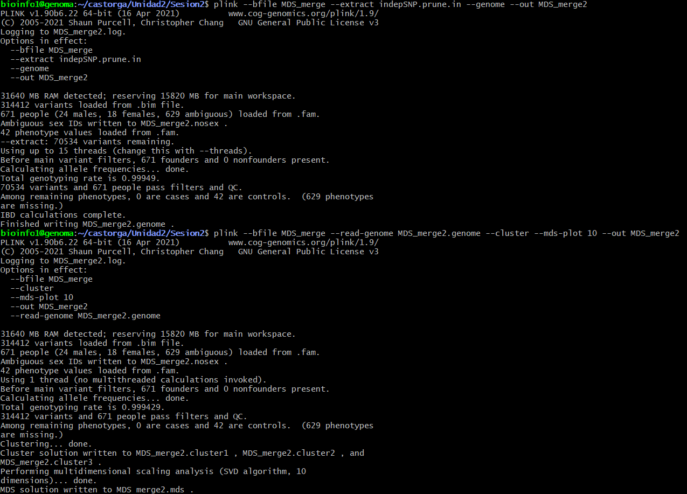

**Figura 36.** *Registro del cálculo de parentesco y del MDS de los datos unidos con los SNPs de bajo desequilibrio de ligamiento.*

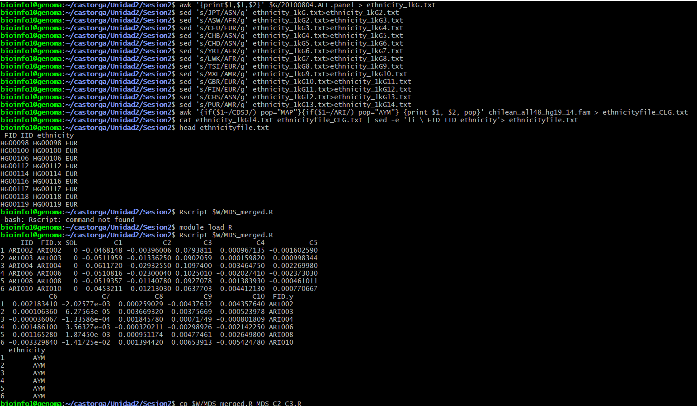

**Figura 37.** *Registro de la conversión de los códigos de población de 1000G, la creación de ethnicityfile.txt, el error por no encontrar Rscript antes de cargar R y las primeras filas de la tabla del MDS, con las muestras aymara (AYM).*

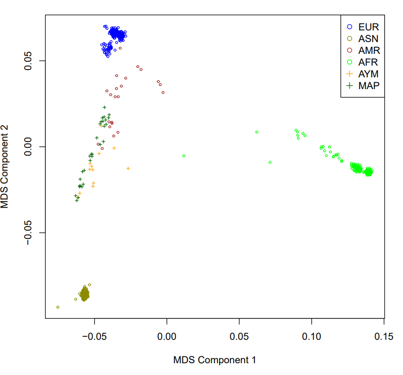

**Figura 38.** *MDS con C1 en el eje horizontal y C2 en el vertical. Los círculos corresponden a EUR, ASN, AMR y AFR; las cruces naranjas y verde oscuro representan AYM y MAP, respectivamente.*


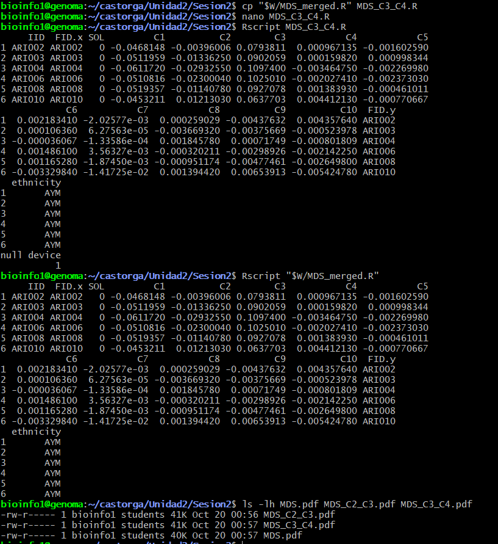

**Figura 39.** *Ejecución de MDS_C3_C4.R y MDS_merged.R, y listado de MDS.pdf, MDS_C2_C3.pdf y MDS_C3_C4.pdf.*

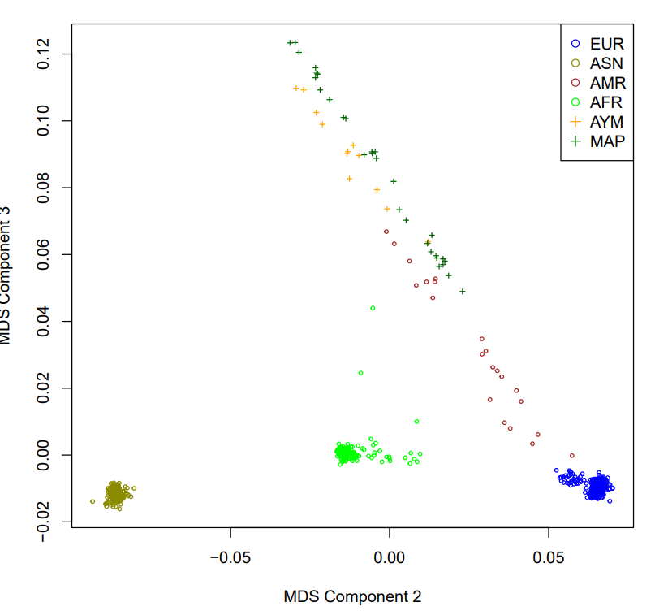

**Figura 40.** *MDS con C2 en el eje horizontal y C3 en el vertical.*

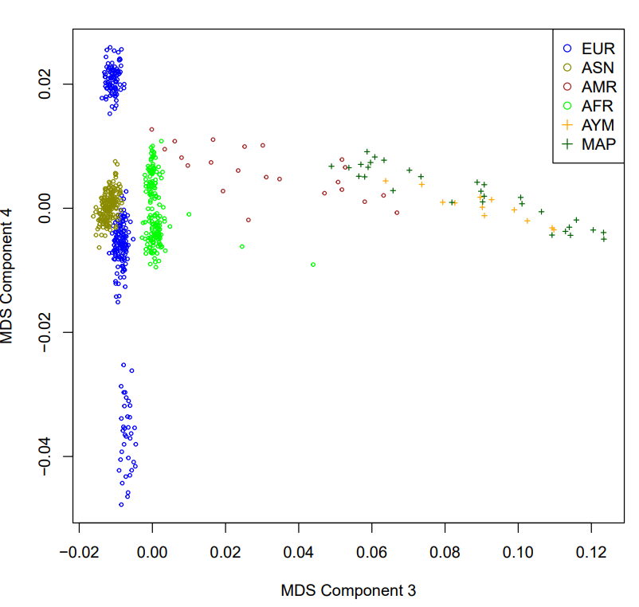

**Figura 41.** *MDS con C3 en el eje horizontal y C4 en el vertical. Se mantiene la superposición parcial entre AYM y MAP y se distinguen agrupaciones de EUR a lo largo de C4.*

#### Conclusión

En C1–C2 se distinguen los grupos africanos, asiaticos y europeos. Las muestras Aymaras y Mapuches se superponen parcialmente y se distribuyen próximas al extremo americano del patrón observado, mientras AMR ocupa posiciones más dispersas. 

En C2–C3, AYM y MAP forman una distribución continua con parte de AMR. En C3–C4 se mantiene ese patrón y se observa mayor diferenciación vertical dentro de EUR. AYM y MAP siguen compartiendo buena parte del espacio, de modo que estos gráficos no muestran una separación completa entre ambas etiquetas. 

En las Figuras 40 y 41, los círculos representan las poblaciones de referencia EUR, ASN, AMR y AFR; las cruces corresponden a AYM y MAP. Los colores y símbolos permiten seguir cada grupo entre las distintas combinaciones de componentes y se ven dispersos de forma mas homogenea.

---

### Ejercicio 8 — ADMIXTURE 
>*¿Cuántos SNPs quedaron luego del filtro? ADMIXTURE asume que los individuos no están emparentados. Sin embargo, no realizamos ningún filtro. ¿Por qué? Interprete la figura de ADMIXTURE y compare los resultados de distintos K. Utilice un comando de Unix para extraer los valores de error de cross-validación a partir de los archivos log. Genere un gráfico de línea en R donde k se muestre en el eje x y la tasa de error en el eje y.*

#### Metodología

ADMIXTURE también supone que los SNPs no están ligados, así que se creó un conjunto reducido con los SNPs de bajo desequilibrio de ligamiento. Se corrió con 4 hebras de cómputo (`-j4`) y validación cruzada (`--cv`), primero para K igual a 3 y después para K de 4 a 6 con un ciclo. En el ciclo del tutorial aparece `-j44`, que parece un error de tipeo, y se usó `-j4` igual que en el primer comando, aún así tuve problemas, y tuve que repetir ese comando con unas modificaciones.

```bash
plink --bfile MDS_merge --extract indepSNP.prune.in --make-bed --out MDS_merge_r2_lt_0.2
module load admixture
admixture -j4 --cv MDS_merge_r2_lt_0.2.bed 3 > MDS_merge_r2_lt_0.2.K3.log
for k in $(seq 4 6)
  do
    admixture -j4 --cv MDS_merge_r2_lt_0.2.bed $k > MDS_merge_r2_lt_0.2.K$k.log
  done
wc -l MDS_merge_r2_lt_0.2.bim
```

Para dibujar los resultados se ordenaron las poblaciones en R, en el orden en que se quieren mostrar, y se ejecutó el script del tutorial. Los errores de validación cruzada se extrajeron de los archivos `.log` con `grep`.

```bash
R --no-save
```

```r
popinfo <- read.table("ethnicityfile.txt", as.is=T, header=T)
popinfo_ls <- split(popinfo, popinfo[,3])
names(popinfo_ls)
popinfo_sorted <- do.call(rbind, popinfo_ls[c("AFR", "EUR", "ASN", "AMR", "AYM", "MAP")])
write.table(popinfo_sorted, "popinfo_sorted.txt", sep="\t", row.names=F)
q()
```

```bash
Rscript $W/admixture_plot.R popinfo_sorted.txt MDS_merge_r2_lt_0.2.fam
grep "CV" MDS_merge_r2_lt_0.2.K*.log
```

#### Resultados

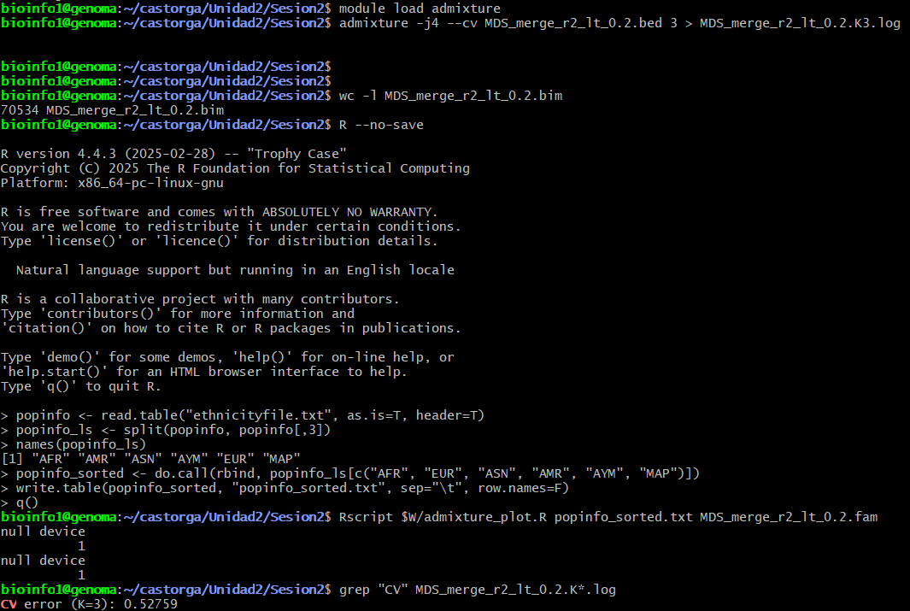

**Figura 42.** *Ejecución para K=3, conteo de SNPs, orden de las poblaciones y generación del gráfico inicial. En esta captura solo se consulta el resultado de K=3.*


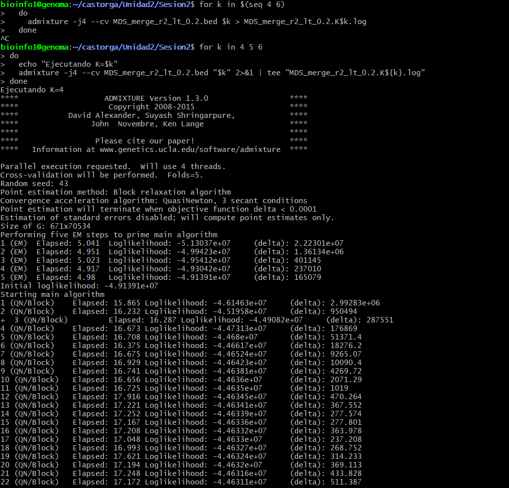

**Figura 43.** *Tras interrumpir un primer ciclo, se ejecutó otro para K=4, 5 y 6 con cuatro hebras. La salida muestra el inicio de K=4 y una matriz de 671 individuos por 70.534 SNPs.*

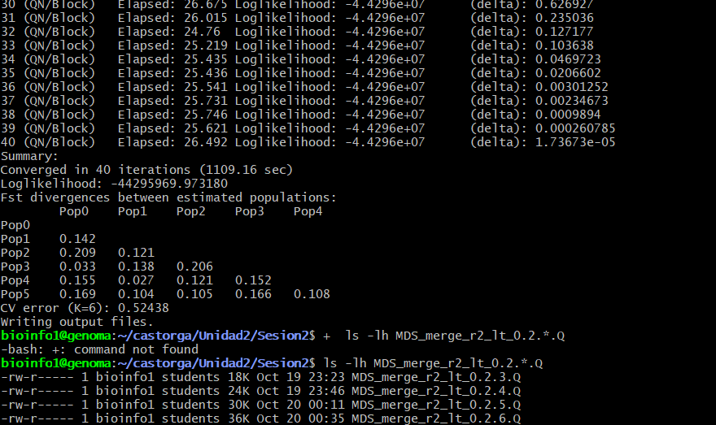

**Figura 44.** *Convergencia de K=6 en 40 iteraciones, error CV de 0.52438 y archivos Q para K=3–6.*

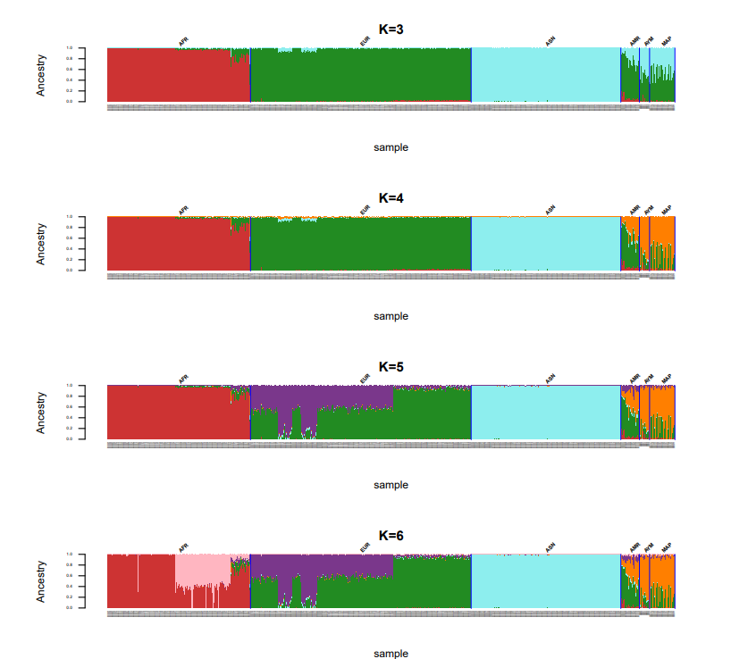

**Figura 45.** *Proporciones estimadas para K=3, 4, 5 y 6, con poblaciones ordenadas como AFR, EUR, ASN, AMR, AYM y MAP. Cada barrita representa una muestra y cada color, un componente inferido. Los paneles permiten comparar la distribución de esos componentes al aumentar K.*

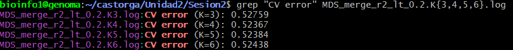

**Figura 46.** *Errores de validación cruzada extraídos de los cuatro registros, con el valor de K identificado en cada línea.*


| K | Error de validación cruzada |
|---|---:|
| 3 | 0.52759 |
| **4** | **0.52367** |
| 5 | 0.52384 |
| 6 | 0.52438 |

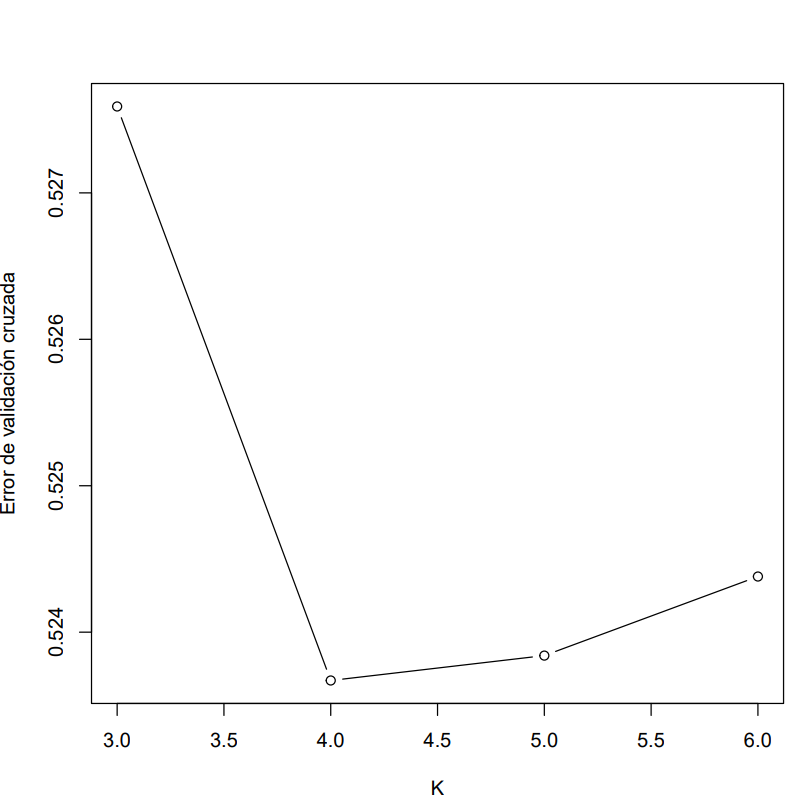

**Figura 48.** *Gráfico de línea de los errores CV para K=3–6. Los cuatro puntos coinciden con los valores de las capturas y el mínimo se encuentra en K=4.*

El gráfico coincide con los cuatro errores de validación cruzada mostrados en las capturas.

#### Conclusión

Después del filtro quedaron **70.534 SNPs y 671 individuos**. No se aplicó un nuevo filtro de parentesco justo antes de ADMIXTURE porque el conjunto chileno ya se había filtrado y, según el tutorial, 1000G venía preprocesado. Eso no garantiza ausencia total de parentesco. 

Para K=3, los componentes predominantes distinguen principalmente AFR, EUR y ASN; en AMR, AYM y MAP se observan combinaciones de componentes. Con K=4 aparece un componente naranja abundante en AYM y MAP y presente en AMR, compatible con estructura compartida por las muestras americanas de este conjunto.

Al aumentar a K=5 se observa una subdivisión más clara dentro de EUR y, con K=6, también dentro de AFR. Agregar componentes permite describir patrones más finos, pero no mejora necesariamente la predicción. **K=4 tuvo el menor error CV, 0.52367**, entre los valores probados. La diferencia con K=5 es pequeña, 0.00017; sin réplicas adicionales no se puede evaluar la estabilidad de esa diferencia. Por eso elegiría K=4 para resumir estos resultados, sin presentarlo como el número definitivo de poblaciones ancestrales.

---

## Discusión

El flujo de control de calidad redujo el conjunto de 813.366 SNPs y 48 individuos a 458.097 SNPs y 42 individuos, como resume la tabla.

| Paso | Archivo | SNPs | Individuos |
|---|---|---|---|
| Datos originales | `chilean_all48_hg19` | 813.366 | 48 |
| `--geno 0.2` | `chilean_all48_hg19_2` | 808.686 | 48 |
| `--mind 0.2` | `chilean_all48_hg19_3` | 808.686 | 48 |
| `--geno 0.02` | `chilean_all48_hg19_4` | 574.624 | 48 |
| `--mind 0.02` | `chilean_all48_hg19_5` | 574.624 | 48 |
| Discrepancias de sexo | `chilean_all48_hg19_6` | 574.624 | 45 |
| Solo autosomas | `chilean_all48_hg19_7` | 557.922 | 45 |
| `--maf 0.011` | `chilean_all48_hg19_8` | 459.378 | 45 |
| `--hwe 1e-6` | `chilean_all48_hg19_9` | 458.097 | 45 |
| Parentesco | `chilean_all48_hg19_10` | 458.097 | 42 |

En total se perdieron 355.269 SNPs y 6 individuos. La mayor parte de los SNPs se perdió en el filtro de datos perdidos de 0.02

Los individuos se perdieron por dos causas distintas, las discrepancias de sexo y los parentescos. En ambos casos el criterio es útil, pero tiene límites. La comprobación de sexo señala discrepancias y valores ambiguos, pero no identifica todos los errores de identidad. Las estimaciones de parentesco, además, pueden verse afectadas por la estructura poblacional, como advierte el tutorial. En esta base, un solo individuo, ARI001, generó casi todos los pares de parentesco aparente, un patrón que motivó su exclusión.

En la unión con 1000G, solo 314.412 de las 5.808.310 variantes de 1000G estaban también en el conjunto chileno, por lo que el análisis se restringió a las variantes compartidas. Ese porcentaje describe el solapamiento entre paneles, no la fracción física del genoma analizada. Después de homologar las coordenadas y los alelos no se detectaron discordancias en las comparaciones realizadas, y con los SNPs de bajo desequilibrio de ligamiento quedaron 70.534 SNPs para ADMIXTURE.


## Conclusión general

El control de calidad redujo el conjunto chileno a **458.097 SNPs y 42 individuos**. Después de excluir duplicados y seleccionar las variantes compartidas con 1000G, la unión quedó con **314.412 SNPs y 671 individuos**. Para los análisis de estructura se utilizaron **70.534 SNPs de bajo LD**.

Los gráficos MDS muestran diferencias entre las poblaciones de referencia y una superposición parcial de AYM y MAP. ADMIXTURE complementa esa observación: K=4 ofrece el menor error de validación cruzada de los cuatro valores evaluados y distingue un componente abundante en las muestras americanas. Estos resultados describen la estructura de las muestras analizadas, sin establecer categorías de ancestría absolutas.

En conjunto, el análisis permitió relacionar las decisiones del control de calidad con los resultados de estructura poblacional. La superposición entre algunas muestras y las diferencias entre valores de K muestran que la interpretación depende tanto de los datos disponibles como del modelo utilizado.


---
