# Tarea 2.4 — Análisis genético de poblaciones

**Curso:** Bioinformática e investigación reproducible para análisis genómicos  **Unidad 2:** Genética de poblaciones  **Estudiante:** Camila Astorga  **Profesora:** Constanza de la Fuente  **Institución:** Facultad de Ciencias Químicas y Farmacéuticas, Universidad de Chile  
**Fecha:** 08-11-2026  **Repositorio:** <https://github.com/camipez/Tareas_BioinfRepro2026_CPA>

---

## Objetivos

### Objetivo general

Aplicar las estadísticas f (f2, f3, f4/D) y los modelos qpWave y qpAdm del paquete ADMIXTOOLS en R para evaluar evidencia de mezcla y estimar proporciones de ancestría en poblaciones humanas actuales y antiguas del conjunto de datos AADR v62.0 (1240K), interpretando cada resultado junto con sus supuestos y limitaciones.

### Objetivos específicos

1. Calcular los bloques f2 y reproducir los análisis del tutorial (f3 de mezcla, f3 de grupo externo, f4, qpWave y qpAdm).
2. Evaluar si las poblaciones europeas actuales tienen la misma mezcla de tres vías entre Barcin, Yamnaya y Mesolítico de Luxemburgo (Proyecto 1).
3. Probar si Sintashta, Alakul y Srubnaya se explican como mezcla de Iran y Sidelkino (Proyecto 2).
4. Contrastar modelos de olas de poblamiento de las Américas y la afinidad con poblaciones australo-melanesias en cinco grupos nativos americanos (Proyecto 3).
5. Evaluar si la población ibérica actual se explica como mezcla de Visigoth, Mozabite y YRI (Proyecto 4).

---

## Contenido del directorio

```
Tarea_2.4/
├── README.md
├── scripts/
└── figuras/capturas de código y de resultados usadas en este informe
```


# Tutorial

## A.1 Instalación, metadatos y selección de poblaciones

### Enunciado

Instalar `admixtools`, cargar los paquetes, definir el directorio de trabajo, leer los metadatos y elegir las 29 poblaciones del tutorial.

### Metodología

Se definieron la ruta de los genotipos (`prefix`) y la carpeta de salida de los bloques f2 (`outdir_all`) (Figura 1) y se listaron las 29 poblaciones en el vector `demo_pops` (Figura 2).

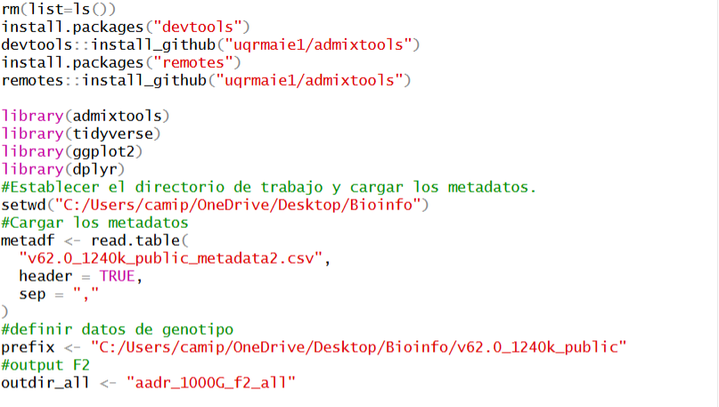

**Figura 1.** Instalación y carga de paquetes, directorio de trabajo, lectura de metadatos y definición de `prefix` y `outdir_all`.

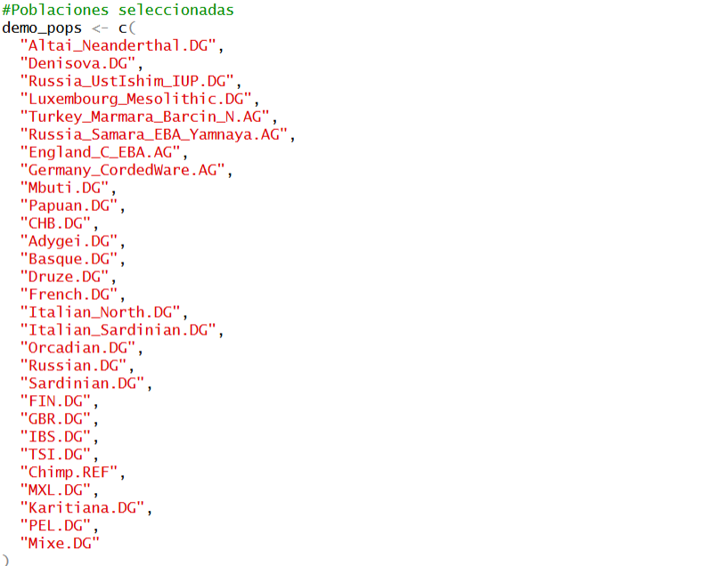

**Figura 2.** Vector `demo_pops` con las 29 poblaciones del tutorial.

## A.2 Bloques f2

### Enunciado

Calcular las estadísticas f2 solo con transversiones y con todos los sitios, y cargar los bloques ya calculados.

### Metodología

Se ejecutó `extract_f2()` dos veces. La primera con `transitions = FALSE` y `transversions = TRUE`, que deja fuera las transiciones porque son las más afectadas por el daño del ADN antiguo, y la segunda con todos los sitios. Luego se cargaron los bloques con `f2_from_precomp()` (Figura 3).

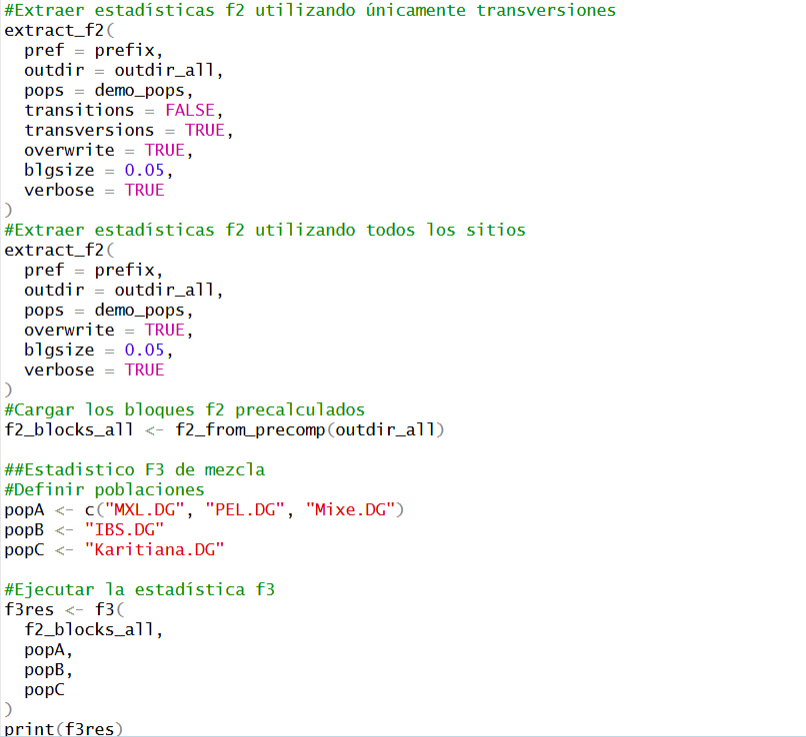

**Figura 3.** Código de `extract_f2()` con transversiones y con todos los sitios, carga de `f2_blocks_all` y primera parte del f3 de mezcla.

### Resultados

Con transversiones quedaron 174.185 SNP. Con todos los sitios quedaron 896.262 SNP, 871.224 polimórficos, en 29 poblaciones y 970 muestras (Figura 4).

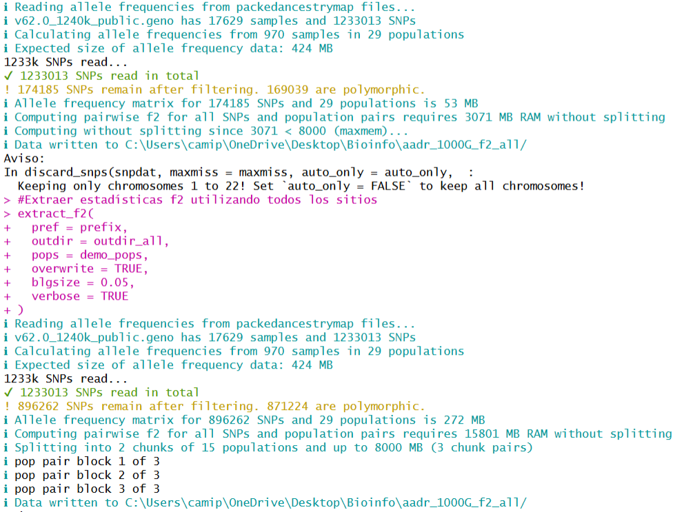

**Figura 4.** Salida de `extract_f2()` para las 29 poblaciones, con transversiones y con todos los sitios.

### Conclusión

Usar solo transversiones deja cerca de una quinta parte de los SNP. Protege de los errores propios del ADN antiguo, pero se pierde poder estadístico. Los análisis siguientes usan los bloques con todos los sitios (`f2_blocks_all`), como indica el tutorial.

## A.3 Estadístico f3 de mezcla

### Enunciado

Evaluar si MXL, PEL y Mixe muestran mezcla entre un componente europeo (ibéricos) y uno indígena americano (Karitiana) con f3(objetivo; ibéricos, Karitiana).

### Metodología

Se definieron los tres objetivos en `popA`, la fuente europea en `popB` y la indígena en `popC`, y se calculó el estadístico con `f3()` sobre `f2_blocks_all` (código en la Figura 3 y en la Figura 5).

### Resultados

MXL tuvo un f3 de −0,0103 (Z = −82,7) y PEL de −0,00579 (Z = −37,6). Los dos son negativos. Mixe tuvo un valor positivo, 0,00574 (Z = 13,9) (Figura 5).

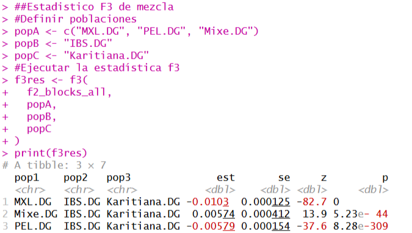

**Figura 5.** f3(objetivo; ibéricos, Karitiana) para MXL, PEL y Mixe.

### Conclusión

Un f3 significativamente negativo indica evidencia de mezcla entre las dos fuentes. MXL y PEL tienen f3 negativo, así que muestran mezcla entre IBS y Karitiana. Mixe tiene f3 positivo, así que con estas fuentes no hay evidencia de mezcla.

## A.4 Estadístico f3 de grupo externo

### Enunciado

Medir la deriva compartida entre el  mesolítico de Luxemburgo y 13 poblaciones actuales de Europa y Oriente próximo, usando Mbuti como grupo externo, y graficar el resultado por región.

### Metodología
El mesolítico se definió como `popA`, las 13 poblaciones actuales como `popB` y Mbuti como `outg`, y se calculó f3(Mbuti; Mesolítico, población) (Figura 6). Después se agregó la región de cada población desde los metadatos y se graficaron las estimaciones (Figura 8).

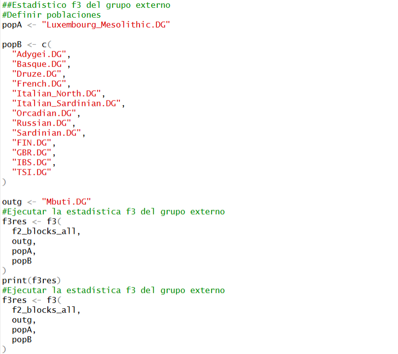

**Figura 6.** Definición de poblaciones y  `f3()` para el f3 de grupo externo.

### Resultados

Las 13 poblaciones tuvieron f3 entre 0,0669 y 0,0750, con Z entre 115 y 135 (Figura 7). Los finlandeses tuvieron el valor más alto (0,0750) y los drusos el más bajo (0,0669), y el gráfico las ordena de mayor a menor deriva compartida (Figura 9).

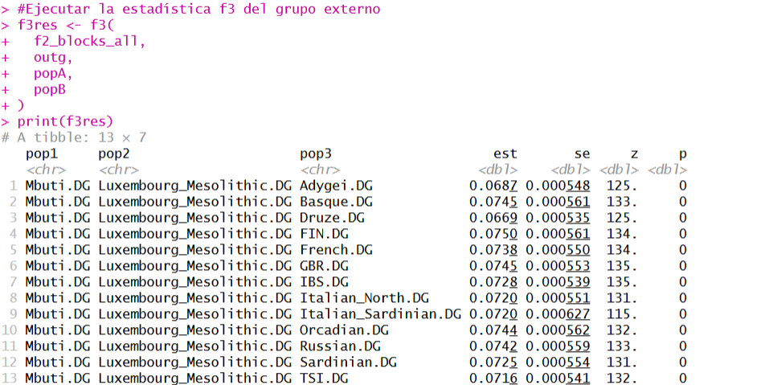

**Figura 7.** f3(Mbuti; Mesolítico, población) para las 13 poblaciones actuales.

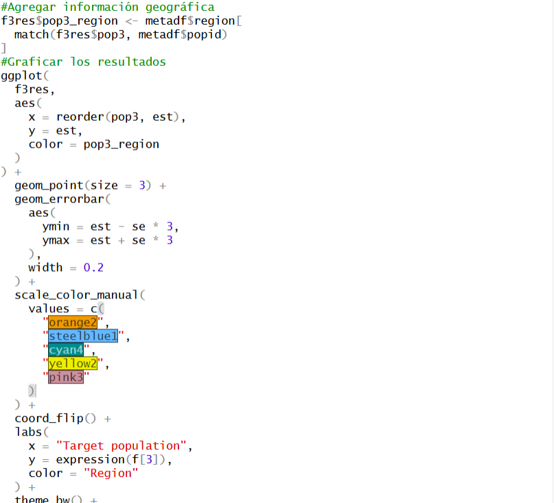

**Figura 8.**  `ggplot2`.

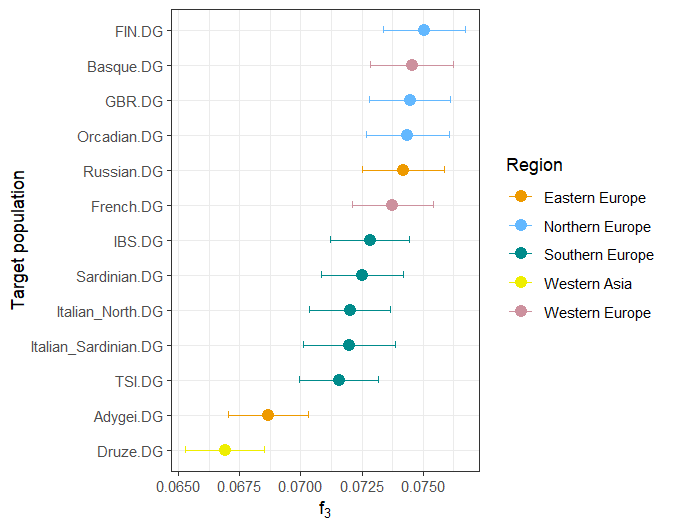

**Figura 9.** Deriva compartida con el  mesolítico por población, ordenada por f3 y coloreada por región.

### Conclusión

FIN tiene el f3 más alto y Druze el más bajo (0,0669). El rango es estrecho, así que las diferencias entre las poblaciones son pequeñas.

## A.5 Estadístico f4 / D

### Enunciado

Probar si pares de poblaciones son simétricas respecto de una tercera con f4(Pop1, Pop2; Pop3, Pop4) y comparar la afinidad de un genoma papú con neandertales y denisovanos.

### Metodología

Con `qpdstat()` se calculó primero f4(británicos, toscanos; Mbuti, Chimp). Después se comparó a los británicos con toscanos, CHB, Mbuti y Papuan usando el neandertal del Altái como tercera población, y por último f4(neandertal, Denisova; Papuan, británicos) (Figura 10).

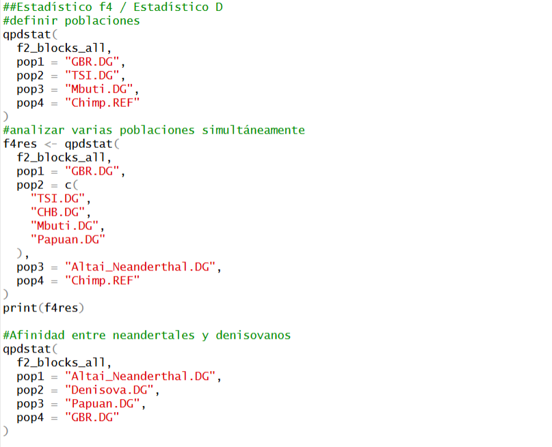

**Figura 10.** Código `qpdstat()` del tutorial.

### Resultados

Británicos frente a toscanos con Mbuti dio f4 = −0,0000832 (Z = −2,32; p = 0,0205). Es un valor cercano a cero (Figura 11). Con el neandertal del Altái, la comparación de los británicos con toscanos (0,0000355; Z = 0,922) y con CHB (−0,000118; Z = −0,705) no se aparta de la simetría. Frente a Mbuti el f4 fue positivo (0,00116; Z = 5,27) y frente a Papuan negativo (−0,000807; Z = −3,40) (Figura 12). En la comparación entre neandertal y Denisova con Papuan y británicos, el f4 fue −0,00135 (Z = −6,25; p = 4,22 × 10⁻¹⁰) (Figura 13).

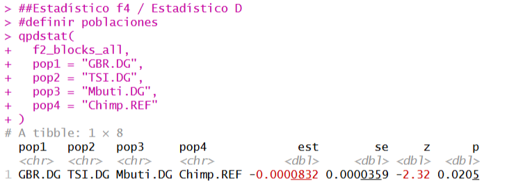

**Figura 11.** f4(británicos, toscanos; Mbuti, Chimp).

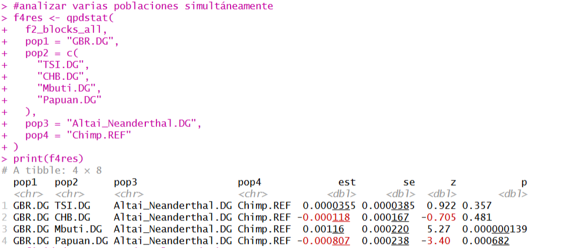

**Figura 12.** f4(británicos, población; neandertal del Altái, Chimp) para toscanos, CHB, Mbuti y Papuan.

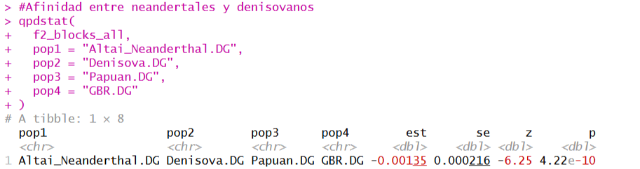

**Figura 13.** f4(neandertal del Altái, Denisova; Papuan, británicos).

### Conclusión

El f4 de GBR y TSI con Mbuti es cercano a cero (Z = −2,32). Con Altai Neanderthal, GBR comparte más alelos que Mbuti (f4 positivo) y menos que Papuan (f4 negativo). En el último f4 el valor negativo indica que Papuan comparte más alelos con Denisova que con Altai Neanderthal, tomando a GBR como referencia.

## A.6 qpWave

### Enunciado

Determinar cuántas corrientes de ancestría independientes se necesitan para explicar England, Barcin, el Mesolítico y Yamnaya respecto de cinco poblaciones.

### Metodología

Se definió England como objetivo y se eligieron Mbuti, Papuan, CHB, Denisova y Russia. Con ellas se ejecutó `qpwave()` poniendo en `left` al objetivo y a las tres fuentes (Figura 14).

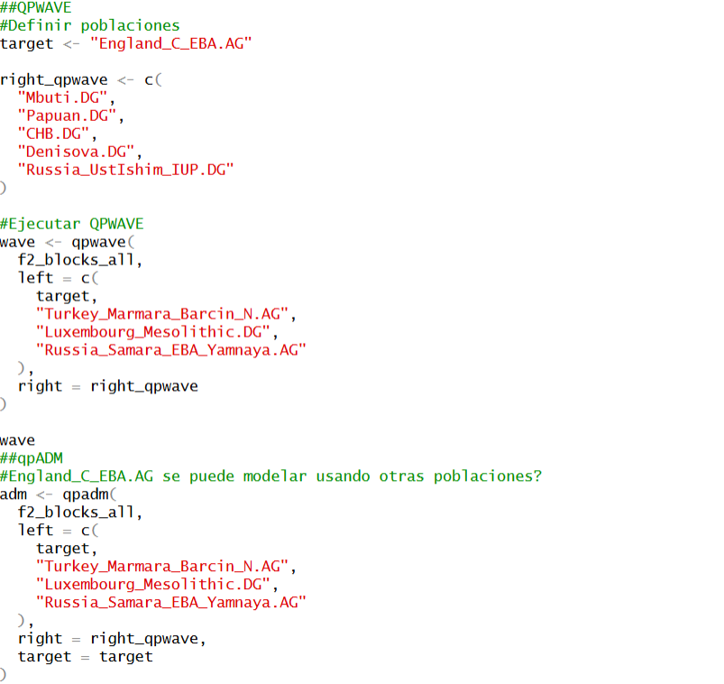

**Figura 14.** Código de qpWave y de qpAdm para England.

### Resultados

qpWave calcula primero los f4 entre `left` y `right` (Figura 15) y luego la tabla `rankdrop`. Se rechazaron los rangos 0 (p = 5,88 × 10⁻⁴⁷) y 1 (p = 0,00263) y no se rechazó el rango 2 (p = 0,667) (Figura 16).

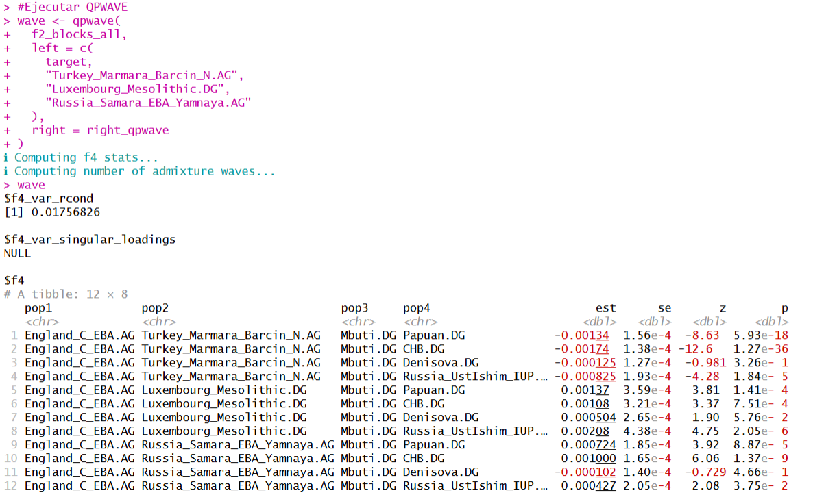

**Figura 15.** Ejecución de `qpwave()` y estadísticos f4 calculados.

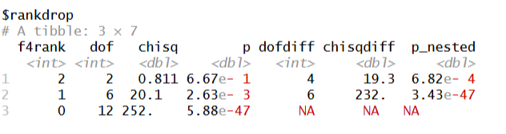

**Figura 16.** Tabla `rankdrop` de qpWave para England y sus tres fuentes.

### Conclusión

Como el rango 2 no se rechaza, tres corrientes de ancestría bastan para explicar las cuatro poblaciones, y menos de tres no alcanzan. 

## A.7 qpAdm

### Enunciado

Modelar England como mezcla de Barcin, el Mesolítico y Russia Yamnaya.

### Metodología

Se ejecutó `qpadm()` con las mismas poblaciones `left` y `right` de qpWave y con England como `target` (código en la Figura 14). Las proporciones de ascendencia y el ajuste de los modelos se vieron con `view(adm$weights)` y `view(adm$popdrop)` (Figura 17).

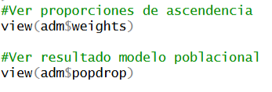

**Figura 17.** Comandos para ver los weights y el resultado del modelo poblacional.

### Resultados

Para England se estimó 0,367 de Barcin (error estándar 0,044), 0,044 del Mesolítico (0,078) y 0,589 de Yamnaya (0,089) (Figura 18). El modelo de tres fuentes no se rechazó (p = 0,667) y el de dos fuentes con Barcin y Yamnaya tampoco (p = 0,760), con weights de 0,368 y 0,632 (Figura 19).

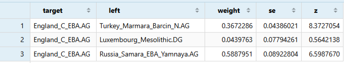

**Figura 18.** Proporciones de ascendencia de England en el modelo de tres fuentes (`adm$weights`).

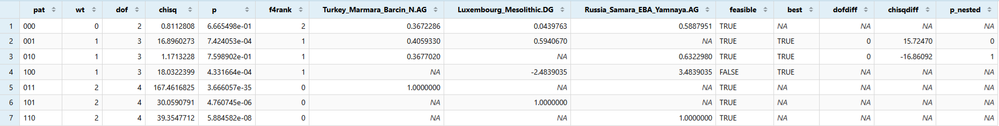

**Figura 19.** Resultado `popdrop` de qpAdm para England.

### Conclusión

El weight de Mesolítico de Luxemburgo en England (0,044) es menor que su error estándar (0,078). El modelo de tres fuentes (p = 0,667) y el de Barcin y Yamnaya (p = 0,760) no se rechazan, así que England se explica con Barcin (0,368) y Yamnaya (0,632) sin necesitar Mesolítico de Luxemburgo

## A.8 Repetición de qpAdm con Germany

### Enunciado

Repetir el análisis de qpAdm usando Germany como objetivo.

### Metodología

Se cambió el objeto `target` por Germany y se volvió a ejecutar `qpadm()` con las mismas fuentes y los mismos `right` (Figura 20).

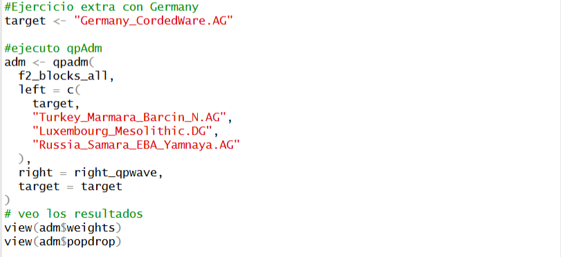

**Figura 20.** Código del ejercicio con Germany.

### Resultados

Los valores fueron 0,157 de Barcin (error estándar 0,072), 0,072 del Mesolítico (0,139) y 0,771 de Yamnaya (0,151) (Figura 21). El modelo de tres fuentes no se rechazó (p = 0,442) y el de Barcin con Yamnaya tampoco (p = 0,521), con valores de 0,161 y 0,839. El de Mesolítico con Yamnaya tuvo p = 0,0363 (Figura 22).

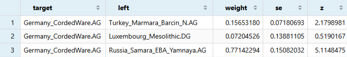

**Figura 21.** Proporciones de ascendencia de Germany en el modelo de tres fuentes.

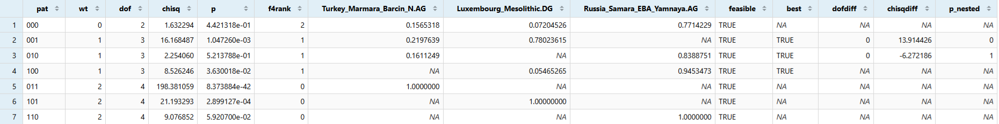

**Figura 22.** Resultado `popdrop` de qpAdm para Germany.

### Conclusión

Germany tiene un weight de Yamnaya de 0,771 en el modelo de tres fuentes, mayor que el de England (0,589). El modelo de Barcin y Yamnaya no se rechaza (p = 0,521), así que Germany también se explica sin Mesolitico de Luxmburg. El modelo sin Barcin, con Mesolítico de Luxemburgo y Yamnaya, se rechaza (p = 0,0363).

---

# Proyectos

## Proyecto  1. ¿Tienen todas las poblaciones europeas actuales la misma mezcla de tres vías?

### Enunciado

Evaluar si poblaciones europeas actuales (británicos, vascos, franceses, italianos del norte, sardos italianos, orcadianos, rusos, sardos, finlandeses, ibéricos y toscanos) tienen la misma mezcla de tres fuentes antiguas, Barcin, Yamnaya y el Mesolítico. Como grupos externos se usan Mbuti, CHB, Papuan, Russia y Denisova.

### Metodología

Se definieron los objetivos, las fuentes y los grupos externos, se calcularon los bloques f2 y se obtuvo el f3 de grupo externo entre cada objetivo y cada fuente. Luego se calcularon tres f4 de asimetría, uno por fuente, con los británicos como pop1 y Mbuti como pop4 (Figura 23). La segunda parte del script corre qpWave y qpAdm para cada población con map_dfr(), con modelos de dos fuentes (Barcin y Yamnaya) y de tres fuentes (Figura 24). Se hizo así porque qpwave() pide que right tenga más poblaciones que left menos uno. Con cinco poblaciones en right, un left de 14 da el error Mat::cols(): indices out of bounds, por lo que  se corrió por cada población objetivo (el objetivo y sus fuentes en left) con map_dfr(), que junta los resultados en una sola tabla.

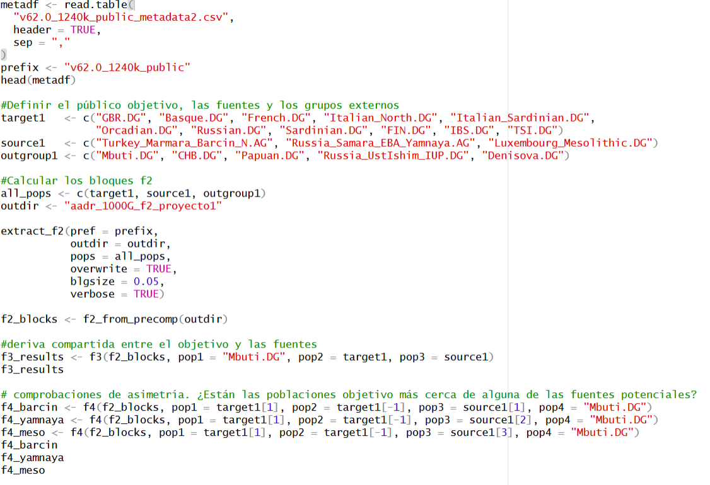

**Figura 23.**  Proyecto 1. Definición de poblaciones, bloques f2, f3 de grupo externo y f4 de asimetría.

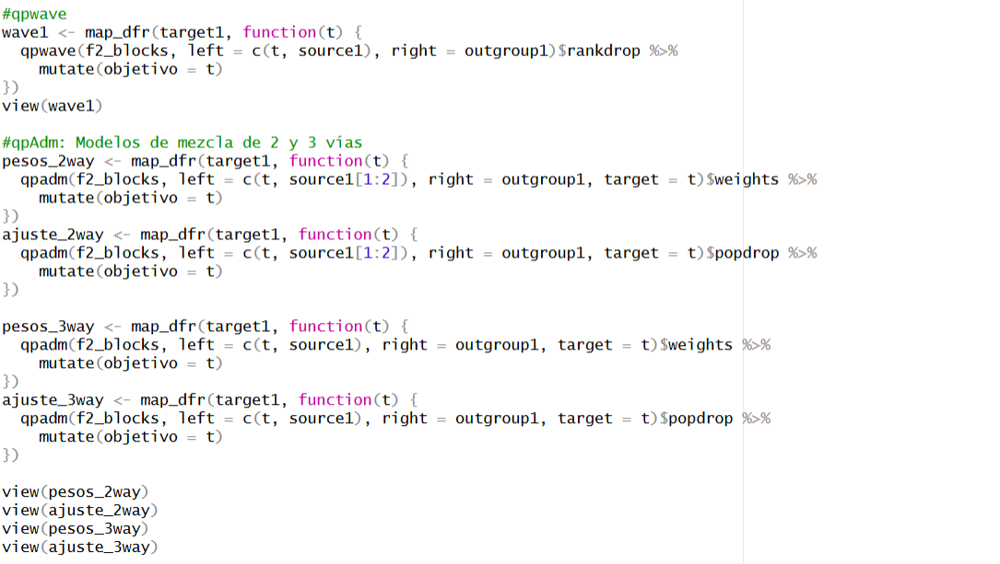

**Figura 24.** Proyecto 1. qpWave por población y qpAdm de dos y tres vías.

### Resultados

**f3 de grupo externo.** Los f3 estuvieron cerca de 0,07 con Z sobre 130 en las filas mostradas. Los vascos, por ejemplo, tuvieron 0,0756 con el Mesolítico, 0,0718 con Yamnaya y 0,0735 con Barcin, y los finlandeses 0,0761, 0,0730 y 0,0712 con las mismas fuentes (Figura 25).

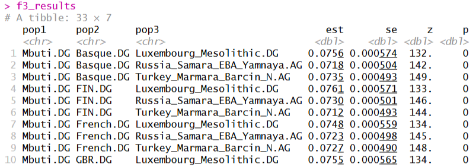

**Figura 25.** Proyecto 1. f3(Mbuti; población, fuente), primeras 10 de 33 filas.

**f4 de asimetría.** Respecto de Barcin, los británicos comparten más alelos que los rusos (0,00158; Z = 20,5) y los finlandeses (0,00124; Z = 21,2), comparten menos que los sardos (−0,00204; Z = −22,4) y no se distinguen de los orcadianos (Z = 1,65) ni de los ibéricos (Z = −0,452) (Figura 26). Respecto de Yamnaya, los británicos comparten más que los ibéricos (0,00203; Z = 37,3), los toscanos (0,00201; Z = 32,8), los sardos (0,00291; Z = 28,8) y los sardos italianos (0,00315; Z = 14,2), y no se distinguen de orcadianos ni finlandeses (Figura 27). Los del  Mesolítico, comparten más que los toscanos (0,00295; Z = 31,5), los italianos del norte (0,00247; Z = 18,9) y los ibéricos (0,00164; Z = 19,1), y menos que los finlandeses (−0,000597; Z = −5,69) (Figura 28).

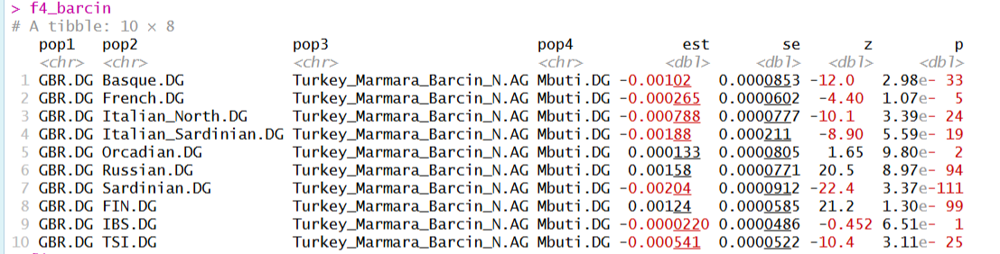

**Figura 26.** Proyecto 1. f4(británicos, población; Barcin, Mbuti).

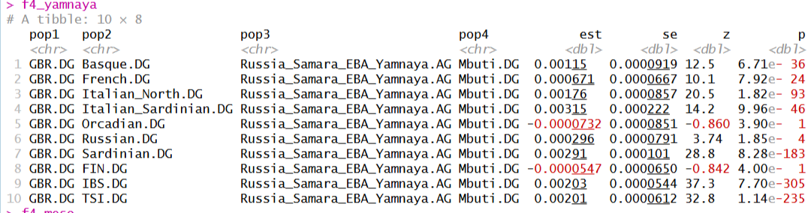

**Figura 27.** Proyecto 1. f4(británicos, población; Yamnaya, Mbuti).

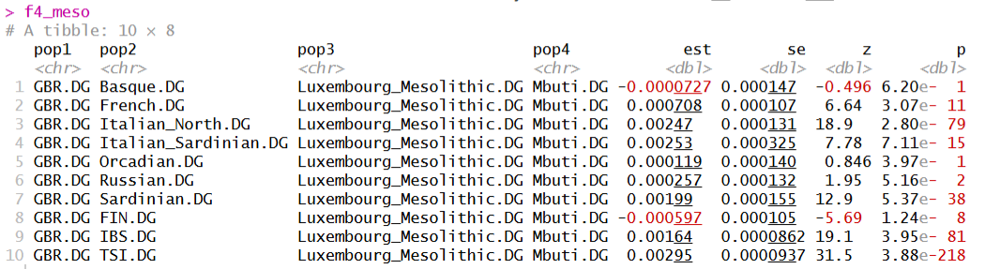

**Figura 28.** Proyecto 1. f4(británicos, población; Mesolítico, Mbuti).

**qpWave.** En las diez poblaciones visibles el rango 2 no se rechazó, con valores de p entre 0,116 (finlandeses) y 0,935 (sardos). El rango 1 se rechazó en todas (p ≤ 2,7 × 10⁻⁴). Cada población necesita entonces tres corrientes de ancestría respecto de los grupos externos (Figura 29).

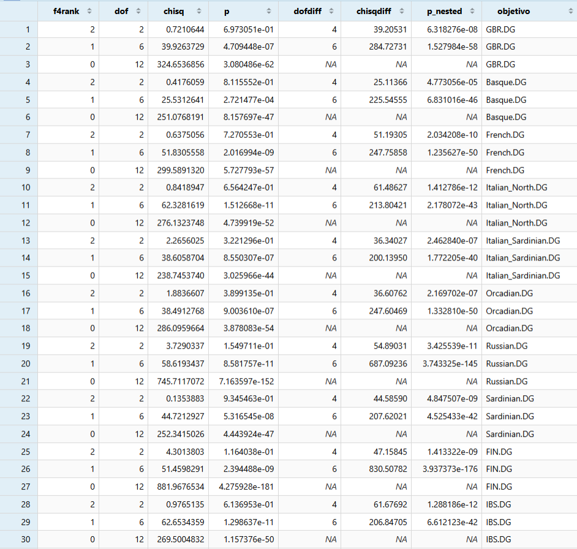

**Figura 29.** Proyecto 1. Tabla `rankdrop` de qpWave por población (30 primeras filas).

**qpAdm de dos vías.** El modelo con Barcin y Yamnaya no se rechazó en los vascos (p = 0,922), los orcadianos (p = 0,123) ni los británicos (p = 0,337, Tabla 1). Sí se rechazó en los franceses (p = 0,018), italianos del norte (p = 4,3 × 10⁻⁵), sardos italianos (p = 0,0047), sardos (p = 0,0037), ibéricos (p = 5,1 × 10⁻⁶) y toscanos (p = 1,0 × 10⁻⁶). En rusos y finlandeses además fue no factible, con weights negativos de Barcin de −0,446 y −0,414 (Figura 30).

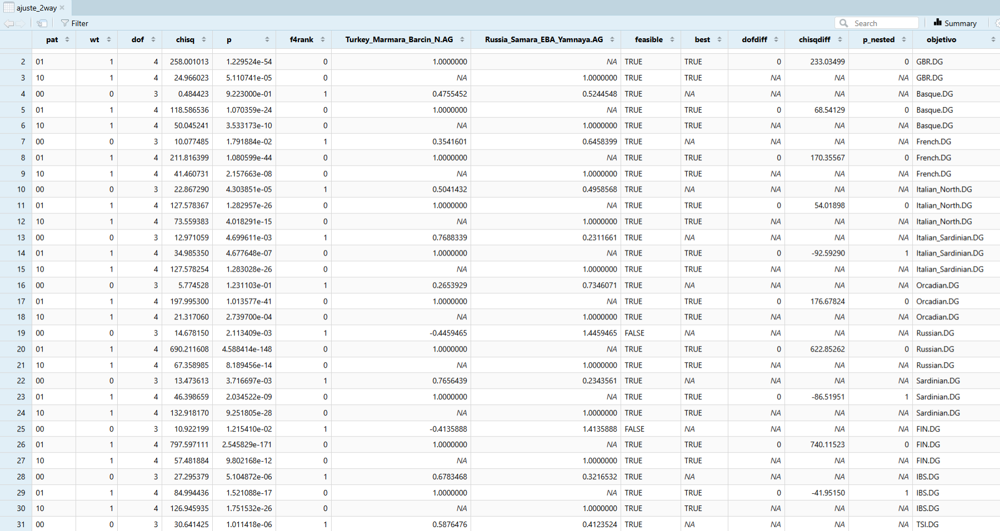

**Figura 30.** Proyecto 1. Ajuste (`popdrop`) del modelo de dos vías, Barcin y Yamnaya, por población.

**qpAdm de tres vías.** Entre las ocho poblaciones con weight mesolítico visible (de británicos a sardos), el weight fue negativo en siete y solo los vascos tuvieron un valor positivo (0,018). Los weights de Barcin fueron negativos en los rusos (−0,349) y los finlandeses (−0,356), con weights de Yamnaya de 1,82 y 1,72 (Figura 31). La tabla de ajuste muestra que el modelo completo no se rechaza en las cinco poblaciones transcritas (p entre 0,32 y 0,81), pero es no factible en británicos, franceses, italianos del norte y sardos italianos por el weight mesolítico negativo. Solo en los vascos es factible (Tabla 1).

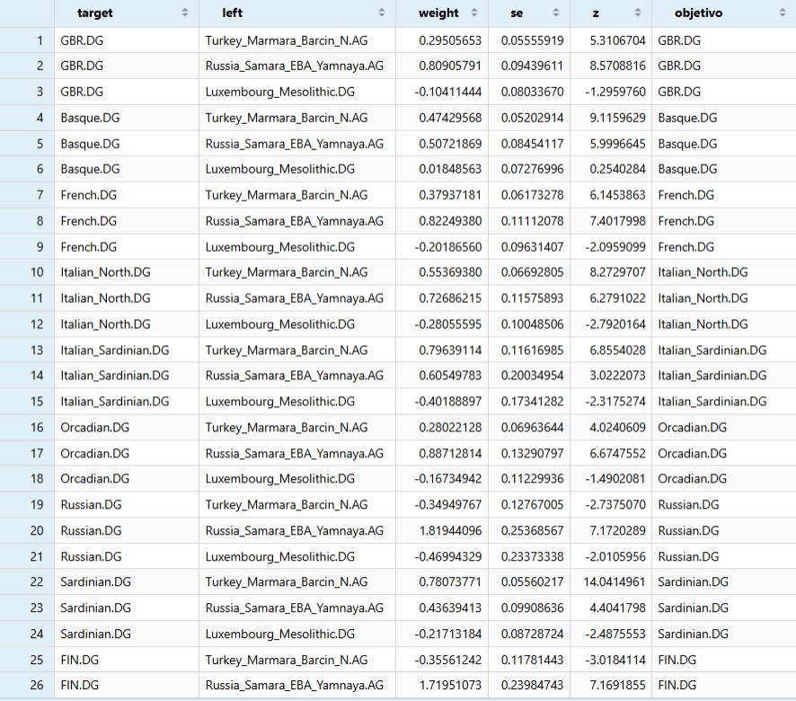

**Figura 31.** Proyecto 1. Weights del modelo qpAdm de tres vías por población (26 primeras filas).

**Tabla 1.** Proyecto 1. Ajuste (`popdrop`) del modelo qpAdm de tres vías, 30 de las 77 filas de `ajuste_3way` (británicos, vascos, franceses, italianos del norte y las dos primeras filas de sardos italianos). En `pat`, un 1 indica la fuente eliminada, en el orden Barcin, Yamnaya y Mesolítico, y `wt` es el número de fuentes eliminadas, por lo tanto no es significativa.

| Objetivo | pat | wt | dof | χ² | p | f4rank | Barcin | Yamnaya | Mesolítico | factible | mejor | dofdiff | chisqdiff | p_nested |
| --- | --- | --- | --- | --- | --- | --- | --- | --- | --- | --- | --- | --- | --- | --- |
| Británicos | 000 | 0 | 2 | 0,72 | 0,697 | 2 | 0,295 | 0,809 | −0,104 | FALSE | NA | NA | NA | NA |
| Británicos | 001 | 1 | 3 | 3,38 | 0,337 | 1 | 0,284 | 0,716 | NA | TRUE | TRUE | 0 | −33,31 | 1 |
| Británicos | 010 | 1 | 3 | 36,69 | 5,34e-8 | 1 | 0,256 | NA | 0,744 | TRUE | TRUE | 0 | 21,68 | 0 |
| Británicos | 100 | 1 | 3 | 15,01 | 0,002 | 1 | NA | 1,543 | −0,543 | FALSE | TRUE | NA | NA | NA |
| Británicos | 011 | 2 | 4 | 257,45 | 1,62e-54 | 0 | 1,000 | NA | NA | TRUE | NA | NA | NA | NA |
| Británicos | 101 | 2 | 4 | 25,33 | 4,32e-5 | 0 | NA | 1,000 | NA | TRUE | NA | NA | NA | NA |
| Británicos | 110 | 2 | 4 | 40,50 | 3,41e-8 | 0 | NA | NA | 1,000 | TRUE | NA | NA | NA | NA |
| Vascos | 000 | 0 | 2 | 0,42 | 0,812 | 2 | 0,474 | 0,507 | 0,018 | TRUE | NA | NA | NA | NA |
| Vascos | 001 | 1 | 3 | 0,50 | 0,919 | 1 | 0,475 | 0,525 | NA | TRUE | TRUE | 0 | −21,79 | 1 |
| Vascos | 010 | 1 | 3 | 22,29 | 5,68e-5 | 1 | 0,535 | NA | 0,465 | TRUE | TRUE | 0 | 0,88 | 0 |
| Vascos | 100 | 1 | 3 | 21,41 | 8,67e-5 | 1 | NA | 3,504 | −2,504 | FALSE | TRUE | NA | NA | NA |
| Vascos | 011 | 2 | 4 | 119,83 | 5,80e-25 | 0 | 1,000 | NA | NA | TRUE | NA | NA | NA | NA |
| Vascos | 101 | 2 | 4 | 52,24 | 1,23e-10 | 0 | NA | 1,000 | NA | TRUE | NA | NA | NA | NA |
| Vascos | 110 | 2 | 4 | 42,61 | 1,25e-8 | 0 | NA | NA | 1,000 | TRUE | NA | NA | NA | NA |
| Franceses | 000 | 0 | 2 | 0,64 | 0,727 | 2 | 0,379 | 0,822 | −0,202 | FALSE | NA | NA | NA | NA |
| Franceses | 001 | 1 | 3 | 10,07 | 0,018 | 1 | 0,355 | 0,645 | NA | TRUE | TRUE | 0 | −35,44 | 1 |
| Franceses | 010 | 1 | 3 | 45,51 | 7,21e-10 | 1 | 0,321 | NA | 0,679 | TRUE | TRUE | 0 | 29,94 | 0 |
| Franceses | 100 | 1 | 3 | 15,57 | 0,001 | 1 | NA | 1,936 | −0,936 | FALSE | TRUE | NA | NA | NA |
| Franceses | 011 | 2 | 4 | 211,30 | 1,39e-44 | 0 | 1,000 | NA | NA | TRUE | NA | NA | NA | NA |
| Franceses | 101 | 2 | 4 | 42,09 | 1,60e-8 | 0 | NA | 1,000 | NA | TRUE | NA | NA | NA | NA |
| Franceses | 110 | 2 | 4 | 50,49 | 2,86e-10 | 0 | NA | NA | 1,000 | TRUE | NA | NA | NA | NA |
| Italianos del norte | 000 | 0 | 2 | 0,84 | 0,656 | 2 | 0,554 | 0,727 | −0,281 | FALSE | NA | NA | NA | NA |
| Italianos del norte | 001 | 1 | 3 | 23,14 | 3,77e-5 | 1 | 0,509 | 0,491 | NA | TRUE | TRUE | 0 | −33,29 | 1 |
| Italianos del norte | 010 | 1 | 3 | 56,44 | 3,39e-12 | 1 | 0,490 | NA | 0,510 | TRUE | TRUE | 0 | 38,16 | 0 |
| Italianos del norte | 100 | 1 | 3 | 18,28 | 3,85e-4 | 1 | NA | 2,883 | −1,883 | FALSE | TRUE | NA | NA | NA |
| Italianos del norte | 011 | 2 | 4 | 128,14 | 9,75e-27 | 0 | 1,000 | NA | NA | TRUE | NA | NA | NA | NA |
| Italianos del norte | 101 | 2 | 4 | 77,44 | 6,06e-16 | 0 | NA | 1,000 | NA | TRUE | NA | NA | NA | NA |
| Italianos del norte | 110 | 2 | 4 | 65,24 | 2,29e-13 | 0 | NA | NA | 1,000 | TRUE | NA | NA | NA | NA |
| Sardos italianos | 000 | 0 | 2 | 2,27 | 0,322 | 2 | 0,796 | 0,605 | −0,402 | FALSE | NA | NA | NA | NA |
| Sardos italianos | 001 | 1 | 3 | 15,60 | 0,001 | 1 | 0,781 | 0,219 | NA | TRUE | TRUE | 0 | −19,19 | 1 |

### Conclusión

Las poblaciones europeas actuales no tienen todas la misma mezcla de tres vías. Solo algunas se explican bien con dos de las fuentes, y las fuentes elegidas no describen bien a todas las poblaciones.

---

## Proyecto 2. Modelo de formación  de la estepa

### Enunciado

Evaluar si Sintashta, Alakul y Srubnaya pueden explicarse como mezcla de Iran y Sidelkino.

### Metodología

Se definieron los tres objetivos, las dos fuentes y los grupos externos, se calcularon los bloques f2 del proyecto y se obtuvo el f3 de grupo externo entre cada objetivo y cada fuente. El f4 de asimetría se calculó como f4(objetivo, Sidelkino; Iran, Mbuti). Por último se corrieron qpWave y qpAdm para cada objetivo con `map_dfr()` (Figura 32).

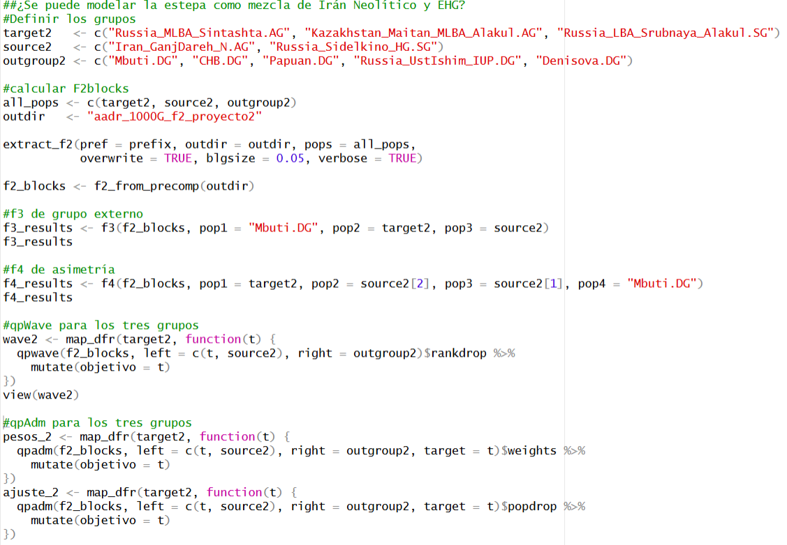

**Figura 32.** Proyecto 2. Código completo del análisis, desde la definición de grupos hasta qpAdm.

### Resultados

**f3 y f4.** En los tres grupos la deriva compartida con Sidelkino (0,0747 a 0,0757) fue mayor que con Iran (0,0674 a 0,0679). El f4(objetivo, Sidelkino; Iran, Mbuti) fue positivo y significativo, con 0,00194 (Z = 5,54) en Sintashta, 0,00213 (Z = 6,00) en Alakul y 0,00162 (Z = 4,61) en Srubnaya (Figura 33).

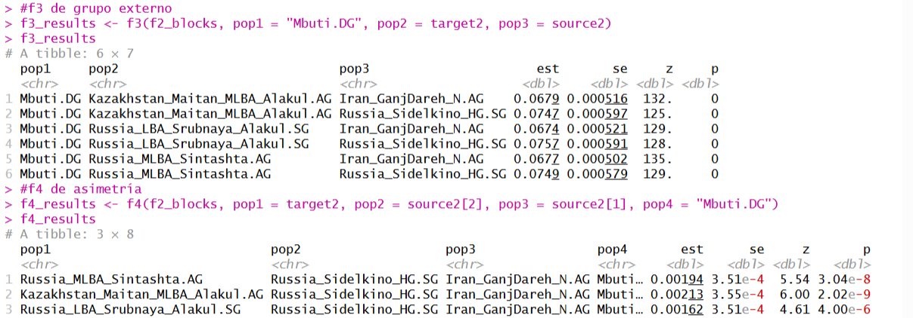

**Figura 33.** Proyecto 2. f3 de grupo externo y f4 de asimetría para los tres grupos de la estepa.

**qpWave.** El rango 1 no se rechazó en ningún grupo (p = 0,667, 0,479 y 0,599) y el rango 0 se rechazó en todos (p entre 10⁻²¹ y 10⁻²⁷). Bastan dos corrientes y una no alcanza (Figura 34).

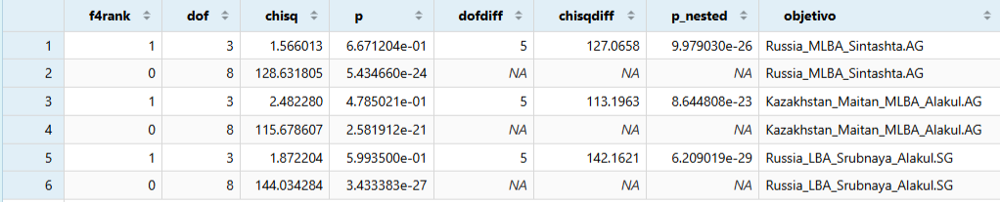

**Figura 34.** Proyecto 2. Tabla `rankdrop` de qpWave para los tres grupos de la estepa.

**qpAdm.** El modelo de dos fuentes no se rechazó en ningún grupo (p = 0,667, 0,479 y 0,599) y fue factible. Los weights de Iran y Sidelkino fueron 0,307 y 0,693 en Sintashta, 0,358 y 0,642 en Alakul, y 0,197 y 0,803 en Srubnaya, con errores estándar de 0,067 a 0,079. Los modelos con Iran como única fuente se rechazaron en los tres grupos (p entre 10⁻¹⁷ y 10⁻²⁷). Los de Sidelkino como única fuente se rechazaron en Sintashta (p = 0,0061) y Alakul (p = 7,8 × 10⁻⁴), pero no en Srubnaya (p = 0,132) (Figura 35).

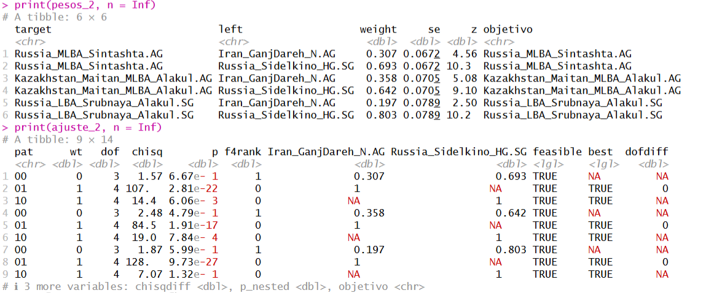

**Figura 35.** Proyecto 2. Weights (`pesos_2`) y ajuste (`ajuste_2`) del modelo qpAdm de dos vías.

### Conclusión

Los tres grupos de la estepa se pueden explicar como una mezcla de Iran y Sidelkino. Sidelkino aporta la mayor parte, entre 64 % y 80 %, y Iran el resto. En uno de los grupos Sidelkino solo también es compatible con los datos, así que ahí el aporte de Iran es menos claro.

---

## Proyecto 3. Poblamiento de las Américas

### Enunciado

Contrastar modelos de varias olas de poblamiento de las Américas (relacionadas con Anzick o con Beringia antigua) y evaluar si algunos grupos tienen afinidad extra con poblaciones australo-melanesias. Se analizan cinco grupos indígenas actuales, Karitiana, Pima, Surui, PEL y Mixe.

### Metodología

Se definieron los cinco grupos objetivo, las tres fuentes antiguas (Anzick, Beringia antigua y Spirit Cave) y los grupos externos, y se calcularon los bloques f2 del proyecto. Se obtuvo el f3 de grupo externo entre cada objetivo y cada fuente y luego tres f4 de olas con pares de fuentes, f4(Anzick, Beringia; objetivo, Mbuti), f4(Anzick, Spirit Cave; objetivo, Mbuti) y f4(Beringia, Spirit Cave; objetivo, Mbuti). Para la afinidad australo-melanesia se calculó un f4 con Karitiana como `pop1` y Papuan como `pop3` (Figura 36). La segunda parte del script corre qpWave y qpAdm por grupo con tres modelos, Anzick con Beringia (A), Beringia con Spirit Cave (B) y las tres fuentes (Figura 37).

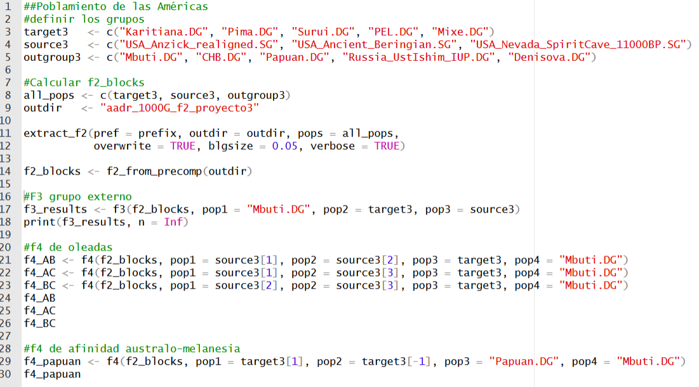

**Figura 36.** Proyecto 3. Definición de grupos, bloques f2, f3 de grupo externo, f4 de olas y f4 de afinidad con Papuan.

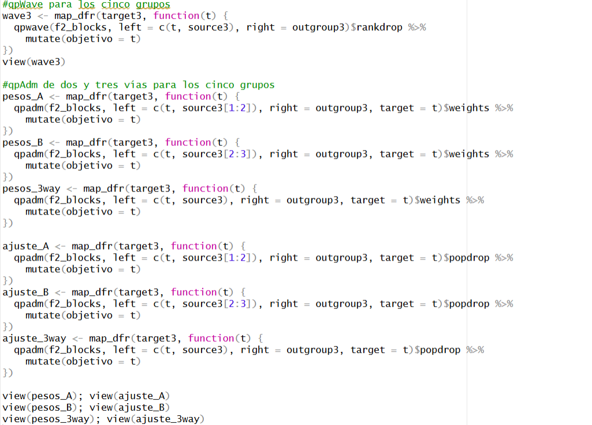

**Figura 37.** Proyecto 3. qpWave por grupo y qpAdm de dos y tres vías.

### Resultados

**f3 de grupo externo.** En los cinco grupos la deriva compartida fue mayor con Spirit Cave (0,0911 a 0,0988), seguida por Anzick (0,0894 a 0,0972) y por Beringia antigua (0,0808 a 0,0863), con Z entre 122 y 144 (Figura 38).

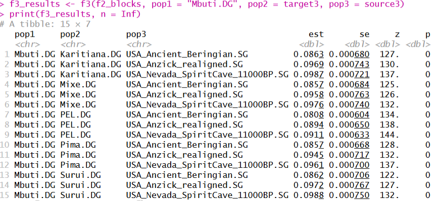

**Figura 38.** Proyecto 3. f3(Mbuti; grupo, fuente) para los cinco grupos y las tres fuentes.

**f4 de olas.** f4(Anzick, Beringia; objetivo, Mbuti) fue positivo en los cinco grupos, entre 0,00862 y 0,0110 (Z entre 14,8 y 17,5). f4(Anzick, Spirit Cave; objetivo, Mbuti) fue negativo y pequeño, entre −0,00162 y −0,00181 (Z entre −2,60 y −3,81), y f4(Beringia, Spirit Cave; objetivo, Mbuti) fue negativo y grande, entre −0,0103 y −0,0126 (Z entre −18,3 y −21,1).

**Afinidad australo-melanesia.** f4(Karitiana, grupo; Papuan, Mbuti) fue positivo para Pima (0,000693; Z = 2,76), PEL (0,00224; Z = 10,9) y Mixe (0,000816; Z = 3,02), y no significativo para Surui (−0,000377; Z = −1,41) (Figura 39).

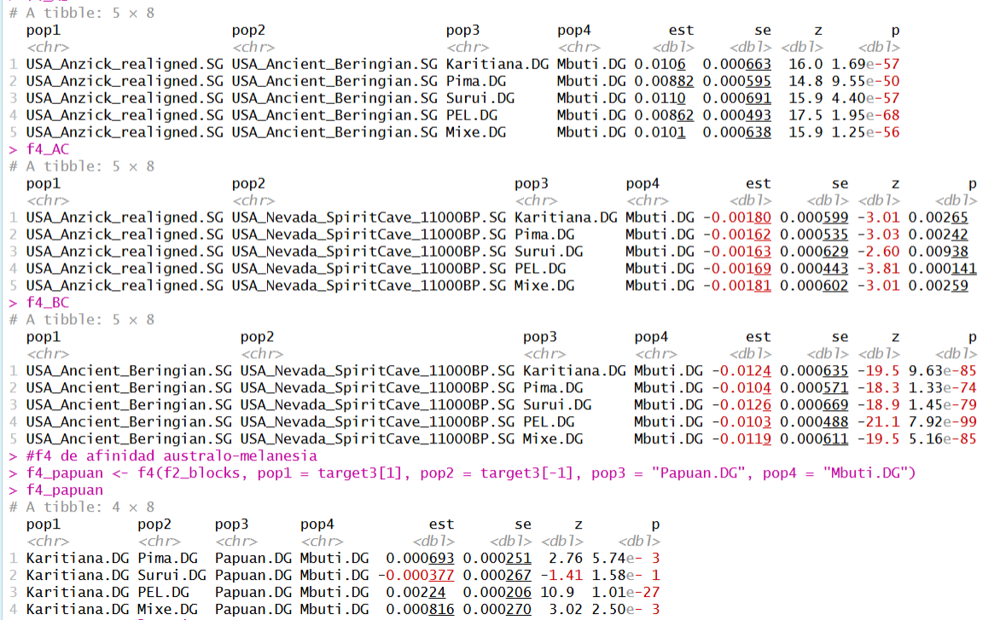

**Figura 39.** Proyecto 3. f4 de olas (f4_AB, f4_AC y f4_BC) y f4 de afinidad con Papuan.

**qpWave.** El rango 2 no se rechazó en ningún grupo (p = 0,090 en Karitiana, 0,718 en Pima, 0,080 en Surui, 0,140 en PEL y 0,944 en Mixe). El rango 1 no se rechazó en Karitiana (p = 0,054), Pima (0,458) ni Mixe (0,512), pero sí en Surui (0,046) y PEL (0,032). Para los tres primeros bastan dos corrientes, y Surui y PEL necesitan tres (Figura 40).

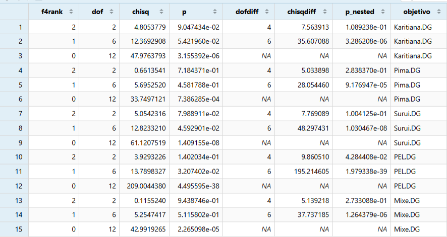

**Figura 40.** Proyecto 3. Tabla `rankdrop` de qpWave para los cinco grupos indígenas.

**qpAdm, modelo A (Anzick y Beringia).** Los weights de Anzick fueron negativos en los cinco grupos (entre −3,06 y −9,95) y los de Beringia mayores que 1 (entre 4,06 y 10,9), con errores estándar entre 6,0 y 27,7 y Z menores que 0,7 en valor absoluto (Tabla 2).

**Tabla 2.** Proyecto 3. Weights del modelo qpAdm A (Anzick y Beringia antigua) por grupo (`pesos_A`).

| target | left | weight | se | Z |
| --- | --- | --- | --- | --- |
| Karitiana | Anzick | −8,12 | 27,7 | −0,293 |
| Karitiana | Beringia antigua | 9,12 | 27,7 | 0,329 |
| Pima | Anzick | −3,06 | 6,00 | −0,510 |
| Pima | Beringia antigua | 4,06 | 6,00 | 0,676 |
| Surui | Anzick | −5,88 | 10,9 | −0,540 |
| Surui | Beringia antigua | 6,88 | 10,9 | 0,631 |
| PEL | Anzick | −9,95 | 27,1 | −0,366 |
| PEL | Beringia antigua | 10,9 | 27,1 | 0,403 |
| Mixe | Anzick | −5,06 | 10,3 | −0,490 |
| Mixe | Beringia antigua | 6,06 | 10,3 | 0,586 |

El ajuste del modelo A muestra que el modelo completo no se rechazó en ningún grupo (p entre 0,144 y 0,174), pero no fue factible en ninguno por el weight negativo de Anzick. Los modelos con una sola fuente se rechazaron en los cinco grupos, tanto con Anzick (p entre 1,6 × 10⁻¹¹ y 7,9 × 10⁻⁵) como con Beringia antigua (p entre 3,1 × 10⁻⁸ y 0,0101) (Figura 41).

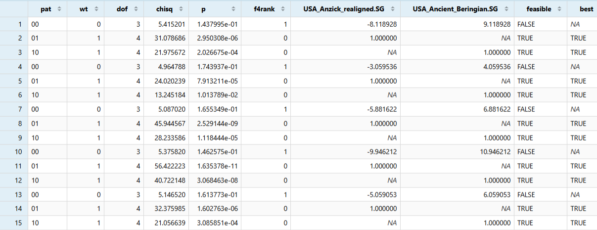

**Figura 41.** Proyecto 3. Ajuste (`popdrop`) del modelo qpAdm A, Anzick y Beringia antigua, por grupo. 

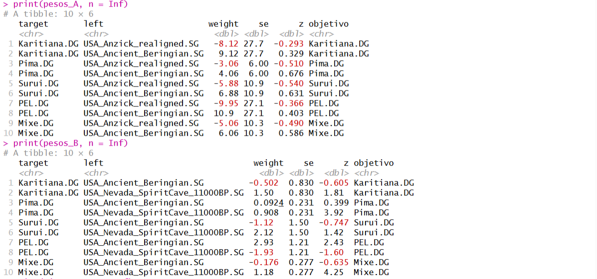

**Figura 42.** Proyecto 3. Weights de los modelos qpAdm A (`pesos_A`) y B (`pesos_B`) por grupo.

**qpAdm, modelo B (Beringia y Spirit Cave).** Los weights  aparecen en la Figura 42. En Karitiana, Surui, PEL y Mixe uno de los dos weights fueron negativos, y solo en Pima ambos fueron positivos (Beringia 0,092 y Spirit Cave 0,908; Z = 3,92). El modelo completo solo fue factible en Pima, con weights de 0,092 para Beringia y 0,908 para Spirit Cave (p = 0,856). Los modelos con Spirit Cave como única fuente no se rechazaron en Pima (p = 0,916), Mixe (p = 0,912) ni Karitiana (p = 0,072), y sí en Surui (p = 0,004) y PEL (p = 1,5 × 10⁻²⁴). Los modelos con Beringia como única fuente se rechazaron en los cinco grupos (Figura 43).

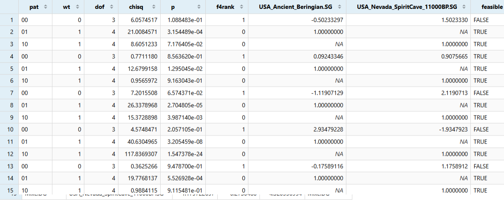

**Figura 43.** Proyecto 3. Ajuste (`popdrop`) del modelo qpAdm B, Beringia y Spirit Cave, por grupo.

**qpAdm de tres vías.** Los errores estándar fueron grandes en Karitiana, Surui y PEL (por ejemplo −9,75 con error estándar 674 en Surui).” Solo en Pima (Spirit Cave 0,915; Z = 3,9) y Mixe (Spirit Cave 1,18; Z = 4,3) el weight de Spirit Cave fue significativo (Figura 44).

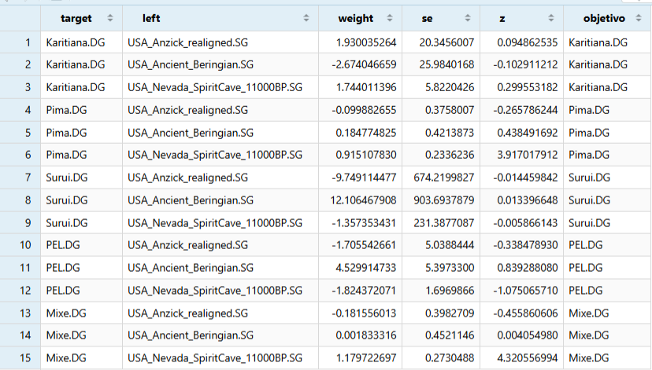

**Figura 44.** Proyecto 3. Weights del modelo qpAdm de tres vías por grupo.

El ajuste del modelo de tres vías muestra que el modelo completo no se rechazó en ningún grupo (p entre 0,080 y 0,944), pero no fue factible en ninguno porque siempre hubo algún weight negativo. De los modelos de dos fuentes solo fueron factibles los de Pima, con Anzick y Spirit Cave (p = 0,814) y con Beringia y Spirit Cave (p = 0,841). El modelo con Spirit Cave como única fuente no se rechazó en Pima (p = 0,908) ni en Mixe (p = 0,905), quedó en el límite en Karitiana (p = 0,0535) y se rechazó en Surui (p = 0,0022) y PEL (p = 1,0 × 10⁻²⁴) (Tabla 3).

**Tabla 3.** Proyecto 3. Ajuste (`popdrop`) del modelo qpAdm de tres vías por grupo (`ajuste_3way`).

| Objetivo | pat | wt | dof | χ² | p | f4rank | Anzick | Beringia | Spirit | factible | mejor | dofdiff | chisqdiff | p_nested |
|---|---|---|---|---|---|---|---|---|---|---|---|---|---|---|
| Karitiana | 000 | 0 | 2 | 4,81 | 0,090 | 2 | 1,930 | −2,674 | 1,744 | FALSE | NA | NA | NA | NA |
| Karitiana | 001 | 1 | 3 | 5,44 | 0,143 | 1 | −7,747 | 8,747 | NA | FALSE | TRUE | 0 | −1,97 | 1 |
| Karitiana | 010 | 1 | 3 | 7,41 | 0,060 | 1 | −0,309 | NA | 1,309 | FALSE | TRUE | 0 | 1,09 | 0 |
| Karitiana | 100 | 1 | 3 | 6,32 | 0,097 | 1 | NA | −0,585 | 1,585 | FALSE | TRUE | NA | NA | NA |
| Karitiana | 011 | 2 | 4 | 32,86 | 1,28e-6 | 0 | 1,000 | NA | NA | TRUE | NA | NA | NA | NA |
| Karitiana | 101 | 2 | 4 | 22,20 | 1,83e-4 | 0 | NA | 1,000 | NA | TRUE | NA | NA | NA | NA |
| Karitiana | 110 | 2 | 4 | 9,32 | 0,054 | 0 | NA | NA | 1,000 | TRUE | NA | NA | NA | NA |
| Pima | 000 | 0 | 2 | 0,66 | 0,718 | 2 | −0,100 | 0,185 | 0,915 | FALSE | NA | NA | NA | NA |
| Pima | 001 | 1 | 3 | 5,00 | 0,172 | 1 | −2,929 | 3,929 | NA | FALSE | TRUE | 0 | 4,05 | 0 |
| Pima | 010 | 1 | 3 | 0,95 | 0,814 | 1 | 0,021 | NA | 0,979 | TRUE | TRUE | 0 | 0,11 | 0 |
| Pima | 100 | 1 | 3 | 0,83 | 0,841 | 1 | NA | 0,090 | 0,910 | TRUE | TRUE | NA | NA | NA |
| Pima | 011 | 2 | 4 | 24,86 | 5,37e-5 | 0 | 1,000 | NA | NA | TRUE | NA | NA | NA | NA |
| Pima | 101 | 2 | 4 | 13,33 | 0,010 | 0 | NA | 1,000 | NA | TRUE | NA | NA | NA | NA |
| Pima | 110 | 2 | 4 | 1,01 | 0,908 | 0 | NA | NA | 1,000 | TRUE | NA | NA | NA | NA |
| Surui | 000 | 0 | 2 | 5,05 | 0,080 | 2 | −9,749 | 12,106 | −1,357 | FALSE | NA | NA | NA | NA |
| Surui | 001 | 1 | 3 | 5,10 | 0,165 | 1 | −5,803 | 6,803 | NA | FALSE | TRUE | 0 | −2,98 | 1 |
| Surui | 010 | 1 | 3 | 8,08 | 0,044 | 1 | −0,797 | NA | 1,797 | FALSE | TRUE | 0 | 0,69 | 0 |
| Surui | 100 | 1 | 3 | 7,39 | 0,060 | 1 | NA | −1,264 | 2,264 | FALSE | TRUE | NA | NA | NA |
| Surui | 011 | 2 | 4 | 48,73 | 6,65e-10 | 0 | 1,000 | NA | NA | TRUE | NA | NA | NA | NA |
| Surui | 101 | 2 | 4 | 28,65 | 9,21e-6 | 0 | NA | 1,000 | NA | TRUE | NA | NA | NA | NA |
| Surui | 110 | 2 | 4 | 16,68 | 0,002 | 0 | NA | NA | 1,000 | TRUE | NA | NA | NA | NA |
| PEL | 000 | 0 | 2 | 3,93 | 0,140 | 2 | −1,706 | 4,530 | −1,824 | FALSE | NA | NA | NA | NA |
| PEL | 001 | 1 | 3 | 5,45 | 0,142 | 1 | −9,857 | 10,857 | NA | FALSE | TRUE | 0 | −5,04 | 1 |
| PEL | 010 | 1 | 3 | 10,49 | 0,015 | 1 | 3,472 | NA | −2,472 | FALSE | TRUE | 0 | 5,89 | 0 |
| PEL | 100 | 1 | 3 | 4,60 | 0,203 | 1 | NA | 2,936 | −1,936 | FALSE | TRUE | NA | NA | NA |
| PEL | 011 | 2 | 4 | 57,01 | 1,23e-11 | 0 | 1,000 | NA | NA | TRUE | NA | NA | NA | NA |
| PEL | 101 | 2 | 4 | 40,90 | 2,82e-8 | 0 | NA | 1,000 | NA | TRUE | NA | NA | NA | NA |
| PEL | 110 | 2 | 4 | 118,68 | 1,02e-24 | 0 | NA | NA | 1,000 | TRUE | NA | NA | NA | NA |
| Mixe | 000 | 0 | 2 | 0,12 | 0,944 | 2 | −0,182 | 0,002 | 1,180 | FALSE | NA | NA | NA | NA |
| Mixe | 001 | 1 | 3 | 5,17 | 0,160 | 1 | −4,921 | 5,921 | NA | FALSE | TRUE | 0 | 5,05 | 0 |
| Mixe | 010 | 1 | 3 | 0,12 | 0,989 | 1 | −0,180 | NA | 1,180 | FALSE | TRUE | 0 | −0,27 | 1 |
| Mixe | 100 | 1 | 3 | 0,39 | 0,942 | 1 | NA | −0,176 | 1,176 | FALSE | TRUE | NA | NA | NA |
| Mixe | 011 | 2 | 4 | 33,69 | 8,64e-7 | 0 | 1,000 | NA | NA | TRUE | NA | NA | NA | NA |
| Mixe | 101 | 2 | 4 | 21,29 | 2,77e-4 | 0 | NA | 1,000 | NA | TRUE | NA | NA | NA | NA |
| Mixe | 110 | 2 | 4 | 1,03 | 0,905 | 0 | NA | NA | 1,000 | TRUE | NA | NA | NA | NA |

### Conclusión

Los cinco grupos están más cerca de Spirit Cave que de las otras dos fuentes. Con las tres fuentes juntas los weight no son estables, y no se puede decir cuánto aporta cada una. Spirit Cave solo explica bien a dos de los grupos, y los otros necesitan más de una corriente.

---

## Proyecto 4. Mezcla medieval ibérica

### Enunciado

Evaluar si la población ibérica actual (IBS) puede explicarse como mezcla de Visigoth, Mozabite y YRI. Como grupos externos se usan Mbuti, Han, CHB, Papuan y Russia.

### Metodología

Se definieron los ibéricos como objetivo, Visigoth, Mozabite y YRI como fuentes, y se calcularon los bloques f2 con `maxmem = 1000` para que no arrojara el error `std::bad_alloc`. Después se obtuvo el f3 de grupo externo de los ibéricos con cada fuente, dos f4 de asimetría con Visigoth como `pop2`, qpWave y los modelos qpAdm de dos y tres fuentes, que se revisaron con `summary()` (Figura 45).El identificador NorthAfrican_Ancient.DG de las pistas no está en la metadata, por lo que se usó Mozabite como fuente norafricana.

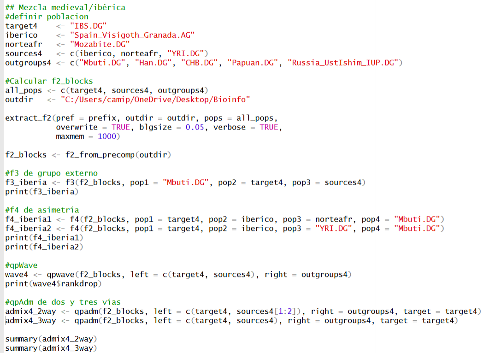

**Figura 45.** Proyecto 4. Definición de poblaciones, bloques f2, f3, f4, qpWave y qpAdm.

### Resultados

**f3 de grupo externo.** Los ibéricos comparten más deriva con Visigoth (0,0679) que con Mozabite (0,0589) y YRI (0,0235) (Figura 46).

**f4 de asimetría.** f4(ibéricos, Visigoth; Mozabite, Mbuti) fue positivo (0,000852; Z = 6,88; p = 6,04 × 10⁻¹²) y f4(ibéricos, Visigoth; YRI, Mbuti) fue negativo y pequeño (−0,000230; Z = −3,34; p = 0,000846) (Figura 46).

**qpWave.** Los rangos 2 y 1 se rechazaron (p = 4,92 × 10⁻⁸ y 3,88 × 10⁻⁷), igual que el rango 0 (Figura 46).

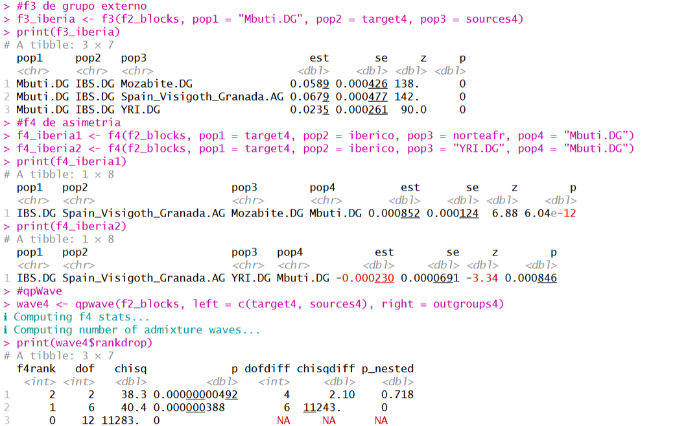

**Figura 46.** Proyecto 4. f3 de grupo externo, f4 de asimetría y tabla `rankdrop` de qpWave para los ibéricos y sus tres fuentes.

**qpAdm de dos vías.** El weight fue 1,2014 (error estándar 0,0266) para Visigoth y −0,2014 (0,0266) para Mozabite (Figura 47).

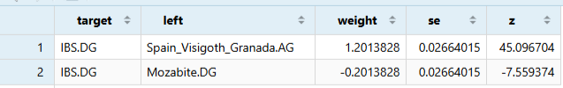

**Figura 47.** Proyecto 4. Weights del modelo qpAdm de dos vías (Visigoth y Mozabite) para los ibéricos.

**qpAdm de tres vías.** Los weights fueron −1,238 (error estándar 2,75) para Visigoth, 2,861 (3,45) para Mozabite y −0,623 (0,700) para YRI (Figura 48).

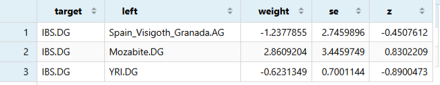

**Figura 48.** Proyecto 4. weights del modelo qpAdm de tres vías para los ibéricos.

### Conclusión

A partir de los resultados, la población ibérica actual no se explica como mezcla de Visigoth, Mozabite y YRI. Se observa que los ibéricos comparten más deriva con Visigoth que con Mozabite y YRI. Sin embargo, qpWave rechazó que tres corrientes de ancestría bastaran para explicar a los ibéricos y sus fuentes. Además, en qpAdm el weight de Visigoth fue mayor que 1 y el de Mozabite negativo, y en tres vías los errores estándar fueron muy grandes. Con estas fuentes no se logra modelar a la población ibérica actual

---


# Conclusión general
La actividad permitió aplicar paso a paso el análisis de genética de poblaciones con ADMIXTOOLS, desde el cálculo de los bloques f2 hasta los modelos de mezcla con qpAdm. Cada estadístico respondió una pregunta distinta y se apoyó en los anteriores, y los cuatro proyectos mostraron que los resultados cambian según las poblaciones que se eligen como fuentes y como grupos externos. Fue útil para aprender a plantear un análisis completo e interpretar su resultado. 
A nivel personal, me pareció un tema muy interesante ya que permite responder con datos cómo se formó una población y de dónde viene su ancestría, lo que ayuda a entender la historia del poblamiento humano y la diversidad genética actual, aun así, la interpretación de resultados se me hizo difícil en algunos casos.


---

