# Tarea 3.1 — Análisis de secuencias 

**Curso:** Bioinformática e investigación reproducible para análisis genómicos  **Unidad 3:** Análisis de secuencias  **Estudiante:** Camila Astorga  **Profesor:** Ricardo Verdugo  **Institución:** Facultad de Ciencias Químicas y Farmacéuticas, Universidad de Chile  
**Fecha:** 18-11-2026  **Repositorio:** <https://github.com/camipez/Tareas_BioinfRepro2026_CPA>

---

## Objetivos

### Objetivo general

Aplicar un flujo de filtrado de lecturas, alineamiento contra el genoma de referencia hg19 y llamado de variantes con GATK sobre los datos de la muestra S11, evaluando la calidad del alineamiento y el potencial patogénico de las variantes detectadas en el panel de genes secuenciado.

### Objetivos específicos

- Filtrar las lecturas crudas con BBDuk, eliminando adaptadores, contaminación con phix y bases de baja calidad.
- Alinear las lecturas filtradas contra hg19.
- Evaluar la calidad del alineamiento con qualimap e identificar una lectura con soft-clipping.
- Recalibrar las calidades de base y llamar variantes con GATK, separando SNPs e InDels.
- Filtrar las variantes por profundidad de cobertura y por un segundo criterio propuesto.
- Anotar las variantes con VEP y evaluar su significancia clínica y puntaje CADD.

---

## Contenido de este directorio

| Ruta | Contenido |
|---|---|
| `figuras/` | Capturas de pantalla del proceso  |
| `Archivos/` | Reporte de qualimap completo (`qualimapReport.html`, `images_qualimapReport/`, `raw_data_qualimapReport/`), `S11_sorted_RG.bam`, la tabla de anotación de VEP (`S11_FILTER_VARIANTS_2026-11-23-01-09_VEP.tsv`) y el resultado del filtrado en R (`S11_variantes_filtradas.csv`). |

---

## Desarrollo

### Preparación del entorno

El trabajo se hizo por ssh en el servidor genoma.med.uchile.cl, dentro de mi carpeta personal `castorga`, cargando los módulos de cada programa antes de usarlo (BBMap, bwa, samtools, qualimap, y las rutas directas a Picard y GATK).

```bash
ssh -Y bioinfo1@genoma.med.uchile.cl
cd castorga
module load BBMap
```

#### Resultados

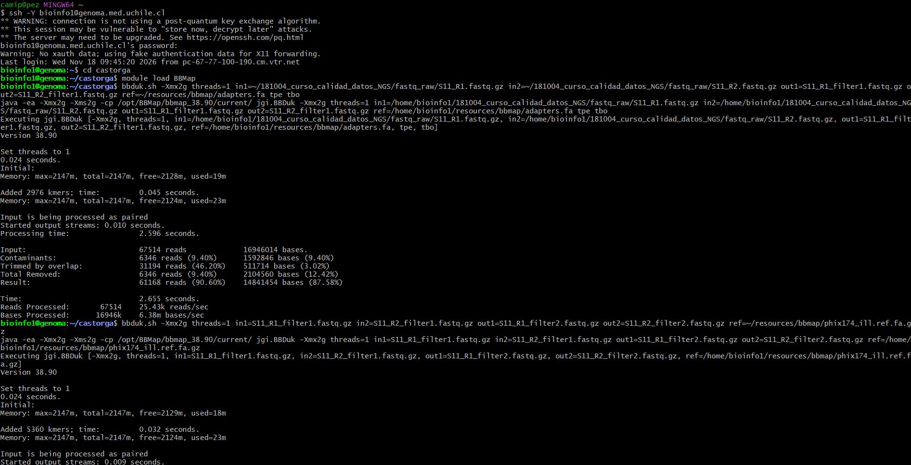

**Figura 1.** *Registro de la conexión al servidor, el ingreso a la carpeta castorga, la carga del módulo BBMap y el primer paso de filtrado con bbduk sobre la muestra S11, con 67.514 lecturas de entrada y 61.168 retenidas tras eliminar adaptadores.*

---

### Tarea 1.1 — Alineamiento contra hg19

> *Realizar el alineamiento contra el genoma humano hg19 de las lecturas R1 y R2 del paciente seleccionado para la tarea de control de calidad de lecturas de secuencia.*

#### Metodología

Las lecturas de S11 se filtraron con BBDuk en tres pasos (adaptadores, phix, calidad) y se alinearon contra hg19 con BWA-MEM. El BAM resultante se convirtió desde SAM, se ordenó por posición, se le añadió el ReadGroup y se indexó.

```bash
bwa mem -t 4 -M /datos/reference/genomes/hg19_reference/hg19.fasta S11_R1_filter3.fastq.gz S11_R2_filter3.fastq.gz > S11.sam
java -jar /opt/picard/picard-2.25.2/picard.jar SamFormatConverter -I S11.sam -O S11.bam
java -jar /opt/picard/picard-2.25.2/picard.jar SortSam -I S11.bam -O S11_sorted.bam -SO coordinate
java -jar /opt/picard/picard-2.25.2/picard.jar AddOrReplaceReadGroups -I S11_sorted.bam -O S11_sorted_RG.bam -ID sample -LB Paired-end -PL Illumina -PU Unknown -SM sample
samtools index S11_sorted_RG.bam
```

#### Conclusión

El alineamiento se completó y quedó disponible como `S11_sorted_RG.bam.

### Tarea 1.2 — Lectura con soft-clipping y código CIGAR

> *Utilizando una línea de comando, encuentre la primera lectura en el archivo SAM que contenga bases enmascaradas (secuencias suavizadas por soft-clipping)
Muestre el registros de la lecturas en el archivo SAM e identifique y explique el código CIGAR de esa lectura.*

#### Metodología

Se buscó, entre las líneas del SAM:

```bash
grep -v "^@" S11.sam | awk '$6 ~ /S/' | head -1
```

#### Resultados

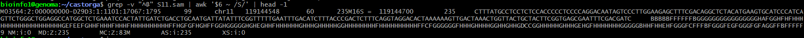

**Figura 2.** *Primera lectura del SAM con soft-clipping, en chr11:119144548, con CIGAR 235M16S.*


#### Conclusión

El CIGAR 235M16S indica que, de los 251 pb de la lectura, las primeras 235 bases alinearon con la referenci y las últimas 16 quedaron fuera del alineamiento por soft-clipping. Esas 16 bases se conservan en la secuencia del read y en el archivo SAM, pero no cuentan en la posición de referencia ni en la identidad del alineamiento, lo habitual cuando el extremo de una lectura no calza con la referencia.

---

### Tarea 1.3 — Reporte de calidad con qualimap

> *Generar un reporte técnico de calidad del alineamiento con qualimap.*

#### Metodología

```bash
module load qualimap
export JAVA_OPTS="-Xms32m -Xmx1200M -Djava.awt.headless=true"
qualimap bamqc -bam S11_sorted_RG.bam -gff ~/181004_curso_calidad_datos_NGS/regiones_blanco.bed -outdir ./S11_sorted_RG
```

El modo headless fue necesario porque el servidor no tiene una conexión gráfica para dibujar los gráficos del reporte y no se generaba.


---

### Tarea 1.4 — Selección de figuras e interpretación de resultados

> *Seleccionar 4 figuras informativas sobre la calidad de los datos y del ensamble, incluirlas en resultados con leyenda descriptiva, interpretarlas enfocándose en posibles problemas con los datos o el alineamiento, y comentar potenciales razones. Incluir una sección de conclusiones para la muestra.*

#### Resultados

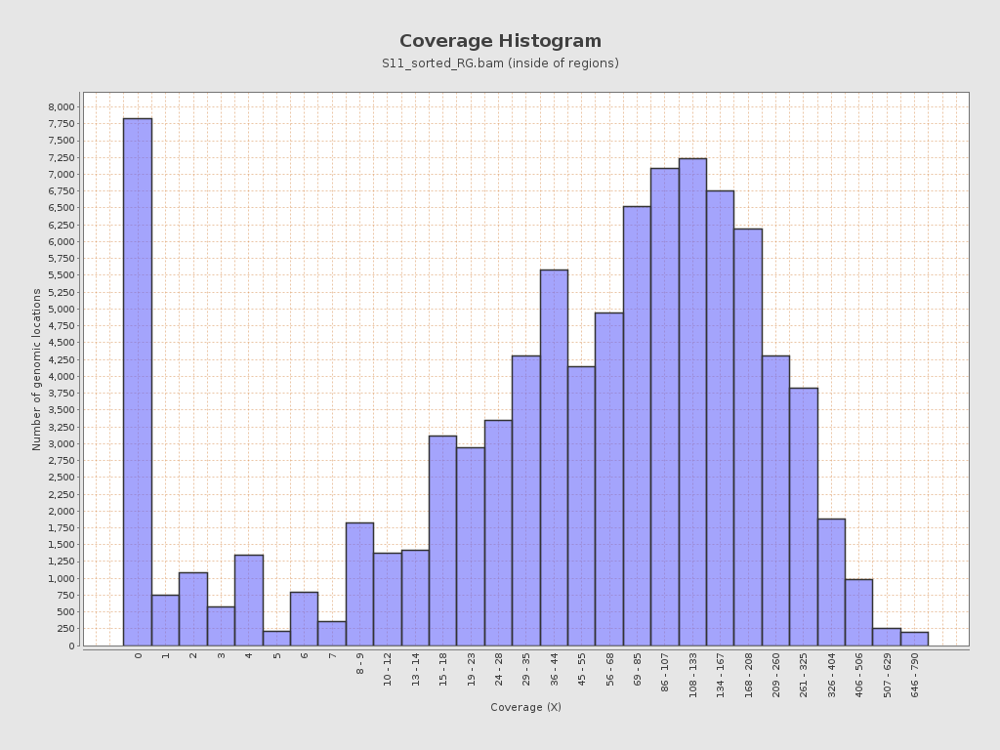

**Figura 3.** *Histograma de cobertura dentro de las regiones del panel. Hay un pico marcado en 0X con cerca de 7.800 posiciones sin cobertura, y el grueso de las posiciones cubiertas se concentra entre 30X y 200X, con un final de valores muy altos (600-790X).*

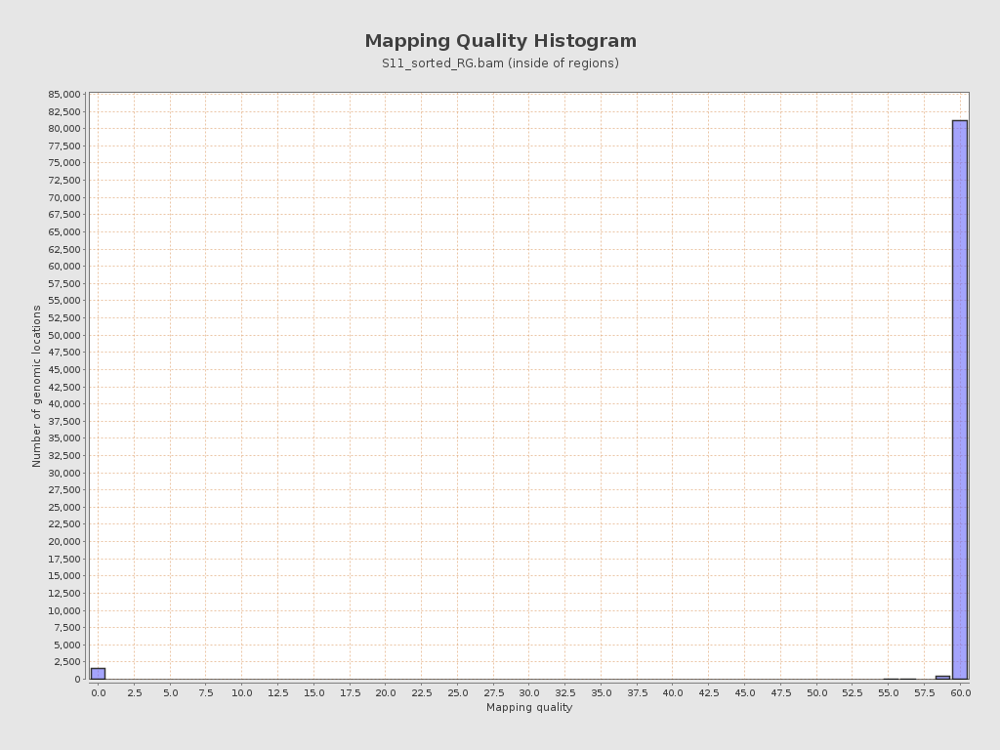

**Figura 4.** *Histograma de calidad de mapeo. La inmensa mayoría de las posiciones tiene calidad 60, el máximo que reporta BWA-MEM, con una fracción mínima en 0 y casi nada en valores intermedios.*

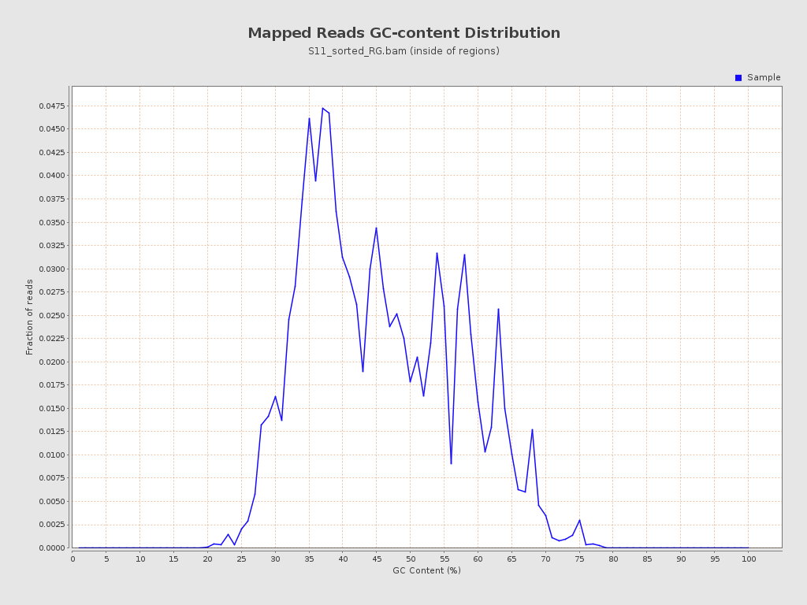

**Figura 5.** *Distribución del contenido GC de las lecturas mapeadas. El perfil es irregular, con varios picos entre 30% y 65% de GC en lugar de una curva más pareja.*

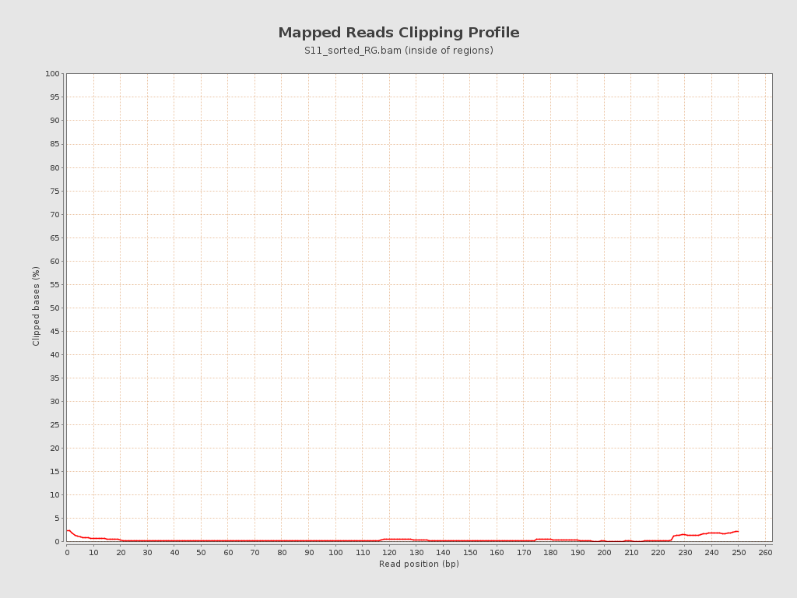

**Figura 6.** *Porcentaje de bases recortadas (clipping) según la posición dentro de la lectura. El nivel se mantiene bajo, entre 0% y 3%, con un leve aumento hacia ambos extremos de la lectura.*

#### Conclusión

El pico de 7.800 posiciones en 0X de la Figura 3 llama la atención dentro de una región, ya que es muy alto. Como el panel cubre genes completos con sus exones, es esperable que haya tramos intrónicos o intergénicos dentro de esas coordenadas, lo que explicaría ese pico sin necesidad de un problema técnico. La calidad de mapeo (Figura 4) es consistentemente alta, concentrada en el valor máximo de BWA-MEM, lo que indica lecturas mapeadas de forma confiable.

La distribución de GC (Figura 5) no sigue una curva pareja, sino que presenta varios picos. Con un panel de solo 91.120 pb, el número de ventanas de secuencia analizadas es bajo. El perfil de clipping (Figura 6) se mantiene bajo en toda la lectura, consistente con el soft-clipping puntual identificado en la Tarea 1.2, que corresponde a casos aislados y no a un patrón generalizado de mala calidad en los extremos.

En conjunto, la muestra S11 muestra un alineamiento de buena calidad para el análisis posterior de variantes, sin señales claras de contaminación ni de problemas sistemáticos de mapeo.

---

### Tarea 1.5 — Anexo y GitHub

> *Incluya el reporte completo generado con qualimap como anexo. Comparta el informe en formato markdown a través de github para dar por completada esta tarea.*

El reporte completo de qualimap quedo en `Archivos/qualimapReport.html`. 

---

### Tarea 2.1 — Genes del panel y región cubierta

> *Indique el número de genes incluidos en el panel e incluya una tabla con la lista de genes. Indique la región genómica total cubierta por el panel.*

#### Metodología
 (`chr:inicio:fin:gen:tipo`), así que el nombre del gen se extrae tomando el cuarto campo con `cut -d: -f4`:

```bash
awk '{print $4}' ~/181004_curso_calidad_datos_NGS/regiones_blanco.bed | cut -d: -f4 | sort -u
awk '{print $4}' ~/181004_curso_calidad_datos_NGS/regiones_blanco.bed | cut -d: -f4 | sort -u | wc -l
```

#### Resultados

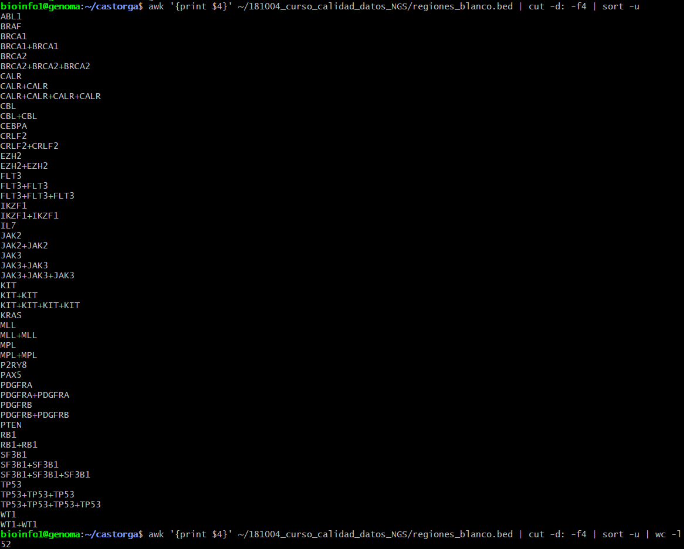

**Figura 7.** *Listado de genes obtenido con `cut -d: -f4`. Algunos nombres aparecen repetidos y unidos con "+" (por ejemplo `BRCA1+BRCA1` o `TP53+TP53+TP53`), por lo que `sort -u | wc -l` da 52 en vez del número real de genes distintos.*

La región genómica total cubierta por el panel, según el reporte de qualimap, es de **91.120 pb** ("Regions size/percentage of reference" en `qualimapReport.html`).

agrupando   los nombres repetidos, el panel incluye **27 genes distintos**:

| Geness | Genes | Genes |
|---|---|---|
| ABL1 | FLT3 | P2RY8 |
| BRAF | IKZF1 | PAX5 |
| BRCA1 | IL7 | PDGFRA |
| BRCA2 | JAK2 | PDGFRB |
| CALR | JAK3 | PTEN |
| CBL | KIT | RB1 |
| CEBPA | KRAS | SF3B1 |
| CRLF2 | MLL | TP53 |
| EZH2 | MPL | WT1 |

#### Conclusión

El conteo automático con `cut -d: -f4 | sort -u | wc -l` sobrestima el total (52), porque algunas regiones del panel se solapan y quedan anotadas con el nombre del gen repetido y unido por "+" (`BRCA1+BRCA1`, `TP53+TP53+TP53`), y `sort -u` trata cada una de esas variantes como un valor distinto del nombre simple. Corrigiendo esas repeticiones , el panel cubre 27 genes distintos.

---

### Tarea 2.2 — Filtrado de variantes con dos criterios

> *Realice el filtrado de variantes con dos filtros, DP<10 y uno adicional que usted proponga. Estime cuántas variantes son eliminadas por DP<10 solamente, y cuántas por ambos filtros. Genere una tabla con el número de variantes totales, SNPs e InDels, filtradas y que pasaron los filtros.*

#### Metodología

El segundo filtro propuesto fue QUAL<30, aplicado junto a DP<10 en la misma instrucción de VariantFiltration, por separado para SNPs e InDels, y luego combinados con CombineVariants.

```bash
java -jar /opt/GenomeAnalysisTK-3.7-0/GenomeAnalysisTK.jar -T VariantFiltration -R /datos/reference/genomes/hg19_reference/hg19.fasta -V S11_RAW_SNP.vcf --filterExpression "DP <10" --filterName "lowDP" --filterExpression "QUAL <30" --filterName "lowQUAL" -o S11_FILTERED2_SNP.vcf
```

#### Resultados

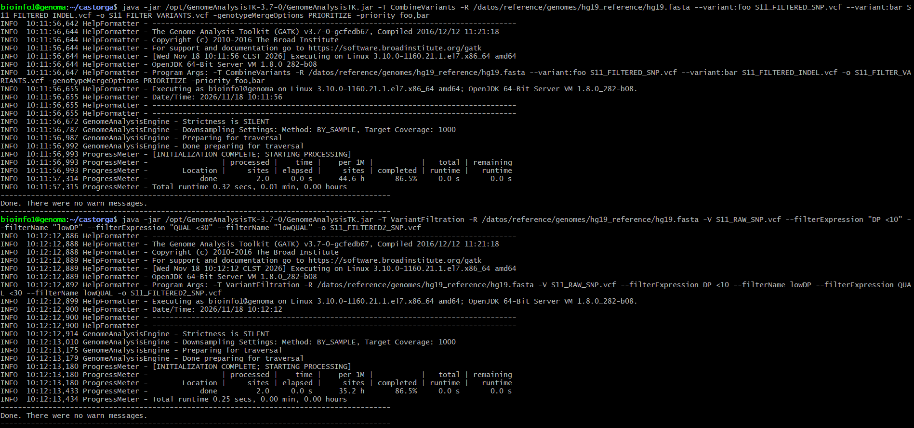

**Figura 8.** *Finalización de la combinación de los VCF del primer filtro (DP<10) en `S11_FILTER_VARIANTS.vcf`, e inicio de VariantFiltration con el segundo filtro (DP<10 + QUAL<30) sobre los SNPs.*

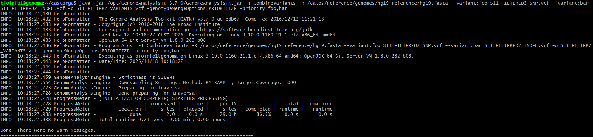

**Figura 9.** *VariantFiltration del segundo filtro (DP<10 + QUAL<30) sobre los InDels, y combinación final de SNPs e InDels filtrados en `S11_FILTER2_VARIANTS.vcf` con CombineVariants.*

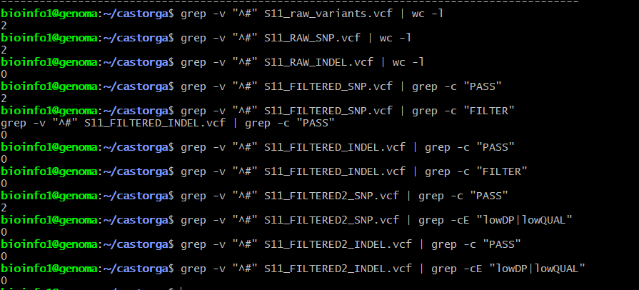

**Figura 10.** *Conteo de variantes totales, SNPs e InDels, y de las que pasan cada combinación de filtros.*

| Tipo | Total  | PASS con DP<10 | Filtradas por DP<10 | PASS con DP<10 + QUAL<30 | Filtradas por ambos |
|---|---|---|---|---|---|
| SNPs | 2 | 2 | 0 | 2 | 0 |
| InDels | 0 | 0 | 0 | 0 | 0 |
| Total | 2 | 2 | 0 | 2 | 0 |

#### Conclusión

En el cromosoma 19 se detectaron únicamente 2 variantes, ambas SNPs. Ninguna fue eliminada por el filtro de profundidad DP<10 ni por el filtro adicional de calidad QUAL<30, y no se detectaron InDels en esta región. Esto es consistente con la alta cobertura media y la buena calidad de mapeo observadas en qualimap para chr19.

---

### Tarea 2.3 — Visualización en IGV

> *Visualice una variante en IGV, mostrando tracks tanto para el alineamiento como para las variantes detectadas, con un track de genes visible cerca de la variante elegida.*

#### Metodología

Se cargó el genoma hg19, el BAM `S11_sorted_RG.bam` y el VCF `S11_FILTER_VARIANTS.vcf` en IGV.
#### Resultados

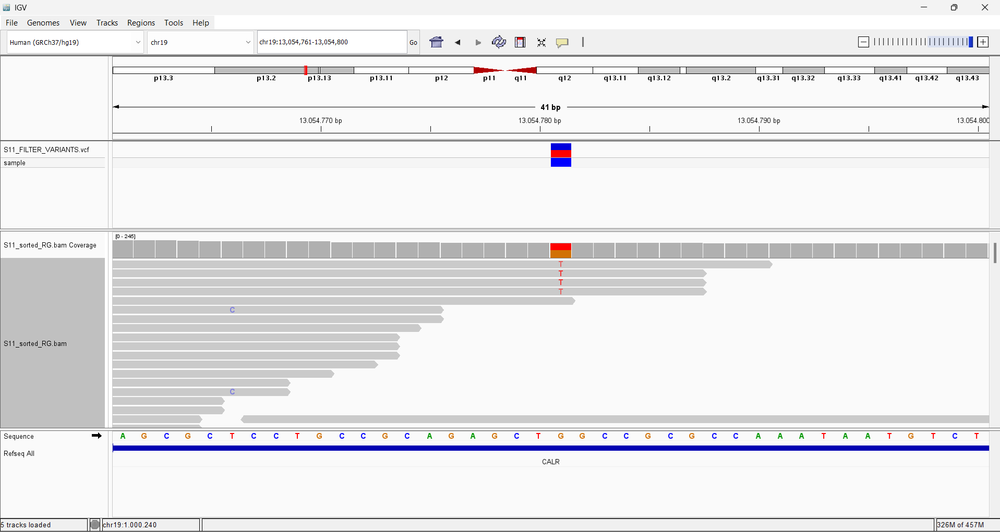

**Figura 11.** *Una de las dos variantes detectadas, visualizada en IGV en chr19:13.054.780 aproximadamente, dentro del gen CALR, con los tracks del BAM y del VCF.*

#### Conclusión

La variante visualizada cae dentro del gen CALR.


### Tarea 2.4 — Anotación con VEP

> *Realice una anotación de las variantes con VEP, usando la versión del genoma del alineamiento. Incluya Significancia clínica y puntajes CADD. Filtre la tabla (por ejemplo en R) para quedarse con variantes con CLIN_SIG distinto de "benign" o CADD > 20.*

#### Metodología

El primer intento, subiendo `S11_FILTER_VARIANTS.vcf` a la herramienta VEP dedicada para GRCh37 (<https://grch37.ensembl.org/Homo_sapiens/Tools/VEP>), falló por una caída temporal del servidor de Ensembl, sin relación con el VCF ni con el procedimiento. Se reintentó desde el formulario principal (<https://www.ensembl.org/tools/vep>), que permite elegir ahí mismo la versión GRCh37.p13 del genoma humano. Se subió el VCF, se activó la predicción CADD y la sección "Phenotype & disease associations", que en esta versión del formulario trae la significancia clínica de ClinVar sin una casilla separada con ese nombre. El primer envío con esa opción quedó marcado como fallido. Se reenvió el mismo trabajo, la segunda vez se completó, y el resultado se descargó como tabla TSV (`S11_FILTER_VARIANTS_2026-11-23-01-09_VEP.tsv`).

#### Resultados

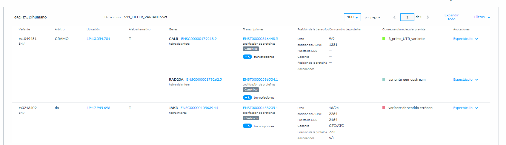
**Figura 12**. Anotación completada en la versión GRCh37.p13

La tabla TSV descargada agrega, para cada variante, el puntaje CADD y la significancia clínica de ClinVar

| Variante | Gen |  | CADD_PHRED | ClinVar_CLNSIG | ClinVar_CLNREVSTAT |
|---|---|---|---|---|---|
| rs1049481 | CALR / RAD23A | 3_prime_UTR_variant / upstream_gene_variant | 14.60 | Benign | criteria_provided, multiple_submitters, no_conflicts |
| rs3213409 | JAK3 | missense_variant (p.Val722Ile) | 11.93 | Benign | reviewed_by_expert_panel |

#### Conclusión

Las dos variantes detectadas en S11 están clasificadas como **Benign** en ClinVar y tienen puntajes CADD por debajo de 20, incluida rs3213409, la única variante codificante del conjunto.

---

### Tarea 2.5 — Tabla de variantes por ubicación y conclusiones

> *Indique en una tabla el número de variantes según ubicación (intrónica, río arriba, río abajo, codificante, etc.). En conclusiones, concluya sobre la presencia o ausencia de mutaciones con potencial patogénico.*

#### Metodología

Sobre la tabla de VEP cargada en R (`vep`), se filtró por CLIN_SIG distinto de "benign" o CADD > 20, y por separado se extrajo la consecuencia del transcrito canónico (`CANONICAL == "YES"`) de cada variante para ubicarlas por tipo de región.

```r
# Abre el archivo y guarda la tabla como "vep"
vep <- read.delim("S11_FILTER_VARIANTS_2026-11-23-01-09_VEP.tsv")

# Convierte CADD_PHRED a números
vep$CADD_PHRED <- as.numeric(vep$CADD_PHRED)

# TRUE si ClinVar tiene algo escrito
tiene_clinvar <- !is.na(vep$ClinVar_CLNSIG) & vep$ClinVar_CLNSIG != ""

# TRUE si ClinVar no es "benign"
no_es_benign <- tolower(vep$ClinVar_CLNSIG) != "benign"

# TRUE si cumple ambas condiciones de ClinVar
clinvar_ok <- tiene_clinvar & no_es_benign

# TRUE si CADD tiene valor y es mayor que 20
cadd_tiene_valor <- !is.na(vep$CADD_PHRED)
cadd_mayor_20 <- vep$CADD_PHRED > 20
cadd_ok <- cadd_tiene_valor & cadd_mayor_20

# TRUE si cumple ClinVar o CADD
cumple <- clinvar_ok | cadd_ok

# Se queda solo con las filas que cumplen
filtrada <- vep[cumple, ]

# Guarda la tabla filtrada en CSV
write.csv(filtrada, "S11_variantes_filtradas.csv", row.names = FALSE)

# Muestra cuántas filas quedaron
nrow(filtrada)

# TRUE si la fila es canónica
filas_canonicas <- vep$CANONICAL == "YES"

# Se queda con las canónicas y 3 columnas
canonicos <- vep[filas_canonicas, c("Uploaded_variation", "SYMBOL", "Consequence")]

# Muestra la tabla de canónicos
canonicos


```

#### Resultados

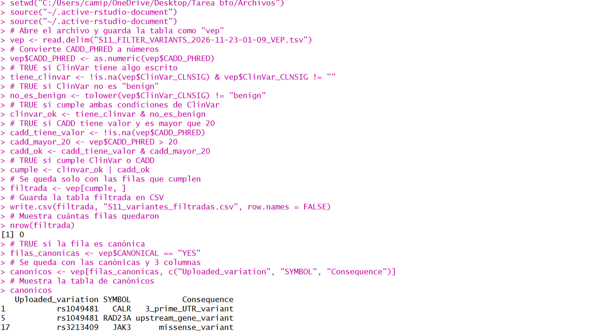

**Figura 13.** *Lectura de la tabla de VEP en R*

| Variante | Gen | Ubicación |
|---|---|---|
| rs1049481 | CALR | 3' UTR (3_prime_UTR_variant) |
| rs1049481 | RAD23A | Río arriba (upstream_gene_variant) |
| rs3213409 | JAK3 | Codificante, sentido erróneo (missense_variant) |

El filtrado por CLIN_SIG distinto de "benign" o CADD > 20 no retuvo ninguna variante (`S11_variantes_filtradas.csv` quedó con 0 filas), porque ambas variantes cumplen "benign" en ClinVar y ninguna supera CADD 20.

#### Conclusión

No se encontró evidencia de mutaciones con potencial patogénico en la muestra S11 dentro del panel de genes analizado. La única variante codificante detectada está clasificada como benigna en ClinVar, con revisión del panel y su puntaje CADD (11.93) está por debajo del umbral de 20. La otra variante (rs1049481) cae en una región no codificante (3' UTR de CALR y río arriba de RAD23A) y también es benigna.

---

## Discusión

El flujo de filtrado y alineamiento de S11 no mostró señales de problemas técnicos, la calidad de mapeo fue consistentemente alta y el único soft-clipping identificado correspondió a un caso puntual, no a un patrón generalizado. El pico de posiciones sin cobertura dentro de las regiones del panel es esperable dada la naturaleza de una captura dirigida a exones sobre coordenadas que incluyen genes completos.

El llamado de variantes en chr19 arrojó un número bajo de variantes, 2 en total, ambas SNPs, y ambas robustas a los dos filtros aplicados. Esto concuerda con la alta cobertura y calidad del alineamiento en esa región. La anotación con VEP, una vez resuelto el error de servidor inicial, mostró que ambas variantes están clasificadas como benignas en ClinVar y con puntajes CADD bajos, por lo que el filtrado en R no retuvo ninguna.

El conteo de genes del panel (Tarea 2.1) requirió varios intentos porque el campo de anotación del archivo bed combina coordenadas y nombre de gen en un mismo campo separado por ":", y porque algunas regiones solapadas quedan anotadas con el nombre de gen repetido.

## Conclusión general

El alineamiento de la muestra S11 contra hg19 se completó con buena calidad de mapeo y sin problemas evidentes en los datos. El panel secuenciado cubre 27 genes distintos sobre 91.120 pb. Se detectaron 2 variantes en el cromosoma 19, ambas SNPs, que pasaron tanto el filtro de profundidad DP<10 como el filtro adicional de calidad QUAL<30, una de las cuales se visualizó en IGV dentro del gen CALR.

La anotación con VEP (GRCh37.p13) y el filtrado en R no encontraron evidencia de mutaciones con potencial patogénico en el panel analizado.
